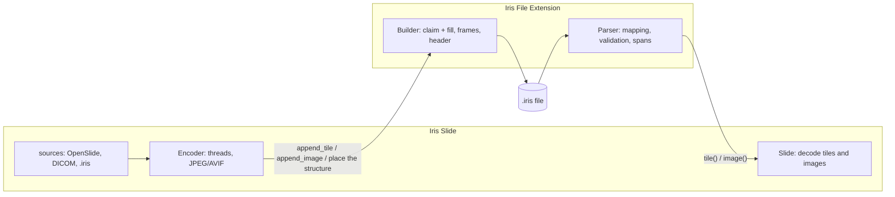

# Iris Slide

Copyright &copy; 2025 Iris Developers; MIT Software License

Iris Slide is the open-source decoder and encoder of Iris whole slide image files, maintained at [Aptix-Bio](https://github.com/Aptix-Bio/Iris-Slide). It was named Iris-Codec until 2026-11-24. It provides:
- Reading and writing Iris whole slide image (WSI) files (*.iris*)
- Decoding JPEG- and AVIF-compressed tile image data

This repository provides extremely fast slide access through a simple API. Available as:
- [Pre-compiled binaries](https://github.com/Aptix-Bio/Iris-Slide/releases)
- [CMake source builds](README.md#building-from-source)
- [Python packages](README.md#python)
- [JavaScript WASM module](https://www.jsdelivr.com/package/npm/iris-slide)

> [!TIP]
> **Iris files can directly replace deep zoom images (DZI)** in your OpenSeaDragon-based image stacks. Use our [Iris RESTful Server](https://github.com/IrisDigitalPathology/Iris-RESTful-Server) and [OpenSeaDragon IrisTileSource](https://github.com/openseadragon/openseadragon/blob/master/src/iristilesource.js) for seamless integration.

> [!NOTE]
> **For scanner manufacturers**: The [Iris File Extension (IFE) repository](https://github.com/Aptix-Bio/Iris-File-Extension) provides the specification for custom encoder/decoder development.

> [!WARNING]
> **This tool is in Beta**: There may be minor bugs present (some major) with edge conditions. If you notice them, please [open an issue](https://github.com/Aptix-Bio/Iris-Slide/issues) and we will address them as soon as we are able.

# Example Slides
The following example WSI files are publically available from AWS S3:
* [cervix_2x_jpeg.iris (jpeg encoded at 2x downsampling)](https://irisdigitalpathology.s3.us-east-2.amazonaws.com/example-slides/cervix_2x_jpeg.iris)
* [cervix_4x_jpeg.iris (jpeg encoded at 4x downsampling)](https://irisdigitalpathology.s3.us-east-2.amazonaws.com/example-slides/cervix_4x_jpeg.iris)

# Encoding Slide Files

The Iris Slide encoder converts WSI files from various vendor formats into optimized Iris format, supporting DICOM (via libdicom) and OpenSlide formats with flexible compression and metadata options.

**Key Features:**
- **Native DICOM Support**: Byte-stream preservation for lossless quality
- **Multi-format Support**: SVS, NDPI, VSI, MRXS, and other OpenSlide formats
- **Modern Compression**: JPEG (default) or AVIF
- **Automatic Pyramid Derivation**: Generate 2x or 4x, or use source pyramid format.
- **Privacy Controls**: Metadata stripping and anonymization options
- **High Performance**: Multi-threaded with real-time progress tracking

## How the codec sits on the Iris File Extension

The [Iris File Extension](https://github.com/Aptix-Bio/Iris-File-Extension) owns the file; Iris Slide owns the pixels. The encoder reads sources, compresses tiles on its own threads and hands each stream to an `Iris::File::Builder`, which claims space in a sparse, never-remapped arena and writes every block. A slide reads through an `Iris::File::Parser`, which maps the file and hands back bounds-checked streams for the codec to decode. The codec maps no file and computes no offset itself.



The Builder writes each block where the head is when it is asked, so the encoder chooses the layout: blocks that never change first, those an edit replaces last — tiles, tile table, metadata, ICC profile, associated images, attributes. A slide is written to a scratch file in the system temp directory and moved into place once it is complete, so a failed encode leaves nothing at the destination.

# Installation

**Requirements:**
- C++ 20 Standard Library
- [libjpeg-turbo](https://github.com/libjpeg-turbo/libjpeg-turbo), [libavif](https://github.com/AOMediaCodec/libavif)
- [OpenSlide](https://github.com/openslide/openslide) and [libdicom](https://github.com/ImagingDataCommons/libdicom) (for encoder only)

## Building From Source

[](https://github.com/Aptix-Bio/Iris-Slide/actions/workflows/ci.yml)
[](https://github.com/Aptix-Bio/Iris-Slide/actions/workflows/ci.yml)
[](https://github.com/Aptix-Bio/Iris-Slide/actions/workflows/ci.yml)

**Basic Build:** every dependency comes from `vcpkg.json`; the first configure
fetches the pinned vcpkg into `dependencies/` and builds the packages once
(`pkg-config` is needed on macOS and Linux). See
[development/PIPELINE.md](development/PIPELINE.md).
```shell
git clone --depth 1 https://github.com/Aptix-Bio/Iris-Slide.git
cd Iris-Slide
cmake --workflow --preset release
cmake --install build/release
```

### Build Configuration Options

The build system provides several configurable options to customize your build:

| Option | Default | Description |
|--------|---------|-------------|
| `IRIS_BUILD_SHARED` | `ON` | Build shared library (.so/.dylib/.dll) |
| `IRIS_BUILD_STATIC` | `ON` | Build static library (.a/.lib) |
| `IRIS_BUILD_ENCODER` | `ON` | Build the encoder executable for converting WSI files |
| `IRIS_BUILD_PYTHON` | `OFF` | Build Python bindings |
| `IRIS_SYSTEM_DEPENDENCIES` | `OFF` | Find the dependencies installed on the system instead of through vcpkg |
| `IRIS_USE_OPENSLIDE` | `ON` | Enable OpenSlide support (required for most WSI formats) |

## Python
[](https://anaconda.org/conda-forge/iris-slide) 
[](https://pypi.org/project/Iris-Slide/)
[](https://github.com/Aptix-Bio/Iris-Slide/actions/workflows/python-CI.yml)


```shell
# Conda (recommended)
conda install -c conda-forge iris-slide

# PyPI
pip install iris-slide openslide-bin
```

## JavaScript
[](https://www.npmjs.com/package/iris-slide)
[](https://www.jsdelivr.com/package/npm/iris-slide)
[](https://github.com/Aptix-Bio/Iris-Slide/actions/workflows/ci.yml)

**Option 1: Iris RESTful Server** (recommended for server deployments)
- Extremely high performance (multi-threaded with dual stack)
- Server-side serialization with virtual memory mapping
- Compatible with [OpenSeaDragon IrisTileSource](https://github.com/openseadragon/openseadragon/blob/master/src/iristilesource.js)

**Option 2: WebAssembly Module** (for client-side/bucket storage)
```html
<script type="module">
import createModule from 'https://cdn.jsdelivr.net/npm/iris-slide@latest/iris-slide.js';
const irisSlide = await createModule();
</script>
```

> [!IMPORTANT] 
> RESTful server has substantially better performance. WASM is useful for bucket storage (S3, GCS) where custom servers can't be deployed. **There is a substantial performance cost to client side deserialization relative to IrisRESTful.** This WASM API is a unique feature of Iris but is not our preferred method of HTTP streaming.


# API Examples

## Encoder Usage

**Command Line:**
```shell
# Basic encoding
./IrisSlideEncoder -s input.svs -o ./output/ -d use_source

# Advanced options
./IrisSlideEncoder -s input.dcm -o ./output/ -e AVIF -d 2x -c 8

# Research Example (strip metadata)
./IrisSlideEncoder -s patient.dcm -o ./research/ -sm -d 4x -c 4
```

**Available Arguments:**
- `-h, --help`: Print help text
- `-s, --source`: File path to the source WSI file (must be compatible with OpenSlide)
- `-o, --outdir`: Output directory path (encoder names file as XXX.iris based on source filename)
- `-d, --derive`: Generate lower resolution layers - Options: `2x`, `4x`, or `use-source` (default)
- `-sm, --strip_metadata`: Strip patient identifiers from encoded metadata
- `-e, --encoding`: Compression format - `JPEG` (default) or `AVIF`
- `-c, --concurrency`: Number of threads to use (defaults to all CPU cores)

**Python:**
```python
from Iris import Encoder
result = Encoder.encode_slide_file('input.svs', './output/')
```

**C++:**
```cpp
#include "IrisSlideCore.hpp"
auto encoder = IrisSlide::create_encoder({.srcFilePath = "input.svs"});
IrisSlide::dispatch_encoder(encoder);
```

## Reading Slides

**C++:**
```cpp
#include <Iris/IrisSlideCore.hpp>

auto slide = open_slide({.filePath = "slide.iris"});
SlideInfo info;
get_slide_info(slide, info);

// Read tiles
Iris::Buffer tile = read_slide_tile(SlideTileReadInfo {
  .slide = slide,
  .layer = 0,
  .tile = 0
});
```

**Python:**
```python
from Iris import Slide

slide = Slide.open_slide('slide.iris')
result, info = slide.get_info()

# Read tiles
tile_data = slide.read_slide_tile(layer=0, tile=0)
```

**JavaScript:**
```javascript
import createModule from 'https://cdn.jsdelivr.net/npm/iris-slide@latest/iris-slide.js';

(async () => {
  const irisSlide = await createModule();
  const validationResult = await irisSlide.validateFileStructure('https://example.com/slide.iris');
  if (validationResult.severity === irisSlide.Severity.FAILURE) {
    throw new Error(`Validation failed: ${validationResult.message}`);
  }

  const slide = await irisSlide.openIrisSlide('https://example.com/slide.iris');
  const info = slide.getSlideInfo();
})();
```
For complete examples and advanced usage, see the [full documentation](https://github.com/Aptix-Bio/Iris-Headers) and [API reference](https://github.com/Aptix-Bio/Iris-Headers/blob/main/include/IrisSlideCore.hpp).

# Detailed API Documentation

## C++ Detailed Examples

### Basic Setup and Validation
```cpp
// Import the Iris Slide header
// This import includes the types header automatically
#include <filesystem>
#include <Iris/IrisSlideCore.hpp>
```

You may choose to perform your own file system validations and recovery routines. Iris will, however catch all of these (and the main API methods are declared `noexcept`).

```cpp
if (!std::filesystem::exists(file_path)) {
    printf(file_path.string() + " file does not exist\n");
    return EXIT_FAILURE;
}
if (!is_iris_slide_file(file_path.string())) {
    printf(file_path.string() + " is not a valid Iris slide file\n");
    return EXIT_FAILURE;
}
IrisResult result = validate_slide(SlideOpenInfo{
    .filePath = file_path.string()
    // Default values for any undefined parameters
});

if (result.failed()) {
    printf(result.message);
    return EXIT_FAILURE;
}
```

Should a runtime error occur, it will be reported in the form of an `IrisResult` message, as seen in the `IrisResult validate_slide(const SlideOpenInfo&) noexcept;` call.

### Opening and Reading Slides
Successful loading of a slide file will return a valid `IrisSlide::Slide` object; failure will return a `nullptr`.

```cpp
auto slide = open_slide(SlideOpenInfo{
    .filePath = file_path.string(),
    .context = nullptr,
    .writeAccess = false
});
if (!slide) return EXIT_FAILURE;
```

Once opened, the slide `IrisSlide::SlideInfo` structure can be loaded using the `Result get_slide_info(const Slide&, SlideInfo&) noexcept` call and used as an initialized structure containing all the information needed to navigate the slide file and read elements.

```cpp
SlideInfo info;
IrisResult result = get_slide_info(slide, info);
if (result.failed()) {
    printf(result.message);
    return EXIT_FAILURE;
}
```

### Reading Tile Data
The `SlideTileReadInfo` struct provides a simple mechanism for reading slide image data. The `info.extent` struct is extremely simple to navigate. Please refer to the `struct Extent` type in the [IrisTypes.hpp](https://github.com/Aptix-Bio/Iris-Headers/blob/main/include/IrisTypes.hpp) core header file for more information about slide extents.

```cpp
struct SlideTileReadInfo read_info{
    .slide = slide,
    .layer = 0,
    .optionalDestination = NULL, /*wrapper can go here*/
    .desiredFormat = Iris::FORMAT_R8G8B8A8,
};
for (auto& layer : info.extent.layers) {
    for (int y_index = 0; y_index < layer.yTiles; ++y_index) {
        for (int x_index = 0; x_index < layer.xTiles; ++x_index) {
            // Read the tile slide tile
            Iris::Buffer rgba = read_slide_tile(read_info);
            
            // Do something with the tile pixel values in rgba

            // Do not worry about clean up;
            // The Iris::Buffer will deallocate it.
        }
    }
    read_info.layer++;
}
```
> [!NOTE]
> Iris::Buffer is a reference counted buffer wrapper that can be safely copied will internally manage the memory lifetime. If externally managing memory you can wrap an existing buffer in a weak Iris::Buffer for API compatability but without lifetime management. 

### Advanced Memory Management
Decompressed slide data can be optionally read into preallocated memory. If the optional destination buffer is insufficiently sized, Iris will instead allocate a new buffer and return that new buffer with the pixel data.

> [!NOTE]
> If writing into externally managed memory, `Iris::Buffer` should weakly reference the underlying memory using `Wrap_weak_buffer_from_data()` as strongly referenced `Iris::Buffer` objects deallocate underlying memory when they pass out of scope.

```cpp
// In this example we have some preallocated buffer we want
// to write our slide pixel data into. A GPU buffer is a great
// example and the GPU API manages that memory:
char* GPU_DST;

// We will write in R8G8B8A8 format for simplicity
Iris::Format format = Iris::FORMAT_R8G8B8A8;
size_t tile_bytes = 256*256*4; 
Iris::Buffer wrapper = Wrap_weak_buffer_from_data(GPU_DST, tile_bytes);

// Read the data
struct SlideTileReadInfo read_info{
    .slide = slide,
    .optionalDestination = wrapper,
    .desiredFormat = format,
};
Buffer result = read_slide_tile(read_info);

// If there was insufficient space in the provided
// destination buffer, a new buffer will be allocated.
if (wrapper != result) {
    printf("Insufficient sized buffer, new buffer was allocated");
}
```

### SIMD-Accelerated Format Conversion
Iris can decompress into different pixel byte orderings and exchange data ownership via the `Iris::Buffer` strength. The codec uses **Google Highway SIMD instructions** for high-performance format conversions, including:

- **Channel Reordering**: RGB ↔ BGR byte swapping using vectorized operations
- **Alpha Channel Operations**: Adding/removing alpha channels with SIMD acceleration
- **Format Conversion**: Converting between R8G8B8, B8G8R8, R8G8B8A8, and B8G8R8A8 formats
- **Tile Downsampling**: 2x and 4x averaging downsampling with vectorized arithmetic

The SIMD implementations automatically adapt to your CPU's capabilities (SSE2, AVX2, AVX-512, ARM NEON) for optimal performance. Format conversions are performed in-place when possible to minimize memory allocation.

For more information about the Iris Buffer, which was designed primarily as a networking buffer, please see [IrisBuffer.hpp](https://github.com/Aptix-Bio/Iris-Headers/blob/main/priv/IrisBuffer.hpp) and [IrisSIMD.hpp](https://github.com/Aptix-Bio/Iris-Headers/blob/main/priv/IrisSIMD.hpp)  in the core headers.

## Python Detailed Examples

### Setup and Validation
Import the Python API and Iris Slide Module.

```python
# Import the Iris Slide Module
from Iris import Slide
slide_path = 'path/to/slide_file.iris'
```

Perform a deep validation of the slide file structure. This will navigate the internal offset-chain and check for violations of the IFE standard.

```python
result = Slide.validate_slide_path(slide_path)
if result.failed():
    raise Exception(f'Invalid slide file path: {result.message}')
print(f"Slide file '{slide_path}' successfully passed validation")
```

### Opening and Reading Slide Information
Open a slide file. The following conditional will always return True if the slide has already passed validation but you may skip validation and it will return with a null slide object (but without providing the Result debug info).

```python
slide = Slide.open_slide(slide_path)
if (not slide): 
    raise Exception('Failed to open slide file')
```

Get the slide abstraction, read off the slide dimensions, and then print it to the console.

```python
# Get the slide abstraction
result, info = slide.get_info()
if result.failed():
    raise Exception(f'Failed to read slide information: {result.message}')

# Print the slide extent to the console
extent = info.extent
print(f"Slide file {extent.width} px by {extent.height}px with an encoding of {info.encoding}. The layer extents are as follows:")
print(f'There are {len(extent.layers)} layers comprising the following dimensions:')
for i, layer in enumerate(extent.layers):
    print(f' Layer {i}: {layer.x_tiles} x-tiles, {layer.y_tiles} y-tiles, {layer.scale:0.0f}x scale')
```

### Creating Composite Images
Generate a quick low-power view of the slide using Pillow images.

```python
from PIL import Image
layer_index = 0  # Lowest power layer is layer zero (0)
scale = int(extent.layers[layer_index].scale)
composite = Image.new('RGBA', (extent.width * scale, extent.height * scale))
layer_extent = extent.layers[layer_index]
for y in range(layer_extent.y_tiles):
    for x in range(layer_extent.x_tiles):
        tile_index = y*layer_extent.x_tiles+x
        composite.paste(Image.fromarray(slide.read_slide_tile(layer_index, tile_index)), (256*x, 256*y))
composite.show()
```

> [!CAUTION]
> Despite Iris' native fast read speed, higher resolution layers may take substantial time and memory for Pillow to create a full image as it does not create tiled images. I do not recommend doing this above layer 0 or 1 as it may be onerous for PIL.Image

### Metadata and Associated Images
Investigate the metadata attribute array and view a thumbnail image:

```python
result, info = slide.get_info()
if result.failed():
    raise Exception(f'Failed to read slide information: {result.message}')

print("Slide metadata attributes")
for attribute in info.metadata.attributes:
    print(f"{attribute}: {info.metadata.attributes[attribute]}")

from PIL import Image
if ('thumbnail' in info.metadata.associated_images):
    image = Image.fromarray(slide.read_associated_image('thumbnail'))
    image.show()
```

### Python Encoder API
The Python module also includes encoding capabilities for converting existing WSI files to the Iris format.

**Basic Encoding:**
```python
from Iris import Encoder

# Simple encoding with default settings
result = Encoder.encode_slide_file(
    source='path/to/input.svs',
    outdir='./output/'
)

if result.failed():
    raise Exception(f'Encoding failed: {result.message}')
print('Encoding completed successfully!')
```

**Advanced Encoding Options:**
```python
from Iris import Encoder, Slide, iris_core

# Encode with custom parameters
result = Encoder.encode_slide_file(
    source='path/to/input.svs',
    outdir='./output/',
    desired_encoding=Slide.Encoding.TILE_ENCODING_AVIF,  # Use AVIF compression
    desired_byte_format=iris_core.Format.FORMAT_R8G8B8A8,  # RGBA format
    strip_metadata=True,  # Remove patient identifiers
    derivation=Encoder.EncoderDerivation.layer_4x,  # 4x pyramid layers
    concurrency=8  # Use 8 threads
)
```

**DICOM Encoding with Progress Monitoring:**
```python
from Iris import Encoder
import time

# The encode_slide_file function includes built-in progress monitoring
# It will automatically display a progress bar during encoding
result = Encoder.encode_slide_file(
    source='sample.dcm',  # DICOM input with byte-stream preservation
    outdir='./encoded/',
    desired_encoding=Encoder.Slide.Encoding.TILE_ENCODING_JPEG
)

# The function handles progress display automatically:
# [████████████████████████████████████████] 100.0% ETA: 00:00
# Iris Encoder completed successfully
# Slide written to ./encoded/sample.iris
```

**Available Encoding Parameters:**
- `source`: Path to input WSI file (required)
- `outdir`: Output directory (defaults to source directory)
- `desired_encoding`: Compression format (JPEG or AVIF, default: JPEG)
- `desired_byte_format`: Pixel format (default: R8G8B8)
- `strip_metadata`: Remove patient identifiers (default: False)
- `anonymize`: Anonymize metadata (default: False)
- `derivation`: Layer derivation strategy (default: layer_2x)
- `concurrency`: Number of threads (default: CPU count)
- `codec_context`: Optional codec context for advanced usage

## JavaScript Detailed Examples

### Iris RESTful API
Iris RESTful has a simple API (and supports DICOMweb WADO-RS), outlined here, and explained in greater detail within the [Iris RESTful API Explained Section](https://github.com/IrisDigitalPathology/Iris-RESTful-Server/blob/main/README.md#api-explained). This will return the slide metadata in JSON format and slide tile image data.

```
Iris RESTful
GET <URL>/slides/<slide-name>/metadata
GET <URL>/slides/<slide-name>/layers/<layer>/tiles/<tile>

Supported WADO-RS
GET <URL>/studies/<study>/series/<UID>/metadata
GET <URL>/studies/<study>/series/<UID>/instances/<layer>/metadata
GET <URL>/studies/<study>/series/<UID>/instances/<layer>/frames/<tile>
```

### Iris JavaScript WASM API
Load the Iris-Slide NPM WebAssembly module via jsDelivr (or download the [latest javascript release](https://github.com/Aptix-Bio/Iris-Slide/releases/latest) and include your local copy):

```html
<!DOCTYPE html>
<script type="module">
    import createModule 
    from 'https://cdn.jsdelivr.net/npm/iris-slide@latest/iris-slide.js';
    
    // Compile the WASM module and stall execution until ready
    const irisSlide = await createModule();
    console.log("Iris-Slide has been loaded");
    
    // ...Your code goes here...
</script>
```

Once loaded, you can access image data in a manner similar to the C++ and Python Iris-Slide API. Importantly, the metadata will be returned in IrisSlide::Abstraction C++ types (file metadata abstractions) exposed using Emscripten bindings. Refer to the included TypeScript file for those definitions. Image tile data will be returned as an image (MIME) source and can be used directly as an image data source.


### Validation and File Opening
Perform a deep validation of the slide file structure. This will navigate the internal offset-chain and check for violations of the IFE standard. This can be omitted if you are confident of the source.

```js
(async () => {
  const irisSlide = await createModule();
  console.log("Iris-Slide has been loaded");
  const url = "https://irisdigitalpathology.s3.us-east-2.amazonaws.com/example-slides/cervix_2x_jpeg.iris";

  try {
      const validationResult = await irisSlide.validateFileStructure(url);
      if (validationResult.severity === irisSlide.Severity.FAILURE) {
          throw new Error(`Validation failed: ${validationResult.message}`);
      }
      console.log(`Slide file at ${url} successfully passed validation`);
  } catch (error) {
      console.log(`Slide file at ${url} failed validation: ${error.message}`);
  }
})();
```

Open a slide file. The following conditional will succeed without throwing an exception if the slide has already passed validation but you may skip validation to reduce server requests.

```js
(async () => {
  const irisSlide = await createModule();
  console.log("Iris-Slide has been loaded");
  const url = "https://irisdigitalpathology.s3.us-east-2.amazonaws.com/example-slides/cervix_2x_jpeg.iris";

  try {
      const validationResult = await irisSlide.validateFileStructure(url);
      if (validationResult.severity === irisSlide.Severity.FAILURE) {
          throw new Error(`Validation failed: ${validationResult.message}`);
      }
      
      const slide = await irisSlide.openIrisSlide(url);
      if (!slide) {
          throw new Error("Failed to open slide");
      }

      // ...Do something with slide

      slide.delete();
  } catch (error) {
      console.error(error);
  }
})();
```

### Reading Slide Information
Get the slide abstraction, read off the slide dimensions, and then print it to the console.

```js
(async () => {
  const irisSlide = await createModule();
  const url = "https://irisdigitalpathology.s3.us-east-2.amazonaws.com/example-slides/cervix_4x_jpeg.iris";

  try {
      const validationResult = await irisSlide.validateFileStructure(url);
      if (validationResult.severity === irisSlide.Severity.FAILURE) {
          throw new Error(`Validation failed: ${validationResult.message}`);
      }
      
      const slide = await irisSlide.openIrisSlide(url);
      if (!slide) {
          throw new Error("Failed to open slide");
      }

      // Let's get the slide dimensions and print them to the console.
      const info = slide.getSlideInfo();
      const extent = info.extent;
      console.log(`Slide file ${extent.width} px by ${extent.height}px at lowest resolution layer. The layer extents are as follows:`);
      console.log(`There are ${extent.layers.size()} layers comprising the following dimensions:`)
      for (var i = 0; i < extent.layers.size(); i++) {
          const layer = extent.layers.get(i);
          console.log(`  Layer ${i}: ${layer.xTiles} x-tiles, ${layer.yTiles} y-tiles, ${layer.scale}x scale`);
      }
      slide.delete();
  } catch (error) {
      console.error(error);
  }
})();
```

### Single Tile Display
Generate a quick view of one of the images (`tileImage`) somewhere earlier in the HTML page.

```html

<!-- ... Somewhere Earlier -->
<script type="module">
    import createModule from 'https://cdn.jsdelivr.net/npm/iris-slide@latest/iris-slide.js';
    
    (async () => {
      try {
          const irisSlide = await createModule();
          const url = "https://example.com/slide.iris";
          
          const validationResult = await irisSlide.validateFileStructure(url);
          if (validationResult.severity === irisSlide.Severity.FAILURE) {
              throw new Error(`Validation failed: ${validationResult.message}`);
          }
          
          const slide = await irisSlide.openIrisSlide(url);
          if (!slide) {
              throw new Error("Failed to open slide");
          }
          
          const layer = 0;
          const tile = 0;
          const tileBlob = await slide.getSlideTile(layer, tile);

          // Now pass the image off to the 'tileImage' element.
          const objectUrl = URL.createObjectURL(tileBlob);
          const imgElement = document.getElementById("tileImage");
          imgElement.src = objectUrl;

          // Clean up after the image is loaded
          imgElement.onload = () => {
              URL.revokeObjectURL(objectUrl);
              slide.delete();
          };
      } catch (error) {
          console.error(error);
      }
    })();
</script>
```

### Complete Tile Grid Example
Bringing it all together, the following full HTML page source will show a low power view of the image using a tile grid view similar to the above view that Pillow.Images produces in the Python API example.

```html
<!DOCTYPE html>
<html lang="en">
<head>
  <meta charset="UTF-8">
  <title>Iris-Slide WASM: Tile Grid</title>

  <style>
    /* The grid container: auto-flows row by row */
    #tileGrid {
      display: grid;
      justify-content: start;      /* left-align if container is wide */
      align-content: start;        /* top-align if container is tall */
    }
    #tileGrid img {
      width: 128px;
      height: 128px;
      object-fit: cover;           /* crop or letterbox if needed */
      background: #f0f0f0;         /* placeholder color */
    }
  </style>
</head>

<body>
  <h1>Iris-Slide WASM: Tile Grid</h1>
  <div id="loadTimeText">Load time: —</div>
  <div id="tileGrid"></div>

  <script type="module">
  import createModule from 'https://cdn.jsdelivr.net/npm/iris-slide@latest/iris-slide.js';
  
  // ————— Main Entry Point —————
  (async () => {
    const irisSlide = await createModule();
    const url = "https://irisdigitalpathology.s3.us-east-2.amazonaws.com/example-slides/cervix_4x_jpeg.iris";
    try {
      // Validate file structure
      const validationResult = await irisSlide.validateFileStructure(url);
      if (validationResult.severity === irisSlide.Severity.FAILURE) {
        throw new Error(`Validation failed: ${validationResult.message}`);
      }
      
      const slide = await irisSlide.openIrisSlide(url);
      if (!slide) {
        throw new Error("Failed to open slide");
      }

      // 1) Read layer info
      const layer = 1;
      const info = slide.getSlideInfo();
      const extent = info.extent.layers.get(layer);
      const { xTiles, yTiles } = extent;
      const nTiles = xTiles * yTiles;

      // 2) Configure the grid container
      const gridEl = document.getElementById("tileGrid");
      gridEl.style.gridTemplateColumns = `repeat(${xTiles}, 128px)`;
      gridEl.style.gridTemplateRows = `repeat(${yTiles}, 128px)`;

      // 3) Fetch all tiles in parallel (or chunked if you prefer)
      const startAll = performance.now();
      const objectUrls = await Promise.all(
        Array.from({ length: nTiles }, async (_, idx) => {
          const blob = await slide.getSlideTile(layer, idx);
          return URL.createObjectURL(blob);
        })
      );
      const endAll = performance.now();
      document.getElementById("loadTimeText").textContent =
        `All tiles fetched in ${Math.round(endAll - startAll)} ms`;

      // 4) Insert  elements in tile order
      objectUrls.forEach(u => {
        const img = new Image(128, 128);
        img.src = u;
        gridEl.appendChild(img);
      });

      // 5) Cleanup on unload
      window.addEventListener("beforeunload", () => {
        // Revoke all blob URLs
        objectUrls.forEach(u => URL.revokeObjectURL(u));
        // Free the slide
        slide.delete();
      });

    } catch (err) {
      console.error(err);
      alert("Error: " + err.message);
    }
  })();
  </script>
</body>
</html>
```
