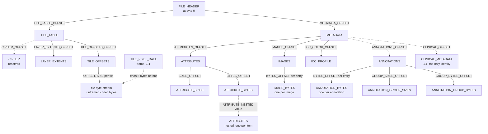
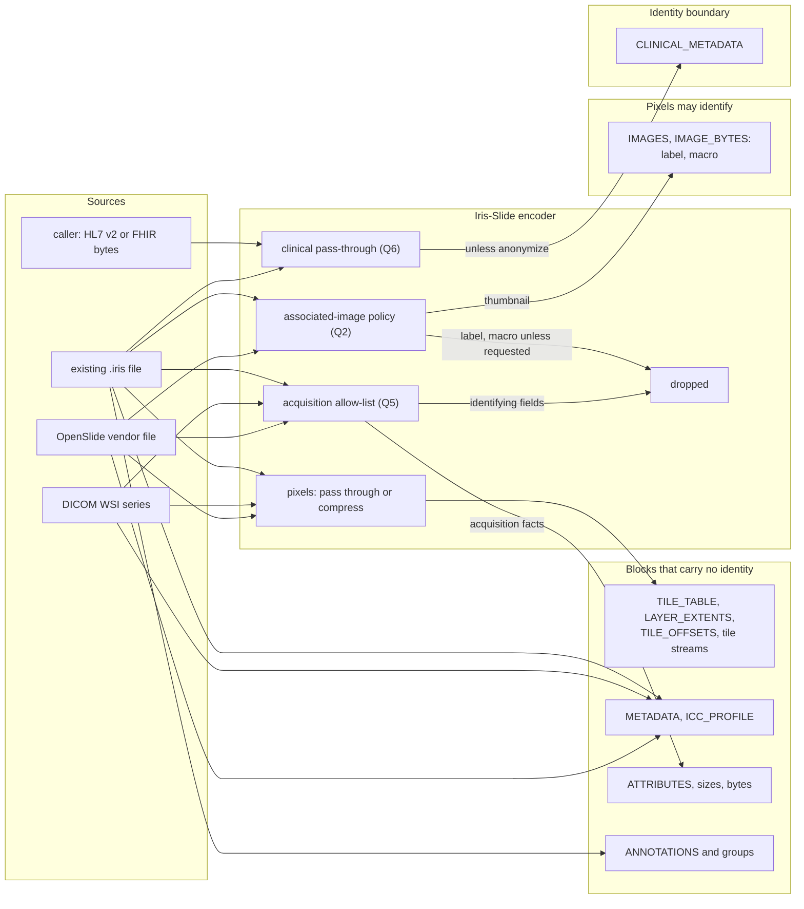

# ARCHITECTURE.md — Iris-Slide: governance and provenance of every IFE block

**Status:** draft contract. D1–D8 record Ryan's decisions of 2026-11-24 in his
words; Q1 is resolved by D7; Q2–Q10 wait on his answers, and each has a task in [WBS.md](WBS.md). A change is an owner amendment, dated, in
the row it changes. · **Date:** 2026-11-24 · **Owner:** Ryan

Iris-Slide (formerly named Iris-Codec) is Aptix Bio's open-source (MIT) reader
and writer of Iris whole-slide-image files (`.iris`). The file format is the
Iris File Extension (IFE), specified in the Iris-File-Extension repository.
This document is the register Ryan asked for: "In the development make a
Architecture doc that shows the governance / providence of each block within
the IFE spec so we are properly guided" (2026-11-24). For every block the
specification defines, it records who governs the block's bytes and their
content, where that content comes from for each kind of source, whether it may
identify a patient, which Iris-Slide code writes and reads it, whether that
code obeys the rules below, and what has to change.

---

## 0. How to read this document

| Section | What it settles |
|---|---|
| §1 Decisions | the governing principle and Ryan's decisions; only amended (dated) by the owner |
| §2 File layout | the blocks and the offsets that reach them (diagram) |
| §3 The block register | one row per block: governance, provenance, identity class, code, state, required handling |
| §4 Provenance and the identity boundary | where each source's content lands, and the one place identity may go (diagram) |
| §5 Defects outside the audit | rule breaches this register found that the design audit does not list |
| §6 Open questions | Q1 (resolved by D7) and Q2–Q10, each with a proposal for Ryan |
| §7 External dependencies | what Iris-Slide waits on from IFE, Iris-Headers and others |
| §8 Sources and what was not verified | the exact revisions read, external sources with dates, and the limits |

**Citations.** `src/…` is this repository at commit `75f4949`
(`feature/PublicReadiness`). `IFE …` is Iris-File-Extension at commit `136dc1c`
(branch `feature/IrisSlideRename`); block definitions are cited as
`ife_fields.json:<line>` and spec clauses by their AsciiDoc anchor
(`ife_spec.adoc` `[[ife-…]]`). `Headers …` is Iris-Headers at commit `e1d6631`
(branch `feature/IrisSlideRename`). Findings of the design audit
([analysis/design_audit_2026-11-24.md](analysis/design_audit_2026-11-24.md))
are cited with the prefix *audit* (audit C3), because the audit's
documentation findings are also numbered D1–D3; a bare **Dn** is a decision of
this document.

**Marks.** *(inference)*: reasoned from code or spec, not reproduced.
*(to measure)*: no measurement exists. *(to confirm)*: an external fact not
checked against its primary source. Nothing was compiled or run for this
document.

**Identity classes** used in §3:

| Class | Meaning |
|---|---|
| **none** | The block's fields are structural or numeric; no field can hold free text or pixels |
| **rule: none** | The block can hold free text, and D2 forbids identifying content in it. The encoder controls what it writes; a reader cannot verify it |
| **pixels may identify** | The block holds an image whose pixels can show patient identity (a slide label) |
| **identity** | The block exists to carry identity: the clinical stream |

---

## 1. Decisions

| # | Decision | Choice | Why |
|---|---|---|---|
| D1 | Governing principle | **IFE owns the bytes; Iris-Slide owns the pixels and is one writer and one reader of them.** Every block's layout, offsets, enumerations and conformance clauses come from IFE's machine-readable specification (`ife_fields.json`, `ife_constants.json`), and Iris-Slide writes blocks only through IFE's `Builder` and reads them only through IFE's `Parser`. Iris-Slide decides what content goes into a block (which pixels, which codec, which attributes) and never how the block is laid out | IFE is append-only and versioned: "Append-only is inviolable, so a bump never invalidates a file written under an earlier one" (`IFE spec/ife_header.json:7`). A second definition of the layout in Iris-Slide would be a second copy to keep in agreement with that guarantee. The specification is published under CC BY-ND 4.0 (`ife_header.json:37`), so a change to a block is a change to IFE, made there |
| D2 | Patient identity | **Patient identity lives only in the clinical stream (CLINICAL_METADATA).** Ryan: "The idea I have is that the patient info does NOT go in the metadata block only the patient info HL7/FFHIR block" (2026-11-24). The attribute arrays carry laboratory and acquisition facts only, whatever `metadata_formats` value the file declares. The clinical stream is HL7 v2, FHIR JSON or FastFHIR (`ife_constants.json:304-326`) | IFE 1.1 already draws this line: the clinical block "is the block that carries identity … removing it de-identifies a slide" (`ife_fields.json:764`), and `METADATA_I2S` pairs each "identifies no individual" (`ife_constants.json:220-222`). `METADATA_DICOM` and `METADATA_FREE_TEXT` make no such promise (`ife_constants.json:224-231`); D2 holds Iris-Slide to the I2S promise for every attributes block it writes, so that dropping one block de-identifies any file Iris-Slide wrote. Today the encoder breaks it (audit C3; §3 rows 6-8) |
| D3 | Decoded size | **A decoder sizes its output from the encoded stream's own header, so it is exact and cannot overflow.** Ryan, on JPEG: "It should capture the size of the buffer based upon the JPEG's encoded size so it's exact and can't overflow" (2026-11-24); the same rule for PNG, and for AVIF. The size read from the header is then compared with the size the file declares (TILE_LENGTH for a tile, WIDTH × HEIGHT for an associated image, PIXEL_WIDTH × PIXEL_HEIGHT for a raster annotation), and a mismatch is an error naming both | The declared size is a claim made by whoever wrote the file; the stream header is what the codec will actually write. Sizing from the claim is the overflow in audit C1 (JPEG) and C2 (PNG) |
| D4 | Public release | **"We should fix all things before we make this repo public"** (Ryan, 2026-11-24). Every row of §3 whose state is *defective*, and every §5 defect, is closed before the repository is made public | A public reader of a whole-slide-image library may be a hospital; a defect in the identity handling (D2) is a privacy leak in someone else's archive |
| D5 | Proprietary codec | **Iris-Slide links no proprietary code. A licensed codec is loaded at run time (dynamic linking) by those who pay royalties for it; every other codec (JPEG, AVIF, and the other open ones) is open and built in.** Ryan: "We can reference the proprietary codec but it's use will be runtime linked for those that pay royalties to use it. The other codecs are open" (2026-11-24) | Keeps the repository MIT-licensable and buildable by anyone, with the licensed codec's terms carried by its own module. Which tile encoding that codec decodes, and how it is loaded, are Q3 and Q4 |
| D6 | This register | **A change to how Iris-Slide writes or reads a block lands with an edit to that block's row in §3**, in the same commit | The register is only a guide while it describes the code |
| D7 | PNG | **SVG is the preferred annotation format, and Iris-Slide neither writes nor decodes PNG anywhere.** Ryan: "SVG preferred and let's just cut the PNG then. Simple is better" (2026-11-24), answering Q1. No tile encoding was ever PNG (`ife_constants.json:159-182`); associated images are written as JPEG or AVIF; annotations are SVG (vector), TEXT, or JPEG; libpng leaves the build (`cmake/png.cmake`, `CMakeLists.txt:104, 154, 192-193`). `IMAGE_ENCODING_PNG` and `ANNOTATION_PNG` are retired in IFE (pending, paired IFE change), in the append-only way D1 requires: the values stay assigned and are never reused. **Consequence:** a file already written with a PNG associated image or a PNG annotation opens, and reading that image or annotation is refused with an error naming it and its encoding. **Amended 2026-11-24** (Ryan: "Yes, refuse PNG on re-encode too."): re-encoding an `.iris` source that carries a PNG image or annotation is refused the same way, naming the image and its encoding | One fewer codec, one fewer dependency, and the PNG decoder that overflows (audit C2) is deleted instead of fixed. Vector annotations scale with the slide; the raster-mask case that argued for PNG is given up for simplicity |
| D8 | Attribute vocabulary | **The attribute arrays are governed by the Iris Interoperability Specification (I2S), a specification to be written in its own repository.** I2S defines the indelible scan-time characteristics of a slide (accession number, stain, scan date and time, scanner identity such as a unique device identifier) as `METADATA_I2S` attributes. Patient HL7 / FHIR data stays in the clinical stream (D2). **Amended 2026-11-24, three decisions of Ryan's.** (1) The accession-type number has a name: "We'll call the accessioning number DigitalSlideIdentifier(DSI)". It is the I2S key `DigitalSlideIdentifier`. IFE describes `METADATA_I2S` keys as DICOM keywords and allows I2S to diverge from DICOM (`ife_constants.json:220-222`); `DigitalSlideIdentifier` is such a divergence. (2) It carries a flag: "We can add in the description that DSI has a separate DSI_is_PHI:bool so we know if it needs to be scrambled during deidentification". I2S carries the boolean companion `DSI_is_PHI`, and a de-identifier scrambles the DSI when the flag is true. A DSI with no `DSI_is_PHI` flag is treated as PHI and scrambled on de-identification: "Absent flag should default to true, scramble it". (3) The specification's form: "let's have I2S be a JSON specification that gets compiled into C++ source like the IFE". I2S (repository Aptix-Bio/Iris-Interoperability-Specification) is a versioned, append-only JSON specification with a generator that emits C++ source, as IFE's `spec/*.json` and `generator/` do; Iris-Slide takes its keys from that generated source (X3) | Ryan's direction of 2026-11-24. IFE already names I2S as the vocabulary of `METADATA_I2S` (`ife_constants.json:220-222`) and governs only where the bytes are (`ife-attributes`); a separate repository gives the vocabulary its own versions, which ATTRIBUTES.VERSION records. What remains open about the DSI is Q10 |

---

## 2. File layout: the blocks and the offsets that reach them

Every arrow is an offset field; its label is the field name. Dashed arrows are
offsets that are `NULL_OFFSET` in every file Iris-Slide writes today. A tile
stream is reached only through its TILE_OFFSETS entry; its frame
(TILE_PIXEL_DATA) sits in the bytes immediately before it and is found by
measuring back from the stream (`ife_spec.adoc` `[[ife-tile-frame]]`).

Every block reached by an offset begins with the universal header
(VALIDATION = its own offset, RECOVERY = its tag; `ife_fields.json:72`);
arrays add STRIDE and COUNT (`:91`), byte arrays add COUNT (`:111`). The frame
is the exception: a 40-bit self-reference laid out backward, with no recovery
tag (`:126`).

---

## 3. The block register

The specification defines **18 blocks** (`ife_fields.json` `blocks`,
lines 145-787). The register adds one row, **19**, for the tile byte-stream
itself: it is not a block (`[[ife-tile-pixel-data]]`: streams "are
deliberately *not* framed blocks"), but it holds the pixels and needs a row.
The three tables below share the row numbers.

### 3.1 Governance and identity

"Section" is the spec anchor in `ife_spec.adoc`; "Content governed by" is the
standard or vocabulary that defines what the bytes mean where IFE does not.

| # | Block (`ife_fields.json` line) | Since | Section | Content governed by | Identity class |
|---|---|---|---|---|---|
| 1 | FILE_HEADER (145) | 1.0 | `ife-file-header` | IFE only (magic `0x49726973`, version, root offsets) | none |
| 2 | TILE_TABLE (203); TILE_LENGTH 1.1 | 1.0 | `ife-tile-table`, `ife-tile-length` | IFE; ENCODING from `tile_encodings` (IRIS 1, JPEG 2, AVIF 3; no encoding added in 1.1, `ife_constants.json:159-182`) | none |
| 3 | CIPHER (274) | 1.0 | `ife-cipher` | IFE reserves it, unspecified: "encoders write nothing beyond the universal header" (`:274`). CIPHER_OFFSET "*shall* be NULL_OFFSET unless the tile encoding is TILE_ENCODING_IRIS" (`ife-tile-table`) | none |
| 4 | METADATA (285); CLINICAL_OFFSET, MICRONS_PLANE 1.1 | 1.0 | `ife-metadata` | IFE (offsets, codec version, MICRONS_PIXEL normalized to layer scale 1, MAGNIFICATION) | none |
| 5 | LAYER_EXTENTS (405); Z_PLANES 1.1 | 1.0 | `ife-layer-extents`, `ife-focal-planes` | IFE (tiles per axis, SCALE strictly increasing) | none |
| 6 | ATTRIBUTES (363) | 1.0 | `ife-attributes` | FORMAT names the vocabulary: I2S (Iris Interoperability Specification, specification to be written in its own repository, D8; DICOM keywords, scan-time facts only), DICOM PS3.3 (unrestricted), or free text (`ife_constants.json:211-235`) | rule: none (D2) |
| 7 | ATTRIBUTE_SIZES (484) | 1.0 | `ife-attribute-sizes` | IFE; KEY_SIZE "*shall* be 4" for DICOM-tag keys | rule: none (D2) |
| 8 | ATTRIBUTE_BYTES (520) | 1.0 | `ife-attribute-bytes` | the FORMAT vocabulary; keys ASCII or 4-byte DICOM tags, values UTF-8 or nested offsets | rule: none (D2) |
| 9 | IMAGES (527) | 1.0 | `ife-images` | IFE; ENCODING from `image_encodings` (JPEG 2, AVIF 3; PNG 1 retired in IFE (pending, paired IFE change), D7) | none (entry fields are numeric) |
| 10 | IMAGE_BYTES (585) | 1.0 | `ife-image-bytes` | ASCII label (IFE) + stream per JPEG (ISO/IEC 10918-1 *(to confirm)*) or AVIF (AOM AVIF 1.2.0); PNG retired (D7) | **pixels may identify** (label, macro); the ASCII label is rule: none |
| 11 | ICC_PROFILE (607) | 1.0 | `ife-icc-profile` | ICC.1 (International Color Consortium), stored verbatim (`specified_by`, `:607`) | none *(inference: a profile describes a device's colour; ICC.1 tag content not checked)* |
| 12 | ANNOTATIONS (615) | 1.0 | `ife-annotations` | IFE; FORMAT from `annotation_types` (SVG 3 preferred, TEXT 4, JPEG 2; PNG 1 retired in IFE (pending, paired IFE change), D7) | none (entry fields are numeric) |
| 13 | ANNOTATION_BYTES (707) | 1.0 | `ife-annotation-bytes` | the entry's FORMAT: SVG (preferred), text or JPEG (`specified_by`, `:707`); PNG retired (D7) | rule: none (D2); text and SVG are free-form user content |
| 14 | ANNOTATION_GROUP_SIZES (714) | 1.0 | `ife-annotation-group-sizes` | IFE | none |
| 15 | ANNOTATION_GROUP_BYTES (738) | 1.0 | `ife-annotation-group-bytes` | IFE; ASCII titles + 24-bit identifiers | rule: none (D2); titles are user text |
| 16 | TILE_PIXEL_DATA frame (743) | 1.1 | `ife-tile-frame` | IFE (TILE_INDEX, Z_PLANES); required on every stream of a Z-stacked layer | none |
| 17 | CLINICAL_METADATA (764) | 1.1 | `ife-clinical-metadata` | ENCODING from `clinical_encodings`: HL7 v2, HL7 FHIR as JSON, FastFHIR (`ife_constants.json:304-326`); the bytes are "not interpreted" by IFE | **identity** (the only block, D2) |
| 18 | FILE_HEADER primitive / BLOCK / ARRAY / BYTE_ARRAY primitives (52-125) | 1.0 | `ife-file-identification`, `ife-block-header`, `ife-array-header`, `ife-byte-array-header` | IFE; inherited by every block above, not written on their own | none |
| 19 | Tile byte-stream (TILE_OFFSETS target) | 1.0 | `ife-tile-pixel-data` | the TILE_TABLE ENCODING: JPEG, AVIF, or the IRIS encoding (reserved; Q3) | none by design; pixels may identify where a scan covers the label *(inference)* |

Row 18 is listed so the register is complete against the JSON; it has no
writer or reader of its own and is omitted from §3.2 and §3.3.

### 3.2 Provenance: where the content comes from

Per source type, as the encoder reads it today. "Generated" means the encoder
or IFE's `Builder` computes it. Iris-Slide has no API through which a caller
supplies clinical data or annotations today.

| # | Block | OpenSlide vendor file | DICOM WSI series | Existing `.iris` file | Generated / caller-supplied |
|---|---|---|---|---|---|
| 1 | FILE_HEADER | — | — | — | generated by `Builder::finalize` (FILE_SIZE, version from IFE's schema constant, `IFE generated_source/IFE_Blocks.hpp:300`) |
| 2 | TILE_TABLE | extent from OpenSlide levels | extent from the series' levels; ENCODING from transfer syntax (`src/IrisSlideDcmBridge.cpp:161`) | extent, format from the source table | ENCODING = requested encoding (`src/IrisSlideEncoder.cpp:988-993`); TILE_LENGTH = Builder default 256 |
| 3 | CIPHER | — | — | — (not carried) | never written; CIPHER_OFFSET defaults to NULL (`IFE_Blocks.hpp:316`) |
| 4 | METADATA | MPP × downsample, objective ÷ downsample (`src/IrisSlideEncoder.cpp:369-385`) | MPP and magnification ÷ downsample (`:500-501`; audit C12b) | codec version re-stamped; MICRONS_PLANE passed through (`:888-889`) | codec version from `get_codec_version()` |
| 5 | LAYER_EXTENTS | OpenSlide levels | series levels | source extents | derived layers when derivation is on (`src/IrisSlideDeriveLayers.cpp`) |
| 6-8 | ATTRIBUTES + sizes + bytes | every vendor property except two OpenSlide keys, as `METADATA_FREE_TEXT` (`src/IrisSlideEncoder.cpp:353-390`) | every element of the data set, sequences flattened to JSON text, as `METADATA_DICOM` (`src/IrisSlideDcmBridge.cpp:308-366`) | source attributes, cleared when `anonymize` (`src/IrisSlideEncoder.cpp:763-768`) | none |
| 9-10 | IMAGES + IMAGE_BYTES | every associated image (label and macro included), decoded and re-encoded as JPEG (`:393-396, 408-421, 798-806`) | not read (`:810`) | passed through compressed in their source encoding (`:794-797`), PNG included today, which D7 ends: a PNG image is refused by name; cleared when `anonymize` | encoding = `IMAGE_ENCODING_DEFAULT` = JPEG (`Headers include/IrisSlideTypes.hpp:149`) |
| 11 | ICC_PROFILE | `openslide_read_icc_profile` (`:399-404`) | OpticalPathSequence › ICCProfile (`src/IrisSlideDcmBridge.cpp:367-389`) | source profile | none |
| 12-15 | ANNOTATIONS + bytes + groups | — | — | **dropped**: not read, not written (`:877`) | none: `annotate_slide` asserts (`src/IrisSlide.cpp:122-129`) |
| 16 | TILE_PIXEL_DATA frame | — | — | dropped for single-plane layers; written for Z-stacked layers by the Builder | `tile_frames = false` (`src/IrisSlideEncoder.cpp:1010-1012`) |
| 17 | CLINICAL_METADATA | — | — (identifying elements go to row 6-8 instead) | **dropped**: not read, not written | none: no API, and `MetadataCreateInfo` leaves CLINICAL_OFFSET NULL (`IFE_Blocks.hpp:354`) |
| 19 | Tile byte-stream | `openslide_read_region` then compressed (`src/IrisSlideEncoder.cpp:314-333`, `:660-668`) | DICOM frame passed through unchanged (`:475-484`) | passed through unchanged with its plane count (`:678-680`) | derived layers compressed by the pool (`src/IrisSlideDeriveLayers.cpp:316-326`) |

### 3.3 Code, state against the rules, required handling

"Writes" is Iris-Slide code that composes the block for IFE's `Builder`;
"Reads" is Iris-Slide code that consumes it after IFE's `Parser` has validated
and lifted it (`src/IrisSlide.cpp:150-157`).

| # | Block | Writes | Reads | State | Required handling |
|---|---|---|---|---|---|
| 1 | FILE_HEADER | `Builder::finalize` via `src/IrisSlideEncoder.cpp:1106` | `Parser::open` (`src/IrisSlide.cpp:15, 28, 49`) | compliant | none |
| 2 | TILE_TABLE | `WRITE_SLIDE_STRUCTURE` (`src/IrisSlideEncoder.cpp:844-851`) | `Slide_t::get_slide_info`, `read_slide_tile` (`src/IrisSlide.cpp:162-170, 217`) | **defective**: ENCODING declares the requested encoding while pass-through streams keep the source's (audit C5); the read path decodes every tile as 256 × 256 whatever TILE_LENGTH says (§5 E3) | pass a stream through only when encodings are equal (audit C5); read TILE_LENGTH and size from the stream (D3) |
| 3 | CIPHER | not written | not read | compliant (NULL) | stays NULL until Q3 is answered; written only if Ryan ties it to the licensed codec |
| 4 | METADATA | `WRITE_SLIDE_STRUCTURE` (`:852, 878-890`) | `get_slide_info` (`src/IrisSlide.cpp:169`) | **defective**: DICOM MICRONS_PIXEL divided where the spec normalizes by multiplying (audit C12b) | one normalization function for every source, tested on a known spacing (audit C12b) |
| 5 | LAYER_EXTENTS | `WRITE_SLIDE_STRUCTURE` (`:834-843`) | `get_slide_info` (extent) | compliant *(derivation from 3-channel sources is audit C6)* | audit C6 |
| 6 | ATTRIBUTES | `WRITE_SLIDE_STRUCTURE` (`:863-876`) | `get_slide_info` (metadata.attributes) | **defective (D2)**: OpenSlide vendor properties and every DICOM element, patient module included, are written unfiltered (audit C3); OpenSlide ignores `anonymize`, and the CLI's `-sm` never reaches it (audit C3a, C3b). FREE_TEXT is written as value 1, which IFE 1.1 reads as an I2S claim (§5 E1) | every source's attributes pass one acquisition allow-list function before the Builder; nothing identifying reaches this block under any FORMAT (D2, Q5). Write `METADATA_I2S` with its version once the allow-list is I2S |
| 7 | ATTRIBUTE_SIZES | `WRITE_SLIDE_STRUCTURE` (`:869`) | IFE `Parser` (lifted into the map) | **defective**: DICOM keys written as decimal text of the tag, where the spec requires 4-byte tags (§5 E2) | follows row 6; if DICOM keys are kept, write the 4-byte tag |
| 8 | ATTRIBUTE_BYTES | `WRITE_SLIDE_STRUCTURE` (`:870`) | IFE `Parser` | **defective (D2)**: same content as row 6; DICOM sequences flattened into unescaped JSON text where IFE now offers `ATTRIBUTE_NESTED` (audit C11) | follows row 6 |
| 9 | IMAGES | `WRITE_SLIDE_STRUCTURE` (`:858-860`) from `Builder::image_entries()` | `get_assoc_image_info` (`src/IrisSlide.cpp:224-232`) | **defective**: an image that fails to encode is printed and skipped (audit C14) | fail the encode naming the image (audit C14); which images are written is Q2 |
| 10 | IMAGE_BYTES | `APPEND_ASSOCIATED_IMAGES` → `Builder::append_image` (`src/IrisSlideEncoder.cpp:781-820`) | `read_assc_image` → `Context_t::decompress_image` (`src/IrisSlide.cpp:239-282`, `src/IrisSlideContext.cpp:683-712`) | **defective**: label and macro written whatever `anonymize` says for OpenSlide (audit C3b); PNG decode sized from the declared size (audit C2); AVIF image decode limited to 256 × 256 (audit C13) | size from the stream header (D3); label and macro per Q2; PNG decode and encode deleted, a PNG image refused by name on read and on re-encode (D7) |
| 11 | ICC_PROFILE | `WRITE_SLIDE_STRUCTURE` (`:853-856`) | `get_slide_info` (metadata.ICC_profile) | **defective**: a DICOM series without a profile dereferences null (audit C4) | early return when absent (audit C4) |
| 12 | ANNOTATIONS | not written (`:877`) | `get_slide_annotations` returns success and nothing in a release build (`src/IrisSlide.cpp:135-149`; audit C14) | **defective**: an `.iris` source's annotations are dropped on re-encode with no message (§5 E4); the read call lies | read through IFE's lifted annotations; pass an `.iris` source's annotations through; refuse loudly until both exist (audit C14, Q7) |
| 13 | ANNOTATION_BYTES | not written | not read | as row 12 | as row 12; SVG preferred, PNG refused by name on read (D7) |
| 14 | ANNOTATION_GROUP_SIZES | not written | not read | as row 12 | as row 12 |
| 15 | ANNOTATION_GROUP_BYTES | not written | not read | as row 12 | as row 12 |
| 16 | TILE_PIXEL_DATA frame | `Builder::append_tile` for Z-stacked layers only (`tile_frames = false`, `src/IrisSlideEncoder.cpp:1010-1012`) | IFE `Parser::tile_planes` (`src/IrisSlideEncoder.cpp:680`); no read API returns a plane (audit A9) | compliant (frames are optional on single-plane layers) | Q8 |
| 17 | CLINICAL_METADATA | not written | not read (IFE lifts it, `IFE include/IrisFileExtension.hpp:594-619`; `SlideInfo` does not expose it) | **defective (D2)**: the identifying content it exists for goes to rows 6-8 instead (audit C3); an `.iris` source's stream is dropped on re-encode with no message (§5 E4) | written only from caller-supplied bytes (Q6), through the IFE block tier (§7 X1); passed through from an `.iris` source unless `anonymize`; dropping it is what `anonymize` means (Q2) |
| 19 | Tile byte-stream | `ENCODE_SOURCE_PYRAMID` → `Builder::append_tile` (`src/IrisSlideEncoder.cpp:626-700`); `IrisSlideDeriveLayers.cpp:326` | `read_slide_tile` → `Context_t::decompress_tile` (`src/IrisSlide.cpp:181-222`, `src/IrisSlideContext.cpp:624-649`) | **defective**: JPEG decode writes the stream's own dimensions into a buffer sized for 256 × 256 (audit C1, D3); `TILE_ENCODING_IRIS` reaches `assert(false && "IMPLEMENTATION NOT YET BUILT")` then throws a generic error (`src/IrisSlideContext.cpp:619-621, 645-647`) | size from the stream header (D3); IRIS per D5, Q3, Q4: a Result naming the encoding and the missing module |

---

## 4. Provenance and the identity boundary

The boundary is the rule of D2: identifying content may cross into the file
only as the clinical stream. The allow-list (Q5) is the one gate attributes
pass; the associated images that can show the label are the open case (Q2).
Today's encoder has neither gate (audit C3).

---

## 5. Defects outside the audit

Found while building the register. Each was verified by reading the cited
lines; none was reproduced.

| # | Defect | Evidence | Consequence | Fix | WBS task |
|---|---|---|---|---|---|
| E1 | Iris-Headers gives `METADATA_FREE_TEXT` the value of `METADATA_I2S` (1); IFE 1.1 assigns it 3 | `Headers include/IrisSlideTypes.hpp:133-138`; `IFE spec/ife_constants.json:220-231` | OpenSlide vendor properties are written as FORMAT 1 with VERSION 0 in a file whose header says 1.1. IFE's errata tells 1 apart by VERSION only for files "written under 1.0", so a 1.1 reader may take the vendor properties, patient fields included, as an I2S claim that they identify no one *(inference from the errata text)* | Iris-Headers takes IFE's values (§7 X2); with D2 enforced, FREE_TEXT is no longer written at all | AttributesNeverIdentify_5.1 (writing); HeadersTakeIfeEnumerations_10.4 (values) |
| E2 | DICOM attribute keys are written as the decimal text of the tag (`std::to_string(tag)`) | `src/IrisSlideDcmBridge.cpp:333`; spec: KEY_SIZE "*shall* be 4" for DICOM, keys "4-byte DICOM tag values" (`ife-attribute-sizes`, `ife-attribute-bytes`) | Non-conformant METADATA_DICOM; a reader following the spec cannot interpret the keys | Write 4-byte tags, or stop writing METADATA_DICOM (Q5) | AttributesNeverIdentify_5.1 |
| E3 | The read path ignores TILE_LENGTH | `src/IrisSlide.cpp:198-205` (TILE_PIX_AREA); `src/IrisSlideContext.cpp:606-607, 635-636` (TILE_PIX_LENGTH, `Headers include/IrisTypes.hpp:79` = 256) | A valid 1.1 file with 512-pixel tiles is decoded into 256 × 256 buffers: the overflow of audit C1 on a conformant file *(inference)* | D3: size from the stream, compared with TILE_LENGTH | TileLengthFromTheFile_2.2 |
| E4 | Re-encoding an `.iris` source drops its annotations and its clinical stream without a message | `READ_METADATA` (`src/IrisSlideEncoder.cpp:758-776`) reads neither; `WRITE_SLIDE_STRUCTURE` leaves ANNOTATIONS_OFFSET and CLINICAL_OFFSET NULL (`:877-890`) | A transcode silently loses a pathologist's annotations; losing the clinical stream is de-identification nobody asked for | Pass both through (unless `anonymize` for the clinical stream); until then refuse a source that has them, naming the blocks | ReencodeRefusesWhatItWouldDrop_6.6 |

---

## 6. Open questions for Ryan

| # | Question | Facts | Proposal | WBS task |
|---|---|---|---|---|
| Q1 | PNG | **Resolved 2026-11-24 by D7** (Ryan: "SVG preferred and let's just cut the PNG then. Simple is better"). The facts that informed it: PNG is lossless with an optional alpha channel (W3C PNG 3rd ed., read 2026-11-24); AVIF carries alpha as an auxiliary image and can code losslessly through AV1 (AOM AVIF 1.2.0, read 2026-11-24) | — | PngRemoved_3 |
| Q2 | The label image (and the macro image, which often shows the label) carries patient identity in pixels. Under D2, should the encoder drop them, keep them only on request, or move them somewhere governed? | OpenSlide exposes "label or macro images" as associated images (openslide.org Python API, read 2026-11-24). The encoder writes all of them for OpenSlide sources whatever `anonymize` says (audit C3b); the `.iris` path clears all images when `anonymize`, the thumbnail included (`src/IrisSlideEncoder.cpp:763-768`). IFE has no field marking an image as identifying; IMAGES entries are numeric and the label is free ASCII | Drop label and macro by default; write them only on an explicit request (a new `EncodeSlideInfo` field naming the images to keep); `anonymize` always drops them and the clinical stream and keeps the thumbnail. Ask IFE separately whether a later minor version should mark an image entry as identifying (an appended field, D1), so a reader can de-identify without knowing vendor label names | AssociatedImagesWithIdentity_5.4 |
| Q3 | Is `TILE_ENCODING_IRIS` the encoding the licensed codec (D5) decodes? And is CIPHER its block? | IFE describes the value as "Iris Slide encoding (reserved, unused)" (`ife_constants.json:168-171`); CIPHER is "Reserved for future use by Iris Slide" and CIPHER_OFFSET "*shall* be NULL_OFFSET unless the tile encoding is TILE_ENCODING_IRIS" (`ife_fields.json:274`; `ife-tile-table`). The open code asserts on it (`src/IrisSlideContext.cpp:619-621, 645-647`) | Not decided here. If yes: the open code never encodes IRIS; it decodes IRIS only through a loaded module (Q4); a pass-through of an IRIS `.iris` source is allowed without the module because no pixel is decoded *(inference)*; CIPHER stays IFE's to specify | LicensedCodecInterface_13 |
| Q4 | How does Iris-Slide find and load a licensed codec, and what does it do when none is loaded? | D5 requires run-time linking; nothing exists today | Minimal: the caller names the module's path when creating the `Context`; Iris-Slide loads it with the platform loader (`dlopen` / `LoadLibraryW`), resolves one exported entry point, checks an interface version the module reports, and registers the module's decode (and, if offered, encode) for the tile encoding it declares. No search path and no environment variable, so which binary runs is always the caller's explicit choice. With no module loaded, decode and encode of that encoding return a `Result` naming the encoding and saying that a licensed module is required. The entry point's name and signature are Ryan's to set | LicensedCodecInterface_13 |
| Q5 | What may the attribute arrays hold, per source? | D2 forbids identity there. I2S governs the block (D8); its specification is to be written in its own repository, so no key list exists yet. DICOM PS3.15 Annex E defines attribute confidentiality profiles (PS3.15 §6.9, read 2026-11-24; table contents *(to confirm)*) | One allow-list of acquisition keys, applied to every source before the Builder; OpenSlide vendor properties and DICOM elements reach the file only if mapped to an allow-listed key; the encoder writes `METADATA_I2S` only. Until I2S publishes its first version, the allow-list is explicit in this repository and short (pixel spacing, objective power, stain, scan date and time, scanner identity), and everything else is dropped; the `DigitalSlideIdentifier` waits on Q10. Once I2S publishes, the list is I2S's generated C++ (X3). A test encodes a fixture with patient fields and finds none in the output | AttributesNeverIdentify_5.1, AttributesFromI2S_5.7 |
| Q6 | Where does the clinical stream come from? | IFE's spec: "an encoder *should not* write duplicate (and potentially conflicting) HL7 data from the EHR / LIS and IMS by default" (`ife-clinical-metadata`). No Iris-Slide API accepts it | Caller-supplied only: bytes plus a `clinical_encodings` value, written verbatim. The encoder does not synthesize HL7 or FHIR from DICOM patient modules; that conversion belongs to a tool that owns the mapping. Default: no clinical block | ClinicalStreamWritten_5.5 |
| Q7 | Annotations on re-encode and through the API | IFE lifts annotations (`IFE include/IrisFileExtension.hpp`, `File::annotations`); Iris-Slide reads none and writes none (§3 rows 12-15) | Pass an `.iris` source's annotation blocks through byte for byte; publish a read call over IFE's lifted annotations; annotation writing is a later package | AnnotationSurface_10.5 |
| Q8 | Tile frames on single-plane layers | Optional, "encouraged" (`IFE include/IrisFileExtension.hpp`, `BuilderCreateInfo::tile_frames`); 11 bytes per tile; they let recovery place a stream when TILE_OFFSETS is lost (`ife-tile-frame`) | Turn them on (the Builder's default) once the size cost on a real slide is known *(to measure)* | TileFrameCost_18.3 |
| Q9 | The orientation constants | Iris-Headers aliases `ORIENTATION_minus_90` to `ORIENTATION_270` (0x5C38) where IFE defines 0xD5A0 (`Headers include/IrisSlideTypes.hpp:150-158`; `ife_constants.json:57-61`). Both mean the same rotation modulo 360 | Take IFE's values when Iris-Headers adopts IFE's enumerations (§7 X2); no file changes meaning | HeadersTakeIfeEnumerations_10.4 |
| Q10 | The `DigitalSlideIdentifier` (DSI): who sets `DSI_is_PHI` at encode time? Whether a DSI identifies an individual under HIPAA and similar rules is being researched elsewhere and is not decided here. The default for an absent flag was decided 2026-11-24 (D8: absent is treated as true) | D8 (amended) names the key and its boolean companion `DSI_is_PHI`; a de-identifier scrambles the DSI when the flag is true. The HIPAA Privacy Rule's Safe Harbor de-identification method lists identifiers to remove, which include medical record numbers and "any other unique identifying number, characteristic, or code" *(to confirm, 45 CFR 164.514(b)(2))*; a DSI may be such a number, which is the case the flag exists for. IFE's rule is that removing the clinical stream de-identifies a slide (`ife-clinical-metadata`); a DSI with `DSI_is_PHI` true is a second thing a de-identifier must change | Not decided here. Who sets the flag is open: the caller of the encoder (a new `EncodeSlideInfo` field), the source (a scanner that writes I2S itself), or a site policy. The scanner's unique device identifier names a device and no person *(inference)* | DigitalSlideIdentifier_5.6 |

---

## 7. External dependencies

| # | Dependency | State, verified | What in Iris-Slide waits on it | WBS task |
|---|---|---|---|---|
| X1 | IFE `Builder`: clinical and annotation writers | The application tier (`set_tile_table`, `append_tile`, `append_null_tile`, `append_image`, `finalize`; `IFE include/IFE_Builder.hpp:166-171`) has **no** clinical or annotation method. The block tier does: generated `ClinicalMetadataCreateInfo` with `store` and `size_of` (`IFE generated_source/IFE_Blocks.hpp:642-649, 858-862`), `AnnotationsCreateInfo` and the annotation byte and group types (`:591-633`), and `MetadataCreateInfo::CLINICAL_OFFSET` (`:354`), reached with `builder->append(…)` as the encoder already does for attributes. So Iris-Slide can write both blocks today through the block tier *(inference; not compiled)* | §3 rows 12-15 and 17 (Q6, Q7). Whether IFE adds an application-tier method is IFE's decision | ClinicalStreamWritten_5.5, AnnotationSurface_10.5 |
| X2 | Iris-Headers: enumerations and `Metadata` | `MetadataType` and `ImageOrientation` disagree with IFE 1.1 (§5 E1, Q9). `IrisSlide::Metadata` has no clinical fields; IFE holds them on `File` until "that header gains the field" (`IFE include/IrisFileExtension.hpp:589-611`) | Row 6 (E1), row 17 (read API) | HeadersTakeIfeEnumerations_10.4 |
| X3 | Iris Interoperability Specification (I2S), repository Aptix-Bio/Iris-Interoperability-Specification | Governs the attribute arrays (D8). A versioned, append-only JSON specification with a generator that emits C++ source, as IFE has (Ryan, 2026-11-24: "let's have I2S be a JSON specification that gets compiled into C++ source like the IFE"). The repository is being set up; no version is published and no key list exists yet *(state as reported 2026-11-24, not read)* | Q5 (the allow-list comes from I2S's generated C++), Q10 (`DigitalSlideIdentifier`, `DSI_is_PHI`) | AttributesFromI2S_5.7, DigitalSlideIdentifier_5.6 |
| X4 | IFE rename | Iris-Slide calls `Parser::is_iris_slide_file()` (`src/IrisSlide.cpp:15`), which exists on IFE's `feature/IrisSlideRename` (`IFE include/IFE_Parser.hpp:82`); audit B8 found it missing on `aptix-main` | Every row: the tree compiles only against the renamed IFE | TestHarness_1, PinnedSources_16.1 |
| X5 | Licensed codec module (D5) | Not part of this repository; its interface is Q4 | Row 19, `TILE_ENCODING_IRIS` | LicensedCodecInterface_13 |
| X6 | IFE: PNG retirement | `IMAGE_ENCODING_PNG` and `ANNOTATION_PNG` retired in IFE (pending, paired IFE change), append-only (D1, D7) | Rows 9, 10, 12, 13: Iris-Slide's enumerations follow IFE's once it lands; the removal of libpng and the PNG codec does not wait on it | EnumerationsFollowIfe_3.4 |

---

## 8. Sources and what was not verified

External sources (all read 2026-11-24):

| Source | Used for |
|---|---|
| W3C, *Portable Network Graphics (PNG) Specification, Third Edition*, REC-png-3-20250624, https://www.w3.org/TR/png-3/ | PNG is lossless with an optional alpha channel (Q1, resolved by D7) |
| AOM, *AV1 Image File Format (AVIF)* v1.2.0, https://aomediacodec.github.io/av1-avif/ | alpha as an auxiliary image; lossless through AV1 (Q1) |
| OpenSlide Python API, https://openslide.org/api/python/ | associated images are "label or macro images" (Q2) |
| DICOM PS3.15, https://dicom.nema.org/medical/dicom/current/output/html/part15.html | §6.9 and Annex E attribute confidentiality profiles exist (Q5); Table E.1-1's rows were not read |

Not verified:

- Nothing was built or run. Every consequence marked *(inference)* is reasoned
  from code and specification text.
- JPEG's governing standard (ISO/IEC 10918-1), ICC.1's tag content, HL7 v2 and
  FHIR were named, not read.
- The I2S specification does not exist yet (D8, X3). The paired IFE change retiring PNG was not seen; its spec text is not quoted (X6).
- 45 CFR 164.514(b)(2) was not read (Q10).
- Line numbers cite the revisions in §0; they drift with every edit (D6).
