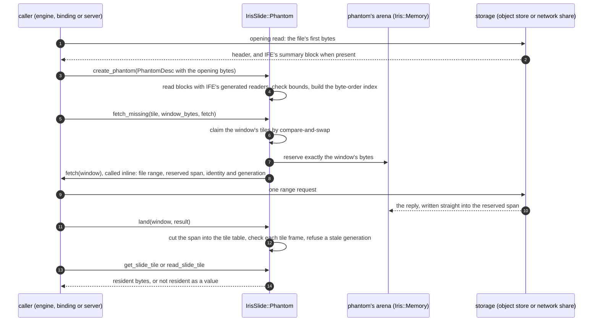
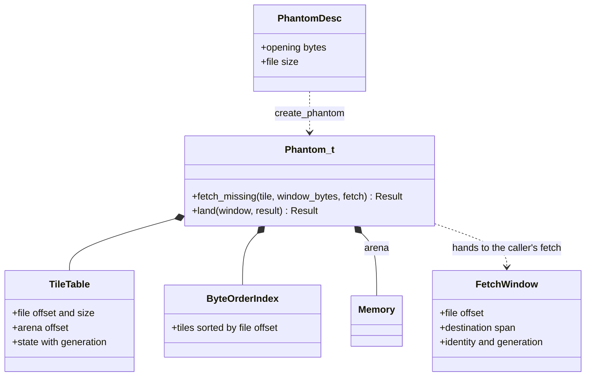
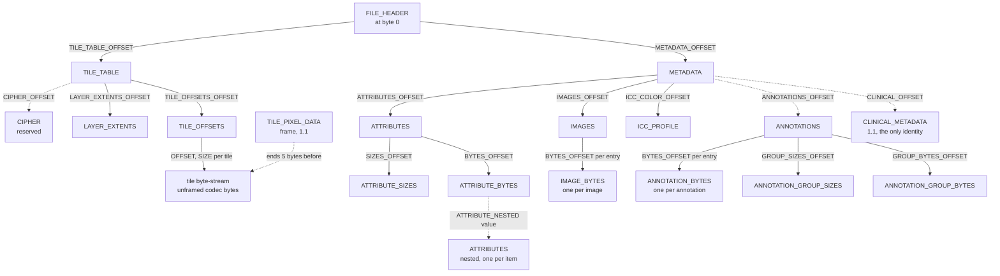
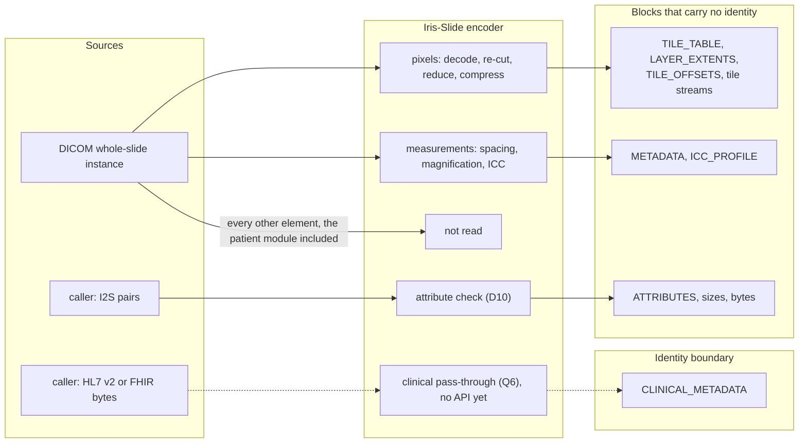

# ARCHITECTURE.md — Iris-Slide: governance and provenance of every IFE block

**Status:** draft contract. D1–D8 record the maintainer's decisions of
2026-11-24 and D9 and D10 those of 2026-11-25, D11 to D13 those of 2026-11-25 and 2026-11-26, D14–D26 those of 2026-11-27; Q1 is resolved by D7, Q12 by D10's amendment of 2026-11-25, and Q13, Q14's choice of library, Q18–Q24 and Q11's encoding half (D22) on 2026-11-27; Q2–Q10, Q11's decoding half, Q14's size-parity margin, Q15, Q16 and Q17 wait on the maintainer's answers, and each has a work item in the plans, which are kept privately. A change is an owner amendment, dated, in
the row it changes. · **Date:** 2026-11-24 · **Owner:** the maintainer

Iris-Slide (formerly named Iris-Codec) is Aptix Bio's open-source (MIT) reader
and writer of Iris whole-slide-image files (`.iris`). The file format is the
Iris File Extension (IFE), specified in the Iris-File-Extension repository.
This document is the register of the governance and provenance of every
block of the IFE specification, required 2026-11-24 to guide the work. For every block the
specification defines, it records who governs the block's bytes and their
content, where that content comes from for each kind of source, whether it may
identify a patient, which Iris-Slide code writes and reads it, whether that
code obeys the rules below, and what has to change.

---

## 0. How to read this document

| Section | What it settles |
|---|---|
| §1 Decisions | the governing principle and the maintainer's decisions; only amended (dated) by the owner |
| §2 File layout | the blocks and the offsets that reach them (diagram) |
| §3 The block register | one row per block: governance, provenance, identity class, code, state, required handling |
| §4 Provenance and the identity boundary | where each source's content lands, and the one place identity may go (diagram) |
| §5 Defects outside the audit | rule breaches this register found that the design audit does not list |
| §6 Open questions | Q1 (resolved by D7) and Q2–Q11, each with a proposal for the maintainer |
| §7 External dependencies | what Iris-Slide waits on from IFE, Iris-Headers and others |
| §8 Sources and what was not verified | the exact revisions read, external sources with dates, and the limits |

**Citations.** `src/…` is this repository at commit `75f4949`
(`feature/PublicReadiness`). `IFE …` is Iris-File-Extension at commit `136dc1c`
(branch `feature/IrisSlideRename`); block definitions are cited as
`ife_fields.json:<line>` and spec clauses by their AsciiDoc anchor
(`ife_spec.adoc` `[[ife-…]]`). `Headers …` is Iris-Headers at commit `e1d6631`
(branch `feature/IrisSlideRename`). Findings of the design audit of
2026-11-24, kept with the plans, are cited with the prefix *audit* (audit C3), because the audit's
documentation findings are also numbered D1–D3; a bare **Dn** is a decision of
this document.

**Marks.** *(inference)*: reasoned from code or spec, not reproduced.
*(to measure)*: no measurement exists. *(to confirm)*: an external fact not
checked against its primary source. Nothing was compiled or run for this
document.

**Identity classes** used in §3:

| Class | Meaning |
|---|---|
| **none** | The block's fields are structural or numeric; no field can hold free text or pixels |
| **rule: none** | The block can hold free text, and D2 forbids identifying content in it. The encoder controls what it writes; a reader cannot verify it |
| **pixels may identify** | The block holds an image whose pixels can show patient identity (a slide label) |
| **identity** | The block exists to carry identity: the clinical stream |

---

## 1. Decisions

| # | Decision | Choice | Why |
|---|---|---|---|
| D1 | Governing principle | **IFE owns the bytes; Iris-Slide owns the pixels and is one writer and one reader of them.** Every block's layout, offsets, enumerations and conformance clauses come from IFE's machine-readable specification (`ife_fields.json`, `ife_constants.json`), and Iris-Slide writes blocks only through IFE's `Builder` and reads them only through IFE's `Parser` (amended 2026-11-26 by D13: a remote slide's blocks are read with IFE's installed generated readers). Iris-Slide decides what content goes into a block (which pixels, which codec, which attributes) and never how the block is laid out | IFE is append-only and versioned: "Append-only is inviolable, so a bump never invalidates a file written under an earlier one" (`IFE spec/ife_header.json:7`). A second definition of the layout in Iris-Slide would be a second copy to keep in agreement with that guarantee. The specification is published under CC BY-ND 4.0 (`ife_header.json:37`), so a change to a block is a change to IFE, made there |
| D2 | Patient identity | **Patient identity lives only in the clinical stream (CLINICAL_METADATA).** Decided 2026-11-24: patient information goes in the clinical (HL7 / FHIR) block and never in the metadata block. The attribute arrays carry laboratory and acquisition facts only, whatever `metadata_formats` value the file declares. The clinical stream is HL7 v2, FHIR JSON or FastFHIR (`ife_constants.json:304-326`) | IFE 1.1 already draws this line: the clinical block "is the block that carries identity … removing it de-identifies a slide" (`ife_fields.json:764`), and `METADATA_I2S` pairs each "identifies no individual" (`ife_constants.json:220-222`). `METADATA_DICOM` and `METADATA_FREE_TEXT` make no such promise (`ife_constants.json:224-231`); D2 holds Iris-Slide to the I2S promise for every attributes block it writes, so that dropping one block de-identifies any file Iris-Slide wrote. Today the encoder breaks it (audit C3; §3 rows 6-8) |
| D3 | Decoded size | **A decoder sizes its output from the encoded stream's own header, so it is exact and cannot overflow.** Decided 2026-11-24 for JPEG: the destination buffer is sized from the JPEG stream's own encoded size, so it is exact and cannot overflow; the same rule for PNG, and for AVIF. The size read from the header is then compared with the size the file declares (TILE_LENGTH for a tile, WIDTH × HEIGHT for an associated image, PIXEL_WIDTH × PIXEL_HEIGHT for a raster annotation), and a mismatch is an error naming both | The declared size is a claim made by whoever wrote the file; the stream header is what the codec will actually write. Sizing from the claim is the overflow in audit C1 (JPEG) and C2 (PNG) |
| D4 | Public release | **Every finding is fixed before the repository is released publicly** (decided 2026-11-24). Every row of §3 whose state is *defective*, and every §5 defect, is closed before the repository is made public | A public reader of a whole-slide-image library may be a hospital; a defect in the identity handling (D2) is a privacy leak in someone else's archive |
| D5 | Proprietary codec | **Iris-Slide links no proprietary code. A licensed codec is loaded at run time (dynamic linking) by those who pay royalties for it; every other codec (JPEG, AVIF, and the other open ones) is open and built in.** Decided 2026-11-24: the proprietary codec may be referenced; it is linked at run time, for those who pay its royalties; the other codecs are open | Keeps the repository MIT-licensable and buildable by anyone, with the licensed codec's terms carried by its own module. Which tile encoding that codec decodes, and how it is loaded, are Q3 and Q4 |
| D6 | This register | **A change to how Iris-Slide writes or reads a block lands with an edit to that block's row in §3**, in the same commit | The register is only a guide while it describes the code |
| D7 | PNG | **SVG is the preferred annotation format, and Iris-Slide neither writes nor decodes PNG anywhere.** Decided 2026-11-24, answering Q1: SVG is preferred and PNG is removed, the simpler design. No tile encoding was ever PNG (`ife_constants.json:159-182`); associated images are written as JPEG or AVIF; annotations are SVG (vector), TEXT, or JPEG; libpng leaves the build (`cmake/png.cmake`, `CMakeLists.txt:104, 154, 192-193`). `IMAGE_ENCODING_PNG` and `ANNOTATION_PNG` are retired in IFE (pending, paired IFE change), in the append-only way D1 requires: the values stay assigned and are never reused. **Consequence:** a file already written with a PNG associated image or a PNG annotation opens, and reading that image or annotation is refused with an error naming it and its encoding. **Amended 2026-11-24** (PNG is refused on re-encode too): re-encoding an `.iris` source that carries a PNG image or annotation is refused the same way, naming the image and its encoding | One fewer codec, one fewer dependency, and the PNG decoder that overflows (audit C2) is deleted instead of fixed. Vector annotations scale with the slide; the raster-mask case that argued for PNG is given up for simplicity |
| D8 | Attribute vocabulary | **The attribute arrays are governed by the Iris Interoperability Specification (I2S), a specification to be written in its own repository.** I2S defines the indelible scan-time characteristics of a slide (accession number, stain, scan date and time, scanner identity such as a unique device identifier) as `METADATA_I2S` attributes. Patient HL7 / FHIR data stays in the clinical stream (D2). **Amended 2026-11-24, three decisions of the maintainer's.** (1) The accession-type number is named the DigitalImageIdentifier (DII), the I2S key `DigitalImageIdentifier`. IFE describes `METADATA_I2S` keys as DICOM keywords and allows I2S to diverge from DICOM (`ife_constants.json:220-222`); `DigitalImageIdentifier` is such a divergence. (2) It carries a flag: the DII has a separate boolean, `DII_is_PHI`, saying whether it must be scrambled during de-identification. I2S carries the boolean companion `DII_is_PHI`, and a de-identifier scrambles the DII when the flag is true. A DII with no `DII_is_PHI` flag is treated as PHI and scrambled on de-identification (an absent flag defaults to true). (3) The specification's form: I2S is a JSON specification compiled into C++ source, as IFE is. I2S (repository Aptix-Bio/Iris-Interoperability-Specification) is a versioned, append-only JSON specification with a generator that emits C++ source, as IFE's `spec/*.json` and `generator/` do; Iris-Slide takes its keys from that generated source (X3) | The maintainer's direction of 2026-11-24. IFE already names I2S as the vocabulary of `METADATA_I2S` (`ife_constants.json:220-222`) and governs only where the bytes are (`ife-attributes`); a separate repository gives the vocabulary its own versions, which ATTRIBUTES.VERSION records. What remains open about the DII is Q10 |
| D9 | AV1 tiles | **The AVIF tile encoding is removed from the Iris format; tile encoding 3 is `TILE_ENCODING_AV1`.** Decided 2026-11-25: a tile whose table declares value 3 holds a bare AV1 sequence in the AV1 Low Overhead Bitstream Format, one shown frame per focal plane, a single-plane tile being one key frame, with no container. `.iris` files are not in use outside development, so no file with AVIF tiles is read: value 3 is reassigned without an alias or a compatibility path. AVIF stays for associated images (`IMAGE_ENCODING_AVIF`), so libavif stays in the build. **Consequence for Iris-Slide (2026-11-25):** it neither encodes nor decodes AV1 tiles yet; a tile table declaring `TILE_ENCODING_AV1` is refused with an error naming the encoding, on decode, on encode, and as an encoder source (§3 rows 2 and 19). Whether Iris-Slide decodes AV1 is Q11. The paired changes in IFE and Iris-Headers are X7 | The maintainer's decision. A bare AV1 sequence carries the focal planes of a Z-stacked tile as frames of one stream, with no container to parse (AV1 Low Overhead Bitstream Format: a sequence of OBUs, each with `obu_has_size_field` set; AV1 Bitstream & Decoding Process Specification, read 2026-11-25). Refusing by name keeps an AV1 stream from reaching libavif, which, before the refusal, received value-3 tiles and failed with "BMFF parsing failed" while the read returned no buffer and no error (TileEncodingAv1Refused_3.6's red step) |
| D10 | A caller's I2S attributes | **The encoder takes a slide's I2S attributes from its caller and writes them as the slide's `METADATA_I2S` attributes block, in place of the pairs read from the source.** Decided 2026-11-25. The caller passes `EncodeSlideInfo::attributes` (Iris-Headers): key text, value text, `METADATA_I2S` and the I2S version as IFE's 16-bit VERSION holds it, the shape I2S's `Attributes::to_pairs()` gives. Iris-Slide does not depend on I2S, which is not yet published, so Iris-Slide's public build cannot fetch it: whether a key belongs to I2S, and whether its text is a valid value, is I2S's check, made before the pairs reach the encoder. The encoder refuses, naming the pair and before the source is opened, only what IFE's attribute blocks cannot hold (a key that is not ASCII or is past the 16-bit KEY_SIZE, a value that is not UTF-8, key and value bytes past ATTRIBUTE_BYTES' 32-bit COUNT; `ife-attribute-sizes`, `ife-attribute-bytes`), a format other than `METADATA_I2S` (D2), and version 0. **When the source also carries pairs**, the caller's replace them: IFE's METADATA holds one ATTRIBUTES_OFFSET (`ife_fields.json`, METADATA), so a slide has one attributes block with one FORMAT, and a merge would put the source's free text or DICOM elements under the caller's claim that no pair identifies anyone. `anonymize` does not clear the caller's pairs, which the caller stated; scrambling a `DigitalImageIdentifier` flagged as PHI is DigitalImageIdentifier_6.6. **Amended 2026-11-25, resolving Q12:** IFE's 16-bit `ATTRIBUTES.VERSION` holds the I2S version under `METADATA_I2S` packed as `major << 8 \| minor` (I2S 0.1 is 1, `0x0001`; 1.0 is `0x0100`), and 0 is unversioned, which IFE reads as free text. The caller packs it (I2S's generated header emits the packed value); the encoder writes the caller's u16 as given and refuses only 0. A major or minor above 255 cannot be expressed in the u16 the caller passes, so the encoder adds no check for it **Amended 2026-11-27:** the caller passes the pairs in `EncoderDesc::attributes` of the rebuilt encoder (D14), checked as above before the source is opened; nothing is read from the source's own attributes | IFE's `ATTRIBUTES.VERSION` holds "the Iris Interoperability Specification version for METADATA_I2S" and an unversioned I2S claim reads as free text (`ife-attributes`, read at IFE `45845fb`, 2026-11-25), so version 0 is refused instead of written; the packing was Q12, resolved by the amendment; the caller passes the packed value. Refusing before the source is opened leaves no partial output (`tests/encoder_rewrite_test.cpp`, Identity_07) |
| D11 | GPU block-compressed tiles | **Tile encodings 4 and 5 are `TILE_ENCODING_UASTC` and `TILE_ENCODING_XUASTC`.** Decided 2026-11-25. Each tile byte-stream is a bare codec stream with no KTX2, .basis or other container: under UASTC, one Zstandard frame whose content is the tile's 16-byte UASTC LDR 4x4 blocks in raster order; under XUASTC, one XUASTC LDR bitstream; one focal plane each (IFE's specification, UASTC and XUASTC Tile Byte-Streams). **Mip levels (amended 2026-11-25):** the slide records a fixed number of mip levels once, in IFE's `TILE_TABLE.MIP_LEVELS` (IFE D29, resolving its OD-T2), instead of per-tile fields in the tile frame; level n is `TILE_LENGTH >> n` pixels, and 0 and 1 both mean level 0 alone. A UASTC stream's one Zstandard frame holds the levels back to back, finest first, level n being ceil(L/4)² 16-byte blocks for L = `TILE_LENGTH >> n`, so each level's offset is computed and nothing is stored per tile (a 256-pixel tile with 3 levels: 65,536 + 16,384 + 4,096 bytes). XUASTC carries level 0 alone, since its bitstream records no total length by which concatenated levels could be split (IFE OD-T4). **Levels capped at the layer step (amended 2026-11-25):** a reader uses min(`MIP_LEVELS`, round(log2(step)) + 1) levels, where the step is the ratio between adjacent pyramid layers' scales (2 under `-d 2x`, 4 under `-d 4x`, or the source pyramid's); so the encoder writes no more levels than round(log2(step)) + 1 needs, and when its configuration asks for more it warns that the extra levels waste space and encodes them anyway: a warning, not a refusal (Encode_08; how the warning reaches the caller is Q15). A viewer transcodes them to the block format its GPU samples, ASTC 4x4 or BC7. **Size parity is a requirement of the encoder:** a UASTC tile is encoded with rate-distortion control until it is no bigger than the same tile encoded as JPEG at the quality bar, within a margin the maintainer sets; a block-compressed payload much bigger than JPEG is not acceptable (Encode_07). **Consequence for Iris-Slide (2026-11-25):** it neither transcodes nor encodes either yet; a tile table declaring one is refused with an error naming the encoding, on decode, on encode and as an encoder source, as AV1 is (D9). **Confirmed 2026-11-27 as the rebuilt encoder's layout** (D23, BlockTileEncode_28). Transcoding is Q13, encoding Q14; the paired IFE and Iris-Headers changes are X8 | The maintainer's decision. A block format keeps a tile at 1 byte per pixel in GPU memory instead of 4 and needs no pixel decode; UASTC LDR 4x4 is a subset of ASTC LDR 4x4, so its transcode to ASTC is lossless, and to BC7 about 0.75–1.5 dB RGB PSNR lower ([UASTC LDR 4x4 specification](https://github.com/BinomialLLC/basis_universal/wiki/UASTC-LDR-4x4-Texture-Specification), read 2026-11-25). UASTC is 8 bits per pixel before Zstandard and XUASTC about 1.15–3.5 at 4x4 ([Basis Universal README](https://github.com/BinomialLLC/basis_universal), v2.5, read 2026-11-25), against JPEG's typically lower rate *(to measure on pathology tiles)*, hence the parity requirement |
| D12 | Failures IFE reports | **A failure IFE reports reaches Iris-Slide's caller with IFE's domain and code.** Decided 2026-11-26: where an Iris-Slide public call returns a `Result` for a read IFE refused, it returns IFE's `Result` as it came (`Iris::Domain::IRIS_FILE_EXTENSION`, an `Iris::File::FileError` code, IFE's message naming the offending value), instead of a `SlideError` under `Iris::Domain::IRIS_SLIDE` re-wrapping it. Inside the library an IFE failure is thrown as a `ResultFailure` carrying that `Result` (`src/IrisSlidePriv.hpp`). Today `is_iris_slide_file` and `validate_slide` return it (NOT_MAPPED for a path IFE cannot map, and a damaged block's own code); the reads that return a `Slide` or a `Buffer` follow with CreateForm_12.2 and ReadsReturnResult_12.3 | IFE's `FileError` names the fault exactly (the block, the byte, the value), and a caller that switches on it would lose it under a second code; IFE's read calls return a `Result` since IFE R-8 (IFE D30). It amends the style guide's Errors section, which named `Iris::Domain::IRIS_SLIDE` for every boundary |
| D13 | Remote slides | **A slide on a network share or in an object store is read through `IrisSlide::Phantom`, a local stand-in for the whole file that does no I/O.** Decided 2026-11-26. The caller opens it with `create_phantom(const PhantomDesc&, Phantom&)` from the first bytes of the file, which it has read: the `FILE_HEADER` and, when the file has one, IFE's optional summary block after it (X10). The phantom reads each metadata block with IFE's installed generated readers and checks the bounds its reads depend on (each block inside the file size the header gives, each tile entry inside the file, the encoding a known value). It keeps, in an arena of its own (`Iris::Memory`), a RAM table from file offset to arena offset for each block and each tile, filled as bytes land, and a byte-order index: the tile indices sorted by file offset once at open. A miss is answered by `fetch_missing(tile, window_bytes, fetch)`: the phantom claims the tile, walks the byte-order index while the span from the first tile's first byte to the last tile's last byte stays within `window_bytes`, claiming each tile it passes by compare-and-swap and stopping at one another thread holds; a lone wanted tile keeps its exact range. It reserves exactly the span's bytes in its arena (X9), then calls `fetch`, a constrained template callable, inline with the window: the file range, the reserved region as `std::span<std::byte>`, and the window's identity with a generation. It keeps no copy of `fetch`. The caller reads the range into the region with its own transport and calls `land(window, result)`, which cuts the span into the tile table, checks each cut against its tile frame, and refuses a stale generation. Every tile inside a window is kept, requested or not. `get_slide_tile` on a phantom returns the resident bytes or, as a value, that the tile is not resident; `read_slide_tile` decodes from them as from a `Slide`. The arena is freed whole when the phantom's last owner drops it | one reader of the format for every caller that brings its own transport, an engine, a binding or a server, with no network library in Iris-Slide; a transport called inline and never stored keeps a shared object free of callbacks (the style guide's ownership webs), as an asynchronous I/O library keeps a completion handler in its operation and never in the socket; one request per window, since object stores do not serve several ranges in one request: Amazon S3 does not support retrieving multiple ranges per GET (https://docs.aws.amazon.com/AmazonS3/latest/API/API_GetObject.html, read 2026-11-24) and Google Cloud Storage's XML API does not accept them (https://docs.cloud.google.com/storage/docs/xml-api/reference-headers, read 2026-11-24); the reply's length is known from the tile table, so the region is reserved before the request is sent and no writer waits; on Windows, touching a mapped view of a remote file whose connection is lost raises `EXCEPTION_IN_PAGE_ERROR` (https://learn.microsoft.com/en-us/windows/win32/memory/reading-and-writing-from-a-file-view, read 2026-11-26), and on Linux a mapped page the file no longer backs raises `SIGBUS` (mmap(2), https://man7.org/linux/man-pages/man2/mmap.2.html, read 2026-11-26; the same on an NFS or SMB mount whose server is gone *(to confirm)*), where a read returns an error. **Amends D1** for the phantom's reads: D1 has Iris-Slide read blocks only through IFE's `Parser`, which needs the whole file as one contiguous mapping, and a remote slide never is one. The phantom reads each block with IFE's generated block readers, which IFE installs as public headers generated from its specification, so the layout still comes from IFE alone and Iris-Slide holds no second copy of it; an IFE entry point that takes caller-supplied block bytes was weighed and not proposed, since the installed readers already serve |
| D14 | The encoder, rebuilt | **`IrisSlide::Encoder` is rewritten from the ground up** (decided 2026-11-27). It keeps the earlier encoder's pipeline in outline (read the source, derive the lower layers, compress, write through IFE's `Builder`), and every stage is rebuilt to this repository's rules: the work is one task graph on Iris-Headers' `Iris::Async` thread pool, each task queued by the task that completes its last input through an atomic dependency count, with nothing that sleeps; every resident buffer is charged to one byte budget, a quarter of the machine's physical memory by default (Q20; half, and lower under memory pressure, since D26); tiles reach the `Builder` in a fixed order, so the same source and options give a byte-identical file (Q21); every public call returns a `Result`, and an encoder dispatched twice, or reused after an interrupt, refuses by name. The output is named for its tile encoding, `<source>.jpeg.iris` (later `.av1.iris`, `.uastc.iris`, `.xuastc.iris`). A change to the surface other repositories compile against is made in Iris-Headers' public headers, as small as the rewrite needs, on a paired branch merged first. From a DICOM source the encoder carries only the pixel spacing, the magnification and the ICC profile (and, since ZStackSource_27.9, DistanceBetweenFocalPlanes as MICRONS_PLANE); attributes come only from the caller's I2S pairs (D2, D10) **Amended 2026-11-27 (cut over):** the rebuilt encoder replaced the earlier one the same day: `src/IrisSlideEncoder.cpp` is the rebuilt encoder, its public API (`create_encoder(const EncoderDesc&, Encoder&)`, `dispatch_encoder`, `encoder_progress`, `interrupt_encoder`, `encoder_output_name`) is declared in Iris-Headers' `IrisSlideCore.hpp`, and the earlier encoder, its layer derivation and its DICOM bridge are deleted. Its sources are DICOM instances whose frames are JPEG, JPEG 2000 or HTJ2K (Q23); OpenSlide vendor files and `.iris` re-encoding left with the earlier encoder and return as Source modules, and OpenSlide left the build | The earlier encoder's defects are in its structure: N reader threads scanning every tile, a 1 ms sleep while a task count exceeds a fixed bound that ignores the buffers it holds, a second dispatch that resets the running one, tile order that differs run to run, associated-image failures printed and skipped, and every DICOM element, the patient module included, written as attributes (audit C3, C7, C8, C14, C16; A5, A6). Fixing them in place would keep the structure that caused them |
| D15 | Derived layers | **The lower layers are derived by a 2× reduction with a cubic of the Mitchell–Netravali family, in fixed-point arithmetic, bit-exact on every path** (decided 2026-11-27). Output pixel i of layer n+1 is a separable weighted sum of source pixels 2i−3 to 2i+4 of layer n: 8 taps per axis, so an output tile reads its 2×2 source tiles and a 3-pixel halo of the eight around them. The weights of each phase are integers computed at compile time from the kernel and summing exactly to a named power of two; the horizontal pass stores signed 16-bit, the vertical pass accumulates in 32-bit, rounds half up and clamps to 0–255. At the slide's boundary the edge pixel repeats; the part of a partial tile beyond the slide's extent is white in every layer. Layers are derived until the slide fits one tile. The kernel starts as Mitchell–Netravali (B = C = 1/3); the final kernel is chosen at a visual review (Q16) **Amended 2026-11-27 (as built):** the vertical pass runs first, over whole rows of the region, and stores signed 16-bit after a shift of 8; the horizontal pass runs second, as the same row kernel over the transposed first-pass output, accumulates in 32-bit, shifts by 20, rounds half up and clamps to 0–255, and its output is transposed back. A tile reads a 518 × 518 region: its 2×2 source tiles with a 3-pixel halo on every side (`src/IrisSlideReduce.cpp`, `IrisSlideReduce.hpp`) | A box average aliases fine periodic detail; a cubic with negative lobes keeps edges sharper. Integer arithmetic gives the same bytes on the scalar path, every SIMD target and a compute shader, so each is tested for byte equality with the scalar reference, where floating point would round differently by instruction set and be comparable only within a tolerance. Mitchell and Netravali, *Reconstruction Filters in Computer Graphics*, SIGGRAPH 1988 (read 2026-11-27) |
| D16 | SIMD | **The reduction's SIMD kernel is written once with Highway and dispatched at run time** (decided 2026-11-27), through `foreach_target.h`, `HWY_EXPORT` and `HWY_DYNAMIC_DISPATCH`, in its own translation unit and target; a test forces each compiled and supported target (`hwy::SupportedAndGeneratedTargets()`, `hwy::SetSupportedTargetsForTest`) and compares it with the scalar reference byte for byte. The encoder stops calling Iris-Headers' `IrisSIMD` box kernels (X11). A compute-shader path of the same arithmetic is written for Vulkan in Slang, compiled to SPIR-V, through MoltenVK on macOS (Q18) | Dynamic dispatch picks the best instruction set the CPU offers, where Iris-Headers' kernels fix one at compile time with `HWY_STATIC_DISPATCH`. Highway quick reference, https://google.github.io/highway/en/master/quick_reference.html (read 2026-11-27) |
| D17 | JPEG 2000 and HTJ2K sources | **DICOM frames in JPEG 2000 (1.2.840.10008.1.2.4.90, .91) and HTJ2K (.201, .202, .203) are decoded by OpenJPEG** (decided 2026-11-27). Each transfer syntax maps to a source codec, a scoped enumeration of the encoder's own, since a source's codec is not an IFE tile encoding; any other transfer syntax is refused naming its UID. A frame decodes into a buffer sized from its codestream's own header, which is compared with the instance's Rows and Columns (D3) | OpenJPEG (BSD-2-Clause, vcpkg `openjpeg`) decodes JPEG 2000 and, since 2.5.0, HTJ2K, so one decoder serves all five syntaxes (OpenJPEG NEWS, https://github.com/uclouvain/openjpeg/blob/v2.5.4/NEWS.md, read 2026-11-27); libdicom returns an encapsulated frame's bytes unchanged for any syntax it does not decode itself (libdicom `src/dicom-data.c`, read 2026-11-27) |
| D18 | One DICOM instance | **From a DICOM series the encoder reads only the highest-resolution VOLUME instance and derives every lower layer itself (D15)** (decided 2026-11-27). A TILED_FULL instance's frames are in row-major tile order; a TILED_SPARSE instance is refused naming DimensionOrganizationType. Frames that are not 256 pixels are cut into 256-pixel tiles, each assembled from the source frames it overlaps, its row spans copied and converted to the tile's pixel format by Highway kernels with dynamic dispatch, as D16's reduction is (decided 2026-11-27); a later run keeps the source's own tile length under IFE's `TILE_LENGTH`. The physical scale is read from the instance's Pixel Spacing, unrounded | The series' lower instances were encoded by the scanner with its own filter; deriving them gives one reduction for every slide. The earlier encoder required 256-pixel frames and refused other tilings, such as 240-pixel frames |
| D19 | Block-compressed tiles' library | **UASTC and XUASTC tiles are transcoded and encoded by Basis Universal 2.50, through vcpkg's `basisu` port, as raw blocks with no KTX2 container** (decided 2026-11-27, resolving Q13 and Q14's choice of encoder; Q14's size-parity margin stays open). Each new pixel layout a transcode produces enters `Iris::Format` (Iris-Headers) with the reader that produces it and its test: BC7 (always 4x4) and ASTC at the stream's own footprint. XUASTC LDR has every ASTC 2D footprint from 4x4 to 12x12, one per stream; it transcodes to ASTC losslessly only at that footprint, and to BC7 directly only at 4x4, 6x6 and 8x6 for solid and one-subset blocks, else by decoding and re-encoding in real time. XUASTC carries its sRGB decode flag in its stream header; UASTC carries none, so the slide records it | One library for both block families keeps one dependency where two would double the surface; KTX-Software 4.4.2 and 5.0.0-rc2 encode UASTC and have no XUASTC codec (release notes, read 2026-11-27). Verified 2026-11-27 at Basis Universal master 073eb6a and tag v2_50 9bebe16 (`transcoder/basisu_transcoder.cpp` `basis_is_format_supported`, `basisu_file_headers.h`), its wiki at 524954e (XUASTC LDR Specification v1.0, still marked preliminary; ASTC and XUASTC LDR Usage Guide), Khronos DataFormat 8020b62 (`bptc.txt`) and vcpkg 99541cc (`basisu` 2.50, static only, not on Android) |
| D20 | Layer step | **The scale between an encode's written layers is any power of two from 2, by default 2** (decided 2026-11-27). The encoder writes one layer in every log2(step) of its 2× reductions; Iris-Headers' `LAYER_STEP_DEFAULT` holds the default; `create_encoder` refuses any other step naming it, and the command line, Python and the README state the same range | Every layer is already derived by 2× reductions (D15), so any power of two costs no further code. The README listed 2, 4 or 8 while `create_encoder` and `--help` accepted any power of two, so a caller reading one could not predict the other |
| D21 | Windows compilers | **Iris-Slide compiles with both Windows compilers, MSVC's `cl` and Visual Studio's ClangCL** (decided 2026-11-27), each a CI cell of its own with the same `ci` preset and tests; a compiler-specific option is chosen by CMake's `MSVC`, which is set for both, so both cells take the same flags, and a flag for one compiler alone carries its reason in the comment beside it. **Amended 2026-11-28 (ZStackWindowsCrash_27.19):** on Windows, aom alone is compiled by Visual Studio's clang-cl in both cells (`triplets/x64-windows-static-md.cmake`, PIPELINE rule 5), since MSVC 19.44 miscompiles libaom 3.15.3's inter-frame mode search; a Windows build needs Visual Studio's C++ Clang tools for Windows | Iris-Slide is open source, and its users build it with either compiler; a cell for each finds a construct one of them refuses (a `<wingdi.h>` macro, a source code page) before a user does |
| D22 | AV1 tile encoder | **AV1 tiles are encoded by libaom 3.15.3, in good-quality mode with no lag, one temporal unit per focal plane** (decided 2026-11-27, answering Q11's encoding half). The first plane in Z order is the key frame and carries the sequence header; the other planes follow as inter frames in Z order (Q24, amended 2026-11-27 from the in-focus plane first); profile Main, 8-bit 4:2:0 at the tile's size, BT.601 matrix coefficients at full range (`AV1E_SET_MATRIX_COEFFICIENTS`, `AV1E_SET_COLOR_RANGE`, libaom `aom/aomcx.h` at v3.15.3, read 2026-11-27); every OBU carries its size field and the stream opens with a temporal delimiter, libaom's default Section 5 output (`aom/aom_encoder.h`, read 2026-11-27); a single-plane tile keeps the full sequence header (`full_still_picture_hdr`), since whether hardware decoders accept a reduced still-picture header is *(to confirm)*. dav1d 1.5.4 decodes the tiles back for the encoder's tests (decode only, BSD-2-Clause, https://github.com/videolan/dav1d, read 2026-11-27). The baseline `9eec002` carries 3.15.2 and vcpkg took 3.15.3 on 2026-11-02 (microsoft/vcpkg `dee3416740`, read 2026-11-27), after its latest release, so 3.15.3 comes through vcpkg's own port at that commit as an overlay (`ports/aom`, amended 2026-11-27, Av1TileEncode_27) until a release carries it | The stream is decoded in software by dav1d and in hardware by Apple's VideoToolbox (AV1 hardware decode reported supported on an M5 Pro, macOS 26.6.2, run 2026-11-27). libaom writes every part of it. Its all-intra mode (`AOM_USAGE_ALL_INTRA`) writes key frames only, since it forces a key-frame distance of 0 (libaom `av1/av1_cx_iface.c`, read 2026-11-27), and a Z-stack's planes after the first are inter frames. SVT-AV1 4.1.0 states no determinism and sets its parallelism as a level with no thread count (SVT-AV1 `Docs/Parameters.md`, https://gitlab.com/AOMediaCodec/SVT-AV1, read 2026-11-27). rav1e has no vcpkg port at the baseline or on vcpkg's master (read 2026-11-27). 3.15.3 (2026-10-20) is libaom's latest release, fixing an overflow found by fuzzing in 3.15.2 (libaom CHANGELOG, https://aomedia.googlesource.com/aom/+/refs/tags/v3.15.3/CHANGELOG, read 2026-11-27) |
| D23 | Block-compressed tile layout | **The rebuilt encoder writes D11's layout** (confirmed 2026-11-27, recorded as D11's amendment of that date) | D11 holds the requirement; this row keeps the number cited on 2026-11-27 |
| D24 | Byte-identical encodes | **Encode_12's byte-identical rule holds per build and CPU path for every software encoder** (decided 2026-11-27): the same source, options, build and instruction set give the same file, whatever the thread count, so each tile is encoded on one thread of its own where a library would otherwise split it (libaom row-mt, Basis Universal's job pool); agreement between x86 and arm64 is measured by a cross-architecture test before any file relies on it. A hardware encode, through a GPU device the caller's Context carries, is opt-in and outside the rule | libaom's own test asserts the same bytes at 1 and 4 threads, and at 2 and 4 with row-mt, in all-intra mode (`test/ethread_test.cc`, AVxEncoderThreadAllIntraTest, read 2026-11-27); D22's good-quality mode is encoded on one thread per tile, and its byte identity is shown by Av1TileEncode_27's own test, while its float neural-network predictor has SSE3, AVX2 and NEON versions tested only to a relative error of 1e-3 (`av1/common/av1_rtcd_defs.pl`, `test/av1_nn_predict_test.cc`, read 2026-11-27). Basis Universal states nothing on determinism, and its XUASTC encode uses the job pool whenever it has more than one thread (`encoder/basisu_comp.h` at `v2_50`, https://github.com/BinomialLLC/basis_universal, read 2026-11-27). No GPU vendor documents identical encodes, and VideoToolbox lists no AV1 encoder (`VTCopyVideoEncoderList` on an M5 Pro, macOS 26.6.2: H.264, HEVC, ProRes and JPEG, run 2026-11-27) |
| D25 | Encoder effort | **How hard the encoder works on each tile is the caller's option, `EncoderDesc::effort`, from 0 (the fastest, the default) to 6 (the slowest, and usually the smallest at the same quality)** (decided 2026-11-27). AV1 maps it to libaom's good-quality speed, 6 - effort; the JPEG path takes 0 alone, so any other JPEG effort is refused naming it, as is an effort above 6. libjpeg-turbo's optimised Huffman tables (`TJPARAM_OPTIMIZE`) would trade JPEG encode time for size at identical pixels, and the codec context does not set them today, so a JPEG effort has nothing to change until it does | Size and time trade against each other: one five-plane tissue tile at quality 90 took 87 ms and 37.4 KB at libaom speed 6 (effort 0), and about 1 s and 35.6 KB at speed 1 (effort 5), measured 2026-11-27 on macOS arm64 with the in-focus plane first; in Z order (Q24) the same tile is 35.1 KB at effort 0 and 34.0 KB at effort 5, so no single setting suits both a quick encode and an archive. At the same quantiser a different speed makes other coding decisions, so an AV1 slide's decoded pixels differ by effort; effort 0 keeps the encoder's earlier output. Higher effort is not smaller on every tile: in Q24's measurement, Z order at sigma 1 took 34,728 B at effort 0 and 35,810 B at effort 5 |
| D26 | Memory budget | **The budget is the most an encode holds at once, by default half of physical memory, and while the operating system reports memory pressure the encoder admits new rows against a lower limit: half the budget under a warning, and the least the slide needs under critical pressure** (decided 2026-11-27, amending Q20's quarter). The pressure is each system's own signal, read at most every 250 ms: macOS's `kern.memorystatus_vm_pressure_level`, whose levels 2 and 4 are libdispatch's `DISPATCH_MEMORYPRESSURE_WARN` and `_CRITICAL` (apple-oss-distributions/libdispatch, `dispatch/source.h`, read 2026-11-27); Linux's pressure stall information, `/proc/pressure/memory`'s `some` and `full` lines, whose `avg10` is the share of the last 10 s in which some or every task stalled on memory (kernel `Documentation/accounting/psi.rst`, read 2026-11-27), or MemAvailable as a share of MemTotal without it (`Documentation/filesystems/proc.rst`); Windows' `MEMORYSTATUSEX::dwMemoryLoad`, the percentage of physical memory in use (Microsoft Learn, GlobalMemoryStatusEx, read 2026-11-27); where none is read, or a reading does not parse, the full budget stands. A compressed stream waiting to be written counts against the budget from the moment its row starts (ZStackBudget_27.10) | The budget is what stops reading and decoding, which outrun compression and the in-order writes (Encode_12), from filling memory: without it a slide, five times larger as a five-plane Z-stack, would be held whole. A fixed share is either too small on an idle machine or too large on a shared one; the system's own pressure signal lets one encode take more when memory is free and give it back when other programs need it, while the budget stays a hard ceiling. The thresholds for Linux and Windows are *(to tune on loaded machines)* |

### 1.1 The phantom's lifecycle (D13)

---

### 1.2 The rebuilt encoder (D14–D18, D22)

```mermaid
flowchart LR
    SRC["DICOM highest-resolution instance<br/>(D18)"] -->|"Pixel Data mapped read-only"| IDX["DicomFrameIndex<br/>offset tables, fragments"]
    IDX -->|"a frame's bytes"| DEC["decode_frame<br/>OpenJPEG: JPEG 2000, HTJ2K (D17)<br/>libjpeg-turbo: JPEG"]
    DEC -->|"RGB8 frames"| CUT["re-cut to 256 px<br/>Highway RGB8 to RGBA8 (D18)"]
    CUT -->|"RGBA8 tiles"| L0["layer 0 tiles"]
    L0 -->|"2x2 tiles and a 3 px halo"| RED["2x cubic reduction (D15)<br/>scalar reference, Highway (D16)"]
    RED --> LN["layer n+1 tiles"]
    LN -->|"until one tile"| RED
    L0 --> ENC["compress: JPEG (libjpeg-turbo)"]
    LN --> ENC
    L0 --> AV1["compress: AV1 (D22)<br/>libyuv 4:2:0 BT.601 full range,<br/>libaom, every plane in one stream"]
    LN --> AV1
    ENC -->|"schedule order (Q21)"| B["IFE Builder"]
    AV1 -->|"schedule order (Q21)"| B
    B --> OUT["source.jpeg.iris<br/>or source.av1.iris"]
    BUD["byte budget (Q20)"] -.->|"admits rows"| L0
```

## 2. File layout: the blocks and the offsets that reach them

Every arrow is an offset field; its label is the field name. Dashed arrows are
offsets that are `NULL_OFFSET` in every file Iris-Slide writes today. A tile
stream is reached only through its TILE_OFFSETS entry; its frame
(TILE_PIXEL_DATA) sits in the bytes immediately before it and is found by
measuring back from the stream (`ife_spec.adoc` `[[ife-tile-frame]]`).

Every block reached by an offset begins with the universal header
(VALIDATION = its own offset, RECOVERY = its tag; `ife_fields.json:72`);
arrays add STRIDE and COUNT (`:91`), byte arrays add COUNT (`:111`). The frame
is the exception: a 40-bit self-reference laid out backward, with no recovery
tag (`:126`).

---

## 3. The block register

*Revised 2026-11-27 for D14's cut-over (D6):* the rows describe the rebuilt encoder, whose one
source is a DICOM instance. Its writers are cited by function in `src/IrisSlideEncoder.cpp`
(`Encoder_t::dispatch`, `write`, `finish`), which stay true as lines move. It writes the tile table,
layer extents, tile offsets, METADATA, the ICC profile and the caller's I2S attributes, and no
associated images, annotations or clinical stream.

The specification defines **18 blocks** (`ife_fields.json` `blocks`,
lines 145-787). The register adds one row, **19**, for the tile byte-stream
itself: it is not a block (`[[ife-tile-pixel-data]]`: streams "are
deliberately *not* framed blocks"), but it holds the pixels and needs a row.
The three tables below share the row numbers.

### 3.1 Governance and identity

"Section" is the spec anchor in `ife_spec.adoc`; "Content governed by" is the
standard or vocabulary that defines what the bytes mean where IFE does not.

| # | Block (`ife_fields.json` line) | Since | Section | Content governed by | Identity class |
|---|---|---|---|---|---|
| 1 | FILE_HEADER (145) | 1.0 | `ife-file-header` | IFE only (magic `0x49726973`, version, root offsets) | none |
| 2 | TILE_TABLE (203); TILE_LENGTH and MIP_LEVELS 1.1 | 1.0 | `ife-tile-table`, `ife-tile-length`, `ife-tile-block-levels` | IFE; ENCODING from `tile_encodings` (IRIS 1, JPEG 2, AV1 3, UASTC 4, XUASTC 5; value 3 was AVIF at the revision cited, `ife_constants.json:159-182`, and is AV1 from 2026-11-25, D9, paired IFE change X7; 4 and 5 from 2026-11-25, D11, X8); MIP_LEVELS from 2026-11-25 (IFE D29, D11), meaningful under UASTC and XUASTC only | none |
| 3 | CIPHER (274) | 1.0 | `ife-cipher` | IFE reserves it, unspecified: "encoders write nothing beyond the universal header" (`:274`). CIPHER_OFFSET "*shall* be NULL_OFFSET unless the tile encoding is TILE_ENCODING_IRIS" (`ife-tile-table`) | none |
| 4 | METADATA (285); CLINICAL_OFFSET, MICRONS_PLANE 1.1 | 1.0 | `ife-metadata` | IFE (offsets, codec version, MICRONS_PIXEL normalized to layer scale 1, MAGNIFICATION) | none |
| 5 | LAYER_EXTENTS (405); Z_PLANES 1.1 | 1.0 | `ife-layer-extents`, `ife-focal-planes` | IFE (tiles per axis, SCALE strictly increasing) | none |
| 6 | ATTRIBUTES (363) | 1.0 | `ife-attributes` | FORMAT names the vocabulary: I2S (Iris Interoperability Specification, specification to be written in its own repository, D8; DICOM keywords, scan-time facts only), DICOM PS3.3 (unrestricted), or free text (`ife_constants.json:211-235`) | rule: none (D2) |
| 7 | ATTRIBUTE_SIZES (484) | 1.0 | `ife-attribute-sizes` | IFE; KEY_SIZE "*shall* be 4" for DICOM-tag keys | rule: none (D2) |
| 8 | ATTRIBUTE_BYTES (520) | 1.0 | `ife-attribute-bytes` | the FORMAT vocabulary; keys ASCII or 4-byte DICOM tags, values UTF-8 or nested offsets | rule: none (D2) |
| 9 | IMAGES (527) | 1.0 | `ife-images` | IFE; ENCODING from `image_encodings` (JPEG 2, AVIF 3; PNG 1 retired in IFE (pending, paired IFE change), D7) | none (entry fields are numeric) |
| 10 | IMAGE_BYTES (585) | 1.0 | `ife-image-bytes` | ASCII label (IFE) + stream per JPEG (ISO/IEC 10918-1 *(to confirm)*) or AVIF (AOM AVIF 1.2.0); PNG retired (D7) | **pixels may identify** (label, macro); the ASCII label is rule: none |
| 11 | ICC_PROFILE (607) | 1.0 | `ife-icc-profile` | ICC.1 (International Color Consortium), stored verbatim (`specified_by`, `:607`) | none *(inference: a profile describes a device's colour; ICC.1 tag content not checked)* |
| 12 | ANNOTATIONS (615) | 1.0 | `ife-annotations` | IFE; FORMAT from `annotation_types` (SVG 3 preferred, TEXT 4, JPEG 2; PNG 1 retired in IFE (pending, paired IFE change), D7) | none (entry fields are numeric) |
| 13 | ANNOTATION_BYTES (707) | 1.0 | `ife-annotation-bytes` | the entry's FORMAT: SVG (preferred), text or JPEG (`specified_by`, `:707`); PNG retired (D7) | rule: none (D2); text and SVG are free-form user content |
| 14 | ANNOTATION_GROUP_SIZES (714) | 1.0 | `ife-annotation-group-sizes` | IFE | none |
| 15 | ANNOTATION_GROUP_BYTES (738) | 1.0 | `ife-annotation-group-bytes` | IFE; ASCII titles + 24-bit identifiers | rule: none (D2); titles are user text |
| 16 | TILE_PIXEL_DATA frame (743) | 1.1 | `ife-tile-frame` | IFE (TILE_INDEX, Z_PLANES); required on every stream of a Z-stacked layer | none |
| 17 | CLINICAL_METADATA (764) | 1.1 | `ife-clinical-metadata` | ENCODING from `clinical_encodings`: HL7 v2, HL7 FHIR as JSON, FastFHIR (`ife_constants.json:304-326`); the bytes are "not interpreted" by IFE | **identity** (the only block, D2) |
| 18 | FILE_HEADER primitive / BLOCK / ARRAY / BYTE_ARRAY primitives (52-125) | 1.0 | `ife-file-identification`, `ife-block-header`, `ife-array-header`, `ife-byte-array-header` | IFE; inherited by every block above, not written on their own | none |
| 19 | Tile byte-stream (TILE_OFFSETS target) | 1.0 | `ife-tile-pixel-data` | the TILE_TABLE ENCODING: JPEG (ISO/IEC 10918-1 *(to confirm)*), AV1 (a bare sequence in the AV1 Low Overhead Bitstream Format, D9), UASTC (one Zstandard frame of UASTC LDR 4x4 blocks, D11), XUASTC (one XUASTC LDR bitstream, D11), or the IRIS encoding (reserved; Q3) | none by design; pixels may identify where a scan covers the label *(inference)* |

Row 18 is listed so the register is complete against the JSON; it has no
writer or reader of its own and is omitted from §3.2 and §3.3.

### 3.2 Provenance: where the content comes from

As the rebuilt encoder reads its one source, a DICOM whole-slide instance (D18). "Generated" means
the encoder or IFE's `Builder` computes it. Iris-Slide has no API through which a caller supplies
clinical data or annotations today.

| # | Block | DICOM whole-slide instance | Generated / caller-supplied |
|---|---|---|---|
| 1 | FILE_HEADER | — | generated by `Builder::finalize` (FILE_SIZE, version from IFE's schema constant) |
| 2 | TILE_TABLE | X_EXTENT and Y_EXTENT from TotalPixelMatrixColumns and Rows of the highest VOLUME instance (`read_dicom_instance`) | ENCODING the descriptor's (`TILE_ENCODING_JPEG` or `TILE_ENCODING_AV1`, D22), FORMAT `R8G8B8A8`, TILE_LENGTH 256 (`Encoder_t::finish`); every layer declared with the source's focal planes to the Builder (`Encoder_t::dispatch`) |
| 3 | CIPHER | — | never written; CIPHER_OFFSET is NULL |
| 4 | METADATA | Pixel Spacing (square, refused otherwise) and the objective power of OpticalPathSequence, both normalised to the lowest layer, and for a Z-stack DistanceBetweenFocalPlanes as MICRONS_PLANE (positive and finite, refused otherwise) (`Encoder_t::finish`) | codec version from `get_codec_version()`; ATTRIBUTES_OFFSET and ICC_COLOR_OFFSET as rows 6 and 11 |
| 5 | LAYER_EXTENTS | TotalPixelMatrixFocalPlanes as Z_PLANES on every layer of a Z-stack, 0 for one plane | every written layer of the 2x chain, every log2(layer_step)-th, lowest first with scale 1 (`Encoder_t::ife_extent`) |
| 6-8 | ATTRIBUTES + sizes + bytes | not read (D2, D14) | the caller's I2S pairs, `EncoderDesc::attributes`, checked by `check_attributes` before the source opens (D10) |
| 9-10 | IMAGES + IMAGE_BYTES | not read | none |
| 11 | ICC_PROFILE | OpticalPathSequence › ICCProfile, verbatim (`read_optical_path`) | none; NULL when the source has none |
| 12-15 | ANNOTATIONS + bytes + groups | — | none: `annotate_slide` asserts (`src/IrisSlide.cpp`) |
| 16 | TILE_PIXEL_DATA frame | — | single-plane layers carry no frame (`tile_frames = false`, `Encoder_t::dispatch`); every stream of a Z-stacked layer is framed by the Builder regardless, with its plane count (`append_tile`'s z_planes) |
| 17 | CLINICAL_METADATA | not read | none: no API, and CLINICAL_OFFSET stays NULL |
| 19 | Tile byte-stream | frames decoded (`decode_frame`) and re-cut to 256 px (`recut_tile`), every focal plane (ZStackSource_27.9) | every tile compressed as JPEG, or as AV1 with its planes in one stream in Z order (D22, Q24; `compress_tile`), and appended in schedule order (`Encoder_t::write`); derived layers by the reduction (D15), each plane on its own |

### 3.3 Code, state against the rules, required handling

"Writes" is Iris-Slide code that composes the block for IFE's `Builder`;
"Reads" is Iris-Slide code that consumes it after IFE's `Parser` has validated
and lifted it (`src/IrisSlide.cpp`).

| # | Block | Writes | Reads | State | Required handling |
|---|---|---|---|---|---|
| 1 | FILE_HEADER | `Builder::finalize` via `Encoder_t::finish` | `Parser::open` (`src/IrisSlide.cpp`) | compliant | none |
| 2 | TILE_TABLE | `Builder::set_tile_table` in `Encoder_t::dispatch`; the block in `Encoder_t::finish` | `Slide_t::get_slide_info`, `read_slide_tile` (`src/IrisSlide.cpp`) | **defective on read**: the read path decodes every tile as 256 × 256 whatever TILE_LENGTH says (§5 E3); the writer is compliant (every stream is the declared encoding) | the reader sizes a tile from TILE_LENGTH (§5 E3) |
| 3 | CIPHER | not written | not read | compliant (NULL) | stays NULL until Q3 is answered |
| 4 | METADATA | `Encoder_t::finish` | `get_slide_info` | compliant: MICRONS_PIXEL multiplied and MAGNIFICATION divided by the lowest layer's downsample, as IFE normalises (audit C12b resolved; `tests/encoder_rewrite_test.cpp`); MICRONS_PLANE the source's plane spacing for a Z-stack (`tests/av1_tiles_test.cpp`) | none |
| 5 | LAYER_EXTENTS | `Encoder_t::finish` | `get_slide_info` (extent) | compliant; Z_PLANES written for a Z-stack (`tests/av1_tiles_test.cpp`) | none |
| 6 | ATTRIBUTES | `Encoder_t::finish`, from the caller's pairs only | `get_slide_info` (metadata.attributes) | compliant with D2 and D10: nothing is read from the source (audit C3 resolved by D14) | none |
| 7 | ATTRIBUTE_SIZES | `Encoder_t::finish` | IFE `Parser` (lifted into the map) | compliant: I2S keys are ASCII text | none |
| 8 | ATTRIBUTE_BYTES | `Encoder_t::finish` | IFE `Parser` | compliant: values are the caller's UTF-8 text | none |
| 9 | IMAGES | not written | `get_assoc_image_info` (`src/IrisSlide.cpp`) | compliant on write; which images are written is Q2 | Q2 |
| 10 | IMAGE_BYTES | not written | `read_assc_image` → `Context_t::decompress_image` (`src/IrisSlideContext.cpp`) | **defective on read**: PNG decode sized from the declared size (audit C2), refused by D7; AVIF image decode as before; JPEG through `decode_jpeg`, strict (JpegFrames_22.9) | D7 removes PNG |
| 11 | ICC_PROFILE | `Encoder_t::finish`, NULL when absent | `get_slide_info` (metadata.ICC_profile) | compliant: an instance without a profile writes none (audit C4 resolved) | none |
| 12 | ANNOTATIONS | not written | `get_slide_annotations` returns success and nothing in a release build (`src/IrisSlide.cpp`; audit C14) | **defective on read**: the read call reports success for what it did not read | read through IFE's lifted annotations, or refuse loudly |
| 13 | ANNOTATION_BYTES | not written | not read | as row 12 | as row 12; SVG preferred, PNG refused by name on read (D7) |
| 14 | ANNOTATION_GROUP_SIZES | not written | not read | as row 12 | as row 12 |
| 15 | ANNOTATION_GROUP_BYTES | not written | not read | as row 12 | as row 12 |
| 16 | TILE_PIXEL_DATA frame | not written on single-plane layers (`tile_frames = false`); written by the Builder on every stream of a Z-stacked layer | no read API returns a plane (audit A9) | compliant: frames are optional on single-plane layers and present on Z-stacked ones (`tile_planes` reads each tile's count back, `tests/av1_tiles_test.cpp`) | Q8 |
| 17 | CLINICAL_METADATA | not written | not read (IFE lifts it; `SlideInfo` does not expose it) | compliant on write (D2: nothing identifying is written anywhere) | written only from caller-supplied bytes (Q6), through the IFE block tier (§7 X1) |
| 19 | Tile byte-stream | `Builder::append_tile` in `Encoder_t::write`, schedule order; JPEG, or AV1 from `encode_av1_tile` | `read_slide_tile` → `Context_t::decompress_tile` → `decode_jpeg` (`src/IrisSlide.cpp`, `src/IrisSlideContext.cpp`); AV1 refused by name (Q11's decoding half) | compliant on write (AV1 decoded back by dav1d in `tests/av1_tiles_test.cpp`); on read, a JPEG tile's header is checked against 256 × 256 and a warning is an error (audit C1, D3 resolved by JpegFrames_22.9); `TILE_ENCODING_IRIS` still asserts | `TILE_ENCODING_IRIS` refused by name |

---

## 4. Provenance and the identity boundary

The boundary is the rule of D2: identifying content may cross into the file
only as the clinical stream. The allow-list (Q5) is the one gate attributes
pass; the associated images that can show the label are the open case (Q2).
The rebuilt encoder needs neither gate today: from its one source it carries only the pixels, the
pixel spacing, the magnification and the ICC profile, and attributes only from its caller (D14, D10).

---

## 5. Defects outside the audit

Found while building the register. Each was verified by reading the cited
lines; none was reproduced.

| # | Defect | Evidence | Consequence | Fix | WBS task |
|---|---|---|---|---|---|
| E1 | Iris-Headers gives `METADATA_FREE_TEXT` the value of `METADATA_I2S` (1); IFE 1.1 assigns it 3. *The encoder side resolved 2026-11-27 (D14's cut-over): OpenSlide is gone and the rebuilt encoder writes no FREE_TEXT; the enumeration's value is still Iris-Headers'* | `Headers include/IrisSlideTypes.hpp:133-138`; `IFE spec/ife_constants.json:220-231` | OpenSlide vendor properties are written as FORMAT 1 with VERSION 0 in a file whose header says 1.1. IFE's errata tells 1 apart by VERSION only for files "written under 1.0", so a 1.1 reader may take the vendor properties, patient fields included, as an I2S claim that they identify no one *(inference from the errata text)* | Iris-Headers takes IFE's values (§7 X2); with D2 enforced, FREE_TEXT is no longer written at all | AttributesNeverIdentify_6.1 (writing); HeadersTakeIfeEnumerations_11.4 (values) |
| E2 | *Resolved 2026-11-27 (D14's cut-over): the bridge is deleted and the rebuilt encoder writes no METADATA_DICOM.* DICOM attribute keys were written as the decimal text of the tag (`std::to_string(tag)`) | the deleted `src/IrisSlideDcmBridge.cpp:333`; spec: KEY_SIZE "*shall* be 4" for DICOM, keys "4-byte DICOM tag values" (`ife-attribute-sizes`, `ife-attribute-bytes`) | Non-conformant METADATA_DICOM; a reader following the spec cannot interpret the keys | Write 4-byte tags, or stop writing METADATA_DICOM (Q5) | AttributesNeverIdentify_6.1 |
| E3 | The read path ignores TILE_LENGTH | `src/IrisSlide.cpp:198-205` (TILE_PIX_AREA); `src/IrisSlideContext.cpp:606-607, 635-636` (TILE_PIX_LENGTH, `Headers include/IrisTypes.hpp:79` = 256) | A valid 1.1 file with 512-pixel tiles is decoded into 256 × 256 buffers: the overflow of audit C1 on a conformant file *(inference)* | D3: size from the stream, compared with TILE_LENGTH | TileLengthFromTheFile_3.2 |
| E4 | *Not reachable since 2026-11-27: the rebuilt encoder reads no `.iris` source (Q23); the requirement returns with the `.iris` Source module.* Re-encoding an `.iris` source drops its annotations and its clinical stream without a message | the deleted encoder's `READ_METADATA` (`src/IrisSlideEncoder.cpp:758-776`) read neither; `WRITE_SLIDE_STRUCTURE` leaves ANNOTATIONS_OFFSET and CLINICAL_OFFSET NULL (`:877-890`) | A transcode silently loses a pathologist's annotations; losing the clinical stream is de-identification nobody asked for | Pass both through (unless `anonymize` for the clinical stream); until then refuse a source that has them, naming the blocks | ReencodeRefusesWhatItWouldDrop_7.6 |

---

## 6. Open questions for the maintainer

| # | Question | Facts | Proposal | WBS task |
|---|---|---|---|---|
| Q1 | PNG | **Resolved 2026-11-24 by D7** (SVG preferred; PNG removed). The facts that informed it: PNG is lossless with an optional alpha channel (W3C PNG 3rd ed., read 2026-11-24); AVIF carries alpha as an auxiliary image and can code losslessly through AV1 (AOM AVIF 1.2.0, read 2026-11-24) | — | PngRemoved_4 |
| Q2 | The label image (and the macro image, which often shows the label) carries patient identity in pixels. Under D2, should the encoder drop them, keep them only on request, or move them somewhere governed? | OpenSlide exposes "label or macro images" as associated images (openslide.org Python API, read 2026-11-24). The encoder writes all of them for OpenSlide sources whatever `anonymize` says (audit C3b); the `.iris` path clears all images when `anonymize`, the thumbnail included (`src/IrisSlideEncoder.cpp:763-768`). IFE has no field marking an image as identifying; IMAGES entries are numeric and the label is free ASCII | Drop label and macro by default; write them only on an explicit request (a new `EncodeSlideInfo` field naming the images to keep); `anonymize` always drops them and the clinical stream and keeps the thumbnail. Ask IFE separately whether a later minor version should mark an image entry as identifying (an appended field, D1), so a reader can de-identify without knowing vendor label names | AssociatedImagesWithIdentity_6.4 |
| Q3 | Is `TILE_ENCODING_IRIS` the encoding the licensed codec (D5) decodes? And is CIPHER its block? | IFE describes the value as "Iris Slide encoding (reserved, unused)" (`ife_constants.json:168-171`); CIPHER is "Reserved for future use by Iris Slide" and CIPHER_OFFSET "*shall* be NULL_OFFSET unless the tile encoding is TILE_ENCODING_IRIS" (`ife_fields.json:274`; `ife-tile-table`). The open code asserts on it (`src/IrisSlideContext.cpp:619-621, 645-647`) | Not decided here. If yes: the open code never encodes IRIS; it decodes IRIS only through a loaded module (Q4); a pass-through of an IRIS `.iris` source is allowed without the module because no pixel is decoded *(inference)*; CIPHER stays IFE's to specify | LicensedCodecInterface_14 |
| Q4 | How does Iris-Slide find and load a licensed codec, and what does it do when none is loaded? | D5 requires run-time linking; nothing exists today | Minimal: the caller names the module's path when creating the `Context`; Iris-Slide loads it with the platform loader (`dlopen` / `LoadLibraryW`), resolves one exported entry point, checks an interface version the module reports, and registers the module's decode (and, if offered, encode) for the tile encoding it declares. No search path and no environment variable, so which binary runs is always the caller's explicit choice. With no module loaded, decode and encode of that encoding return a `Result` naming the encoding and saying that a licensed module is required. The entry point's name and signature are the maintainer's to set | LicensedCodecInterface_14 |
| Q5 | What may the attribute arrays hold, per source? | D2 forbids identity there. I2S governs the block (D8); its specification is to be written in its own repository, so no key list exists yet. DICOM PS3.15 Annex E defines attribute confidentiality profiles (PS3.15 §6.9, read 2026-11-24; table contents *(to confirm)*) | One allow-list of acquisition keys, applied to every source before the Builder; OpenSlide vendor properties and DICOM elements reach the file only if mapped to an allow-listed key; the encoder writes `METADATA_I2S` only. Until I2S publishes its first version, the allow-list is explicit in this repository and short (pixel spacing, objective power, stain, scan date and time, scanner identity), and everything else is dropped; the `DigitalImageIdentifier` waits on Q10. Once I2S publishes, the list is I2S's generated C++ (X3). A test encodes a fixture with patient fields and finds none in the output | AttributesNeverIdentify_6.1, AttributesFromI2S_6.7 |
| Q6 | Where does the clinical stream come from? | IFE's spec: "an encoder *should not* write duplicate (and potentially conflicting) HL7 data from the EHR / LIS and IMS by default" (`ife-clinical-metadata`). No Iris-Slide API accepts it | Caller-supplied only: bytes plus a `clinical_encodings` value, written verbatim. The encoder does not synthesize HL7 or FHIR from DICOM patient modules; that conversion belongs to a tool that owns the mapping. Default: no clinical block | ClinicalStreamWritten_6.5 |
| Q7 | Annotations on re-encode and through the API | IFE lifts annotations (`IFE include/IrisFileExtension.hpp`, `File::annotations`); Iris-Slide reads none and writes none (§3 rows 12-15) | Pass an `.iris` source's annotation blocks through byte for byte; publish a read call over IFE's lifted annotations; annotation writing is a later package | AnnotationSurface_11.5 |
| Q8 | Tile frames on single-plane layers | Optional, "encouraged" (`IFE include/IrisFileExtension.hpp`, `BuilderCreateInfo::tile_frames`); 11 bytes per tile; they let recovery place a stream when TILE_OFFSETS is lost (`ife-tile-frame`) | Turn them on (the Builder's default) once the size cost on a real slide is known *(to measure)* | TileFrameCost_18.3 |
| Q9 | The orientation constants | Iris-Headers aliases `ORIENTATION_minus_90` to `ORIENTATION_270` (0x5C38) where IFE defines 0xD5A0 (`Headers include/IrisSlideTypes.hpp:150-158`; `ife_constants.json:57-61`). Both mean the same rotation modulo 360 | Take IFE's values when Iris-Headers adopts IFE's enumerations (§7 X2); no file changes meaning | HeadersTakeIfeEnumerations_11.4 |
| Q10 | The `DigitalImageIdentifier` (DII): who sets `DII_is_PHI` at encode time? Whether a DII identifies an individual under HIPAA and similar rules is being researched elsewhere and is not decided here. The default for an absent flag was decided 2026-11-24 (D8: absent is treated as true) | D8 (amended) names the key and its boolean companion `DII_is_PHI`; a de-identifier scrambles the DII when the flag is true. The HIPAA Privacy Rule's Safe Harbor de-identification method lists identifiers to remove, which include medical record numbers and "any other unique identifying number, characteristic, or code" *(to confirm, 45 CFR 164.514(b)(2))*; a DII may be such a number, which is the case the flag exists for. IFE's rule is that removing the clinical stream de-identifies a slide (`ife-clinical-metadata`); a DII with `DII_is_PHI` true is a second thing a de-identifier must change | Not decided here. Who sets the flag is open: the caller of the encoder (a new `EncodeSlideInfo` field), the source (a scanner that writes I2S itself), or a site policy. The scanner's unique device identifier names a device and no person *(inference)* | DigitalImageIdentifier_6.6 |
| Q11 | Does Iris-Slide decode AV1 tiles (D9), and with which library? Does it also encode them? | Since 2026-11-25 Iris-Slide refuses `TILE_ENCODING_AV1` by name (D9). dav1d is VideoLAN's AV1 decoder, decode only, under BSD-2-Clause (github.com/videolan/dav1d, read 2026-11-25); vcpkg's baseline in use (`9eec002`) carries `dav1d` 1.5.4 and `aom` 3.15.2 (`versions/baseline.json` at that commit, read 2026-11-25). The build already links aom through libavif's `aom` feature (PIPELINE.md); whether that build of aom includes its AV1 decoder for Iris-Slide's own use is *(to confirm)*. A Z-stacked tile is one AV1 sequence with one shown frame per focal plane (D9), so a decoder of one plane may have to decode the frames before it *(inference; depends on how the encoder predicts between planes)* | **Encoding resolved 2026-11-27 by D22** (libaom 3.15.3); decoding not decided here. Proposal: decode with dav1d from vcpkg, one decoder per thread, through the one destination rule of DecodeSafety_3 (D3: size from the sequence header, compared with TILE_LENGTH) | Av1TileDecode_5.4 |
| Q12 | How is an I2S version packed into IFE's 16-bit `ATTRIBUTES.VERSION`? **Resolved 2026-11-25 by D10's amendment:** `major << 8 \| minor`, as proposed, stated in IFE's `ife-attributes` and emitted by I2S's generator | IFE defines VERSION as a u16 holding the I2S version for `METADATA_I2S` and requires zero only where the format has no version (`ife-attributes`); I2S's version is a major and a minor (0.1) and neither specification defines the packing *(state 2026-11-25)*. D10 refuses version 0 and writes the caller's value as given | Proposed: `major << 8 | minor`, so I2S 0.1 is `0x0001` and 1.0 is `0x0100`; a minor past 255 is a new major. It orders numerically, keeps 0 free for "no version", and reads in a hex dump. Decided in I2S and stated in IFE's `ife-attributes`, then named here as a constant from I2S's generated source once Iris-Slide may depend on it (X3) | EncoderTakesI2S_6.8, AttributesFromI2S_6.7 |
| Q13 | **Resolved 2026-11-27 (D19):** Basis Universal 2.50 through vcpkg's `basisu`, raw blocks with no KTX2 container. Does Iris-Slide transcode UASTC and XUASTC tiles to RGBA for its CPU callers, and with which library? | Basis Universal's transcoder is one C++ file whose only dependency is Zstandard, and each low-level transcoder (`basisu_lowlevel_uastc_ldr_4x4_transcoder`, `basisu_lowlevel_xuastc_ldr_transcoder`) is marked in its header as container-independent, its `transcode_slice` taking a pointer to the image data and its size (`transcoder/basisu_transcoder.h`); its targets include `cTFRGBA32`, `cTFASTC_LDR_4x4_RGBA` and `cTFBC7_RGBA` (read 2026-11-25). Licence Apache-2.0 ([repository](https://github.com/BinomialLLC/basis_universal), read 2026-11-25). vcpkg's baseline in use (`9eec002`) carries port `basisu` 2.50, port-version 1: static only, `supports: !android`, depends on vcpkg's `zstd` (1.5.7 at that baseline) with its bundled copy removed, no features, and builds the whole library and the `basisu` tool, encoder included; its `license` field is null and its copyright file states Apache-2.0 with third-party components under BSD-3-Clause and MIT (`ports/basisu/vcpkg.json`, `portfile.cmake`, `versions/baseline.json` at `9eec002`, read 2026-11-25). The XUASTC LDR specification v1.0 is marked preliminary and subject to change, and the IFE specification leaves XUASTC's footprint and bitstream stability open (IFE OD-T3). IFE fixes the mip levels per slide in `TILE_TABLE.MIP_LEVELS` (its D29, decided 2026-11-25): a UASTC frame's content is the levels back to back, finest first, level n at the sum of ceil((TILE_LENGTH >> k) / 4)² × 16 bytes for k < n, and XUASTC holds level 0 alone (D11). Whether the port builds for `wasm32-emscripten` is *(to confirm)* | Proposal: transcode to RGBA8 through `decompress_tile`, with vcpkg's `basisu` port at the baseline (a transcoder-only overlay port only if the encoder's build cost or its dependencies matter, measured first), in its own target so only what transcodes links it; UASTC first: inflate the Zstandard frame, check its size is the sum of the `MIP_LEVELS` levels' 16-byte blocks for TILE_LENGTH, then `cTFRGBA32` on level 0, which begins at the content's first byte; XUASTC after IFE settles OD-T3 | BlockTileTranscode_5.5 |
| Q14 | **Encoder resolved 2026-11-27 (D19):** Basis Universal 2.50 for both UASTC and XUASTC, raw blocks with no KTX2 container, since Khronos KTX-Software 4.4.2 and 5.0.0-rc2 encode UASTC but have no XUASTC codec (release notes, https://github.com/KhronosGroup/KTX-Software/releases, read 2026-11-27); the size-parity margin stays open. Does Iris-Slide encode UASTC and XUASTC tiles, and how is size parity with JPEG reached and checked? | D11 makes parity the encoder's requirement; the margin is the maintainer's to set and is not yet set. Basis Universal's encoder offers rate-distortion optimisation for UASTC and Zstandard supercompression, and XUASTC LDR at about 1.15–3.5 bits per pixel at 4x4 (README, v2.5, read 2026-11-25); the vcpkg port above carries the encoder. The bytes a pathology tile takes in either format against its JPEG are *(to measure)*. A tile's further mip levels (IFE's `MIP_LEVELS`, D11) count toward its size: before Zstandard, levels 1 and 2 add 20,480 bytes to a 256-pixel tile's 65,536, about 31%, and capping the levels at the layer step bounds how many are written | Proposal: encode with the `basisu` port's encoder in the encoder's own target; a measurement over a fixture set of tiles first, reporting each tile's UASTC and XUASTC bytes against its JPEG at the quality bar and a quality metric against the source; the parity margin set by the maintainer from those numbers, then enforced by a test that fails when a tile exceeds it | BlockTileEncodeParity_7.7 |
| Q15 | How does a warning reach the encoder's caller? Capping the levels at the layer step (D11) asks the encoder to warn, without refusing, when its configuration asks for more mip levels than the layer step needs; Iris-Slide reports only failures today | Iris-Headers' `Result` already has a warning severity: `Result::warning` makes one, `succeeded()` is true for it and `is_warning()` tells it apart, and it does not convert to bool, so a warning cannot pass for a plain success (`IrisTypes.hpp`, Iris-Headers `faa145b`). The encoder returns a `Result` from `dispatch_encoder` (`src/IrisSlideEncoder.hpp:43`) and its errors are `Result` values. The derivation (`-d 2x`, `4x`, or the source's layers) is known before the first tile is written *(inference: whether the source pyramid's scales are read before `dispatch_encoder` returns is to confirm)* | Proposal: the warning rides on the encode's own `Result`: `dispatch_encoder` returns `Result::warning` naming the configured count, the cap and the step, and encodes as asked, so no new type or field is added. A second warning appends to the same message. The alternative, a diagnostics list on `EncodeSlideInfo` the encoder fills, is kept for when the encoder has several warnings to report at once | BlockTileEncodeParity_7.7 |
| Q16 | Which cubic derives the lower layers (D15)? | Mitchell–Netravali (B = C = 1/3) is the authors' recommended compromise; Catmull-Rom (B = 0, C = 0.5) is sharper and rings more, which shows as bright rims at nuclear borders; the cubic B-spline (B = 1, C = 0) never rings and blurs most | Start with Mitchell–Netravali (decided 2026-11-27); the maintainer chooses at a visual review of one slide's derived layers under each, beside the box average | PyramidKernels_23 |
| Q17 | Is the reduction computed on the stored 8-bit values or in linear light? | The stored values are sRGB-encoded under the slide's ICC profile. Filtering them keeps the arithmetic integer and independent of the profile; linear light weights dark detail correctly but needs the profile's transfer curve and 16-bit intermediates | The stored values first; linear light measured against them at the same visual review | PyramidKernels_23 |
| Q18 | Which GPU interface runs the compute-shader reduction? | Iris-Slide already carries the Vulkan and VMA headers | **Resolved 2026-11-27:** Vulkan, the shader in Slang compiled to SPIR-V, through MoltenVK on macOS | ComputePyramid_26 |
| Q19 | JPEG defaults | The earlier encoder fixed quality 90 and 4:2:2 | **Resolved 2026-11-27:** quality and chroma subsampling are the caller's, defaulting to 90 and 4:2:2 | JpegTiles_24.4 |
| Q20 | The default memory budget | The earlier encoder bounded queued tasks by 2 GB of tiles and ignored the buffers it held | **Resolved 2026-11-27:** a quarter of physical memory; the caller may set another. **Amended 2026-11-27 by D26:** half, and lower under memory pressure | MemoryBudget_24.3 |
| Q21 | Is the output byte-identical for the same input? | Fixed order makes finished tiles wait their turn in memory | **Resolved 2026-11-27:** yes; tiles reach the Builder in a fixed order | JpegTiles_24.4 |
| Q22 | What do the encoder's tests read? | No slide file enters the repository (RTM Testing_03); OpenJPEG decodes HTJ2K and cannot write it | **Resolved 2026-11-27:** while the encoder is developed, the tests that need a real slide read the maintainer's own slides from a folder named by a CMake cache variable, locally; hosted test slides for CI follow | LocalSlideInputs_22.6 |
| Q23 | Which sources does the first rebuilt encoder read? | D18 covers DICOM; the earlier encoder also read OpenSlide vendor files and `.iris` files | **Resolved 2026-11-27:** DICOM instances whose frames are JPEG, JPEG 2000 or HTJ2K; OpenSlide and `.iris` sources return as Source modules in a later sprint | EncoderRewrite_24 |
| Q24 | Which focal plane of a Z-stack leads its AV1 stream (D9)? | A TILED_FULL instance records its planes' count (TotalPixelMatrixFocalPlanes) and spacing (DistanceBetweenFocalPlanes) and marks no plane as in focus (PS3.3 C.8.12.4, read 2026-11-27). Measured 2026-11-27 on one tissue tile's five planes at quality 90 (Gaussian defocus, sigma 1 and 2 per step, efforts 0 and 5): of the four orders tried, the in-focus plane first was the smallest stream in one case (sigma 1, effort 5: 31,692 B, where Z order took 35,810 B, 13 % more); Z order, the first plane first, was the smallest in one case and 0.2 % and 0.7 % above the smallest in the other two | **Resolved 2026-11-27:** the planes in Z order, the first plane the key frame, then each later plane an inter frame. No order was smallest in every case measured, and Z order was within 1 % of the smallest in three of the four; it needs no plane measured and no reordering, so the format records no key plane, Z-stacked or not. The first plane is usually the least in focus *(inference: a scanner centres its stack on the focus it found)*. A reader that opens on a middle plane decodes the frames before it | ZStackSource_27.9 |

---

## 7. External dependencies

| # | Dependency | State, verified | What in Iris-Slide waits on it | WBS task |
|---|---|---|---|---|
| X1 | IFE `Builder`: clinical and annotation writers | The application tier (`set_tile_table`, `append_tile`, `append_null_tile`, `append_image`, `finalize`; `IFE include/IFE_Builder.hpp:166-171`) has **no** clinical or annotation method. The block tier does: generated `ClinicalMetadataCreateInfo` with `store` and `size_of` (`IFE generated_source/IFE_Blocks.hpp:642-649, 858-862`), `AnnotationsCreateInfo` and the annotation byte and group types (`:591-633`), and `MetadataCreateInfo::CLINICAL_OFFSET` (`:354`), reached with `builder->append(…)` as the encoder already does for attributes. So Iris-Slide can write both blocks today through the block tier *(inference; not compiled)* | §3 rows 12-15 and 17 (Q6, Q7). Whether IFE adds an application-tier method is IFE's decision | ClinicalStreamWritten_6.5, AnnotationSurface_11.5 |
| X2 | Iris-Headers: enumerations and `Metadata` | `MetadataType` and `ImageOrientation` disagree with IFE 1.1 (§5 E1, Q9). `IrisSlide::Metadata` has no clinical fields; IFE holds them on `File` until "that header gains the field" (`IFE include/IrisFileExtension.hpp:589-611`) | Row 6 (E1), row 17 (read API) | HeadersTakeIfeEnumerations_11.4 |
| X3 | Iris Interoperability Specification (I2S), repository Aptix-Bio/Iris-Interoperability-Specification | Governs the attribute arrays (D8). A versioned, append-only JSON specification with a generator that emits C++ source, as IFE has (decided 2026-11-24). Draft 0.1, not yet published (2026-11-25): its generated C++ holds the keys and `Attributes::to_pairs()` gives the (key, value text) pairs. Iris-Slide takes the pairs as text (D10) and fetches nothing from I2S until I2S publishes | Q5 (the allow-list comes from I2S's generated C++), Q10 (`DigitalImageIdentifier`, `DII_is_PHI`), Q12 (the version's packing), D10 | AttributesFromI2S_6.7, DigitalImageIdentifier_6.6, EncoderTakesI2S_6.8 |
| X4 | IFE rename | Iris-Slide calls `Parser::is_iris_slide_file()` (`src/IrisSlide.cpp:15`), which exists on IFE's `feature/IrisSlideRename` (`IFE include/IFE_Parser.hpp:82`); audit B8 found it missing on `aptix-main` | Every row: the tree compiles only against the renamed IFE | TestHarness_1, FirstPartyPorts_2.7 (pins the rename branches), PortsPinMain_17.6 |
| X5 | Licensed codec module (D5) | Not part of this repository; its interface is Q4 | Row 19, `TILE_ENCODING_IRIS` | LicensedCodecInterface_14 |
| X6 | IFE: PNG retirement | `IMAGE_ENCODING_PNG` and `ANNOTATION_PNG` retired in IFE (pending, paired IFE change), append-only (D1, D7) | Rows 9, 10, 12, 13: Iris-Slide's enumerations follow IFE's once it lands; the removal of libpng and the PNG codec does not wait on it | EnumerationsFollowIfe_4.4 |
| X7 | IFE and Iris-Headers: tile encoding 3 is AV1 (D9) | Iris-Headers' `feature/TileEncodingAv1_1` (`4c78915`, on main) renames `TILE_ENCODING_AVIF = 3` to `TILE_ENCODING_AV1 = 3` and adds `CACHE_ENCODING_AV1`, `IMAGE_ENCODING_AVIF` unchanged; IFE makes the matching specification change on its pull request 6 (`feature/ReviewBot_CI-3`). Iris-Slide's iris-headers port was pinned to the branch's `9fa8a26` (moved to `635afbb` for X8, and on 2026-11-27 to `2cfb551` on `feature/EncoderRewrite_24` for D14's public API, then to Iris-Headers' main at `4eecc96` once that merged, and since 2026-11-27 to `9ca5b91` on the paired branch `feature/Av1TileEncode_27` for `EncoderDesc::effort`), which also adds `EncodeSlideInfo::attributes` (D10) (PIPELINE.md rule 4, the paired branch); IFE's port is not moved, since Iris-Slide reads IFE's tile encoding as a number cast to Iris-Headers' enumeration (`src/IrisSlideEncoder.cpp`, `TILE_TABLE` `ENCODING`) and names none of IFE's enumerators | Rows 2 and 19; the port pins | PortsPinMain_17.6 |
| X8 | IFE and Iris-Headers: tile encodings 4 and 5 are UASTC and XUASTC (D11) | IFE's pull request 6 (`feature/ReviewBot_CI-3`, `e8568c6`) adds both to `tile_encodings` 1.1 with their byte-stream clauses and XUASTC's footprint and stability open (OD-T3); its `TILE_TABLE.MIP_LEVELS` (IFE D29, 2026-11-25) fixes the mip levels per slide; Iris-Headers' `feature/TileEncodingAv1_1` (`2406c23`) adds `TILE_ENCODING_UASTC = 4` and `TILE_ENCODING_XUASTC = 5`, with no cache members, since `CACHE_ENCODING_LZ` and `CACHE_ENCODING_NO_COMPRESSION` hold 4 and 5. Iris-Slide's iris-headers port was pinned to that branch's `635afbb`, and was pinned on 2026-11-27 to Iris-Headers' main at `4eecc96` (the merge of `feature/EncoderRewrite_24`) and then to `9ca5b91` on the paired branch `feature/Av1TileEncode_27`, which carries both (PIPELINE.md); IFE's port is not moved, as for X7 | Rows 2 and 19; the port pins | TileEncodingBlocksRefused_3.7, PortsPinMain_17.6 |
| X9 | Iris-Headers: the arena claim | `Iris::Memory` maps and commits but has no write head and no claim; both return beside it, with a stream head for streams of unknown length, so the phantom reserves a window's bytes with one compare-and-swap (D13). Planned 2026-11-26 in Iris-Headers' own plan | the phantom's reservation (D13) | PhantomTileTable_20.3, FetchMissing_20.4 |
| X10 | IFE: the optional summary block after the header | An IFE amendment, planned 2026-11-26: a block after `FILE_HEADER` naming every block's offset and size, so a remote reader opens a slide in two round trips. A file without it opens as today | the phantom's opening read uses it when present (D13) | PhantomOpen_20.1 |
| X11 | Iris-Headers: the SIMD box kernels | Iris-Headers' `IrisSIMD.cpp` holds `Downsample_into_tile_2x_avg` and `_4x_avg` (`HWY_STATIC_DISPATCH`), which only this encoder calls; Iris-Headers plans to remove them once no consumer does | the reduction of D15 and D16 replaces them | HeadersSimdUnused_23.4 |

---

## 8. Sources and what was not verified

External sources (read 2026-11-24 unless dated):

| Source | Used for |
|---|---|
| W3C, *Portable Network Graphics (PNG) Specification, Third Edition*, REC-png-3-20250624, https://www.w3.org/TR/png-3/ | PNG is lossless with an optional alpha channel (Q1, resolved by D7) |
| AOM, *AV1 Image File Format (AVIF)* v1.2.0, https://aomediacodec.github.io/av1-avif/ | alpha as an auxiliary image; lossless through AV1 (Q1) |
| OpenSlide Python API, https://openslide.org/api/python/ | associated images are "label or macro images" (Q2) |
| DICOM PS3.15, https://dicom.nema.org/medical/dicom/current/output/html/part15.html | §6.9 and Annex E attribute confidentiality profiles exist (Q5); Table E.1-1's rows were not read |
| AOM, *AV1 Bitstream & Decoding Process Specification*, https://aomediacodec.github.io/av1-spec/ (read 2026-11-25) | the Low Overhead Bitstream Format is a sequence of OBUs with `obu_has_size_field` equal to 1; a temporal unit starts with a temporal delimiter OBU (D9, the test stream of TileEncodingAv1Refused_3.6) |
| VideoLAN dav1d, https://github.com/videolan/dav1d (read 2026-11-25) | an AV1 decoder, BSD-2-Clause (Q11) |
| vcpkg `versions/baseline.json` at `9eec002df1cd109f8f104cd966a763daf9751489` (read 2026-11-25) | `dav1d` 1.5.4, `aom` 3.15.2 (Q11) |

Not verified:

- Nothing was built or run. Every consequence marked *(inference)* is reasoned
  from code and specification text.
- JPEG's governing standard (ISO/IEC 10918-1), ICC.1's tag content, HL7 v2 and
  FHIR were named, not read.
- The I2S specification does not exist yet (D8, X3). The paired IFE change retiring PNG was not seen; its spec text is not quoted (X6).
- 45 CFR 164.514(b)(2) was not read (Q10).
- Line numbers cite the revisions in §0; they drift with every edit (D6).
