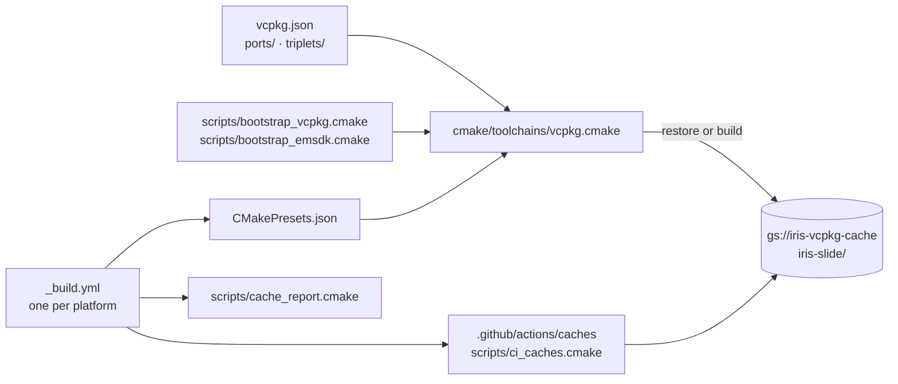

# Pipeline

How Iris-Slide's dependencies are pinned and built, how CI caches them, and
how pull requests are reviewed. Set by VcpkgCaching_2 (2026-11-24); rule 10 by
ReviewBot_17.8 (2026-11-24). The general CI rules are
[ci_runners.md](ci_runners.md); these are the rules specific to this
repository, numbered so a commit or a comment can cite one.



## Rules

1. **One manifest.** Every library Iris-Slide builds against, first-party and
   third-party, comes from `vcpkg.json` and is found with
   `find_package(<package> CONFIG REQUIRED)`. Nothing is fetched at configure:
   no FetchContent, no ExternalProject, no download in a CMake file
   (`tools/workflow_lint.py` refuses `ExternalProject_Add`). The library, the
   encoder, the Python modules and the JavaScript module share it; a CMake
   option selects a manifest feature (`library`, `encoder`, `openslide`,
   `python`, `tests`).
2. **vcpkg is pinned by its baseline.** `builtin-baseline` is the one vcpkg
   commit. The toolchain fetches vcpkg at it into `dependencies/vcpkg`
   (`scripts/bootstrap_vcpkg.cmake`) and refuses a vcpkg at another commit,
   since another commit changes every package's ABI hash and so misses every
   cached package. The fetch is a treeless partial clone: the overrides read
   old port trees from vcpkg's history, which a shallow clone lacks. The bootstrap reads each override's port tree itself, so vcpkg finds them
   local: vcpkg's own git, run with a cleaned environment, could not resolve
   github.com on Blacksmith's Windows runner. The toolchain ignores
   `VCPKG_ROOT`, which Visual Studio's environment points at its bundled vcpkg.
3. **Each direct dependency states its version** by an override in
   `vcpkg.json`, or by its overlay port in `ports/`. Third-party versions equal
   Iris-Headers' `cmake/dependencies.cmake` where vcpkg has them (table
   below); that file's duplicate pins go once Iris-Headers' consumers read
   them from here (PortsPinMain_17.6).
4. **First-party repositories are ports pinned by commit.** `ports/iris-headers`
   and `ports/iris-file-extension` fetch one commit's archive and check its
   SHA-512. A change across repositories is pinned to the paired branch's
   commit until it merges, then to main's. To build against a local checkout
   instead, `scripts/local_ports.cmake` writes overlay ports whose source is
   that checkout, passed as `-DVCPKG_OVERLAY_PORTS`; the checkout's commit and
   uncommitted changes are written into the port, so a package built from
   other source is never restored for it. Iris-Headers' downstream cell builds
   Iris-Slide this way.
5. **Prebuilt over built.** OpenSlide is openslide-bin, OpenSlide's own
   release, as a port (`ports/openslide-bin`): vcpkg's openslide port builds
   glib and cairo, one of whose tools needs autoconf, automake and libtool
   installed on the system. OpenSlide (LGPL-2.1) stays a shared library; every
   other package is static and release-only (`triplets/`).
6. **The store.** CI keeps vcpkg's packages and the compiler's objects (sccache)
   in `gs://iris-vcpkg-cache`, under `iris-slide/` only: `iris-slide/vcpkg/`
   and `iris-slide/sccache/` are main's, written only by `cache.yml` on main;
   `iris-slide/pr/...` is the pull requests' quarantine, which main and
   releases never read and which is deleted 7 days after it was written. Each
   package and object is uploaded as it is built, so a failed job still speeds
   up the next. Access per run (`scripts/ci_caches.cmake`): `quarantine` for
   pull requests and checks, `read` for releases, `write` for `cache.yml`, and
   `none` for a pull request from a fork, which GitHub gives no sign-in and
   which builds without the store; a public bucket was refused because anyone
   could then download from it at Aptix's expense.
7. **Google decides the account.** The job signs in by workload identity
   federation with no stored key (`tools/cloud_federation.sh`): a provider that
   admits only this repository, by repository ID and owner ID; the reader for
   every run, the writer only for `cache.yml` on `refs/heads/main`. The pool
   may host other repositories' providers, so Iris-Slide's attribute names are
   prefixed `iris_slide_` and no other provider can map them. The workflows
   read the provider and the project from the repository variables
   `IRIS_SLIDE_GCP_PROVIDER` and `IRIS_SLIDE_GCP_PROJECT`, and fail naming them
   while either is unset.
8. **A broken cache fails the job.** `scripts/cache_report.cmake` runs after
   every build, whatever its outcome: one line per cache on the run's summary
   page, and a failure on a binary-cache error, an empty install log, no
   compile through sccache, any sccache read or write error, or lookup errors
   with no hit or above one compile in twenty.
9. **One reusable build, CMake does the work.** `_build.yml` configures, builds
   and packages one cell and is called once per platform; Linux runs first,
   Windows and macOS only after it passes. Each `run:` step is one command, at
   most `MAX_RUN_LINES` (2) lines (`tools/workflow_lint.py`): a preset, or
   `cmake -P scripts/<name>.cmake`, which is the same on every operating
   system's shell and is tested in `tools/tests`.

10. **Every pull request from an Aptix-Bio branch is reviewed by the review bot.**
    `.github/workflows/review.yml` runs the Aptix review bot on every non-draft
    pull request whose head branch is in this repository, against
    `.github/review/rubric.toml`; the bot ticks the template's "Agent review"
    boxes (`.github/pull_request_template.md`), posts one comment, and fails the
    `code-review` check on a failed blocking item. The trigger is
    `pull_request_target`, so GitHub runs the workflow, and the bot reads the
    rubric, its reference files and `.github/CODEOWNERS`, as the default branch
    holds them: a pull request cannot change the rules it is judged by. Since
    that trigger gives the run the repository's secrets and a token that can
    write, each job checks out only the default branch's commit and the bot's
    pinned commit, and the bot reads the pull request's diff through the API as
    data; nothing from the head is checked out or run. The job that holds the
    model key reads only; the job that writes to the pull request never sees
    the key. The bot is kept in a private repository, and GitHub lets only
    private repositories use an action from a private repository
    ([GitHub, "Allowing access to components in a private repository"](https://docs.github.com/en/repositories/managing-your-repositorys-settings-and-features/enabling-features-for-your-repository/managing-github-actions-settings-for-a-repository),
    read 2026-11-24): each job checks the bot out at the commit
    `GOVERNANCE_COMMIT` names with the secret `GOVERNANCE_READ_TOKEN`, a token
    that can read that one repository's contents and nothing else, passed only
    to that checkout step and not persisted. The model key is the secret
    `ANTHROPIC_KEY`. A job whose secret is unset fails naming it
    (`cmake/require_settings.cmake`). The workflow is the review workflow
    every public Aptix repository runs, apart from comments and product text.

    **Forks.** A pull request from a fork is not reviewed by the model: under
    `pull_request_target` its run would hold the secrets while the model reads
    text the fork's author wrote. Both review jobs are skipped and the job
    "Fork pull requests get no model review" leaves a notice on the run. A
    maintainer reviews such a change by pushing its commits to an Aptix-Bio
    branch and opening a pull request from there, which the bot reviews.

    **Where to read a review:** each job's log (every line starts
    `review_bot:`), the run's summary page, the bot's comment on the pull
    request, and the `review-verdict` artifact (the full record, kept 90 days).
    `cmake/check_review_configuration.cmake`, in the `lint` job of `ci.yml`,
    holds the workflow's properties and the steps it shares with the other
    repositories; `tools/tests/test_review_configuration.py` holds the rubric,
    the template and the step order.

    ```mermaid
    flowchart LR
        PR["pull request<br/>from an Aptix-Bio branch"] -->|pull_request_target| W["review.yml<br/>as the default branch holds it"]
        F["pull request<br/>from a fork"] -->|pull_request_target| N["notice only"]
        W --> R["1. Aptix Review Agent<br/>ANTHROPIC_KEY · read-only"]
        W --> C["2. Update PR from Agent<br/>no key · pull-requests: write"]
        G[("review bot<br/>pinned commit")] -->|"GOVERNANCE_READ_TOKEN<br/>checkout only"| R
        G -->|"GOVERNANCE_READ_TOKEN<br/>checkout only"| C
        D[("default branch<br/>rubric · references · CODEOWNERS")] --> R
        D --> C
        R -->|"verdict artifact"| C
        C -->|"boxes · comment · check"| PR
    ```

## Pins

Read 2026-11-24 from vcpkg's registry at the baseline (`versions/`,
https://github.com/microsoft/vcpkg/tree/9eec002df1cd109f8f104cd966a763daf9751489)
and from each upstream's release.

| Dependency | Pinned | Iris-Headers pins | Source |
|---|---|---|---|
| vcpkg | `9eec002df1cd109f8f104cd966a763daf9751489` | — | release 2026.10.16, https://github.com/microsoft/vcpkg/releases/tag/2026.10.16 |
| Highway | 1.2.0 (override; floor 1.2.0) | 1.2.0 (floor 1.2) | vcpkg `versions/h-/highway.json` |
| libjpeg-turbo | 3.2.0#1 | 3.2.0 | vcpkg baseline |
| libavif | 1.4.2#1, feature `aom` (aom 3.15.2, libyuv 1916 from the baseline) | v1.4.2 | vcpkg baseline; the source build used aom and libyuv too |
| libpng | 1.6.50 (override) | v1.6.50 | vcpkg `versions/l-/libpng.json` (baseline 1.6.59) |
| zlib | 1.3.2#2 (baseline; libpng's dependency) | zlib-ng 2.3.3 | **differs**: vcpkg's libpng depends on the `zlib` port; zlib-ng's port builds its zlib-compatible library only when a triplet sets `ZLIB_COMPAT`, and the `zlib` port would still be installed for libpng. Ends with libpng (PngRemoved_4) |
| libdicom | 1.3.0#1 (overlay: vcpkg's port plus a CMake config) | v1.3.0 | vcpkg baseline |
| OpenSlide | openslide-bin 4.0.1.2 (OpenSlide 4.0.1), each archive by SHA-512 | 4.0.1.2 | https://github.com/openslide/openslide-bin/releases/tag/v4.0.1.2; GitHub's SHA-256 of each asset matched |
| Vulkan-Headers | 1.4.363.0 (override) | vulkan-sdk-1.4.363.0 | vcpkg baseline |
| VulkanMemoryAllocator | 3.4.0 (override) | v3.4.0 | vcpkg baseline |
| GLM | 1.0.3 (override) | 1.0.3 | vcpkg baseline |
| pybind11 | 3.1.0 (overlay: vcpkg's port without its python3 dependency) | v3.1.0 | vcpkg baseline; the archive's SHA-512 is vcpkg's |
| Catch2 | 3.15.1 (override, feature `tests`) | 3.15.1 | vcpkg `versions/c-/catch2.json` (baseline 3.16.0) |
| Iris-Headers | `4c78915a2627c18113047f405d2f56d16edfbe59` (feature/TileEncodingAv1_1, on main) | — | the paired branch: tile encoding 3 is `TILE_ENCODING_AV1` (decided 2026-11-25, ARCHITECTURE X7), until it merges (PortsPinMain_17.6); the rename (Aptix-Bio/Iris-Headers#5, X4) is merged into main |
| Iris-File-Extension | `45845fb3bc42af431588503c856da7281cda70b8` (feature/VcpkgCaching_2, on feature/PngRetiredClinicalWriter) | — | the paired branch, until it merges |
| Emscripten SDK | 6.0.13, `35659964bc2762fffec0d257997fb61475f765b7` | — | https://github.com/emscripten-core/emsdk/releases/tag/6.0.13 |
| sccache | v0.19.0 | — | through mozilla-actions/sccache-action v0.0.11 |

## Building locally

`cmake --workflow --preset release` (or `cmake --preset release` and
`cmake --build --preset release`) fetches vcpkg into `dependencies/`, builds the
packages once into `dependencies/vcpkg-archives`, and restores them in every
later build folder. vcpkg needs `pkg-config` on macOS and Linux (Homebrew's
`pkgconf`, or `PKG_CONFIG` naming one). The JavaScript module is
`cmake --workflow --preset wasm` in `javascript/`, which also fetches the
Emscripten SDK. `-DIRIS_SYSTEM_DEPENDENCIES=ON` skips vcpkg and finds the same
packages installed on the system.
