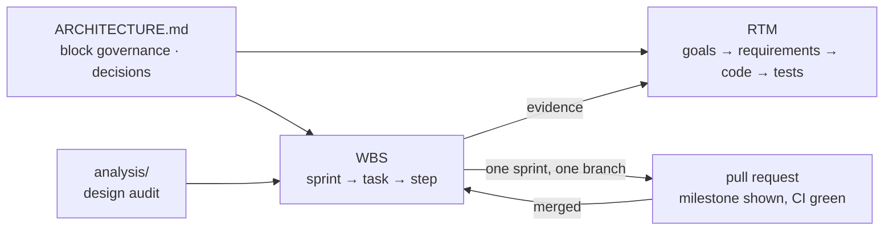

# development/

How Iris-Slide is planned, tracked and verified before and after it becomes
public. The design contract is [ARCHITECTURE.md](ARCHITECTURE.md): the
governance and provenance of every block of the Iris File Extension that
Iris-Slide reads or writes, and the decisions that follow from it. This folder
breaks that contract down to sprints, tasks and requirements. Product
documentation lives next to the code.

| File | Use it to… |
|---|---|
| [ARCHITECTURE.md](ARCHITECTURE.md) | know who governs each IFE block, where its content comes from, whether it may identify a patient, and which code writes and reads it |
| [WBS.md](WBS.md) | track the work sprint by sprint: each sprint's milestone and pull request, its tasks and their red-first steps, each tick with its evidence; the session log |
| [RTM.md](RTM.md) | trace each requirement back to Ryan's goals and forward to code and tests, with status |
| [style_guide.md](style_guide.md) | the binding conventions for code, plans and prose |
| [ci_runners.md](ci_runners.md) | the rules every workflow follows: when a runner runs, reuse, caches, robustness |
| [PIPELINE.md](PIPELINE.md) | the dependency pins, the vcpkg ports and triplets, the cache store and who may write it, and the numbered pipeline rules |
| [analysis/](analysis/) | dated analyses the plan was built from, kept as written: the design audit of 2026-11-24 |

## How a sprint runs

A sprint is one work package of the WBS: a few days of work that ends in a
milestone someone can see working, and one pull request.

1. The branch is named after the sprint (`feature/DecodeSafety_3`), chosen
   before the first push, since renaming a pull request's head branch closes
   the pull request.
2. Each task starts with a test shown red, recorded with its failure; then the
   code that turns it green, with the evidence (test counts, the command run).
3. The milestone is demonstrated: the sprint's **Shown by** command, which
   anyone can run, and its output pasted into the pull request.
4. The sprint ends with a **VERIFY** step for Ryan and a **Gate** step: CI
   green on the pull request. Nothing from the next sprint is started on the
   same branch.
5. A sprint that changes the public headers has a paired branch of the same
   name in Iris-Headers, merged first. A task that waits on one of Ryan's
   answers is marked `blocked` and does not hold its sprint.

Sprints that touch different files run in parallel; [WBS.md](WBS.md) draws
the order and names the lanes.

The pull request's description has these sections, in this order: Summary ·
WBS (the sprint's tasks, ticked, with evidence and commit links) · RTM (rows
changed, with evidence) · Decisions (dated, with Ryan's words) · Measurements
(when any were taken) · Test results (per cell, local and CI) · Red first ·
Failures fixed (symptom, root cause, fix, commit) · Clinical impact (what a
pathologist would see differently) · Security impact (new input parsed? new
dependency? patient data in the diff, logs or fixtures?).

**Naming:** every ID says what it is. A WBS item is `PascalCaseName_<number>`
(`DecodeSafety_3`, `JpegSizedFromHeader_3.1`); an RTM row is
`PascalCaseArea_<nn>` (`Decode_01`); a goal is `Goal_<nn>`. No abbreviations.

**Update rule:** a commit that changes code updates the WBS steps it completes
and the RTM rows it touches, in the same commit, and the step names the
commit once it exists. Commits are staged by explicit path.
