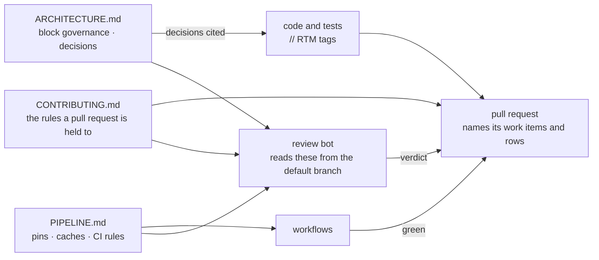

# development/

How Iris-Slide is designed and built. The design contract is
[ARCHITECTURE.md](ARCHITECTURE.md): the governance and provenance of every
block of the Iris File Extension that Iris-Slide reads or writes, and the
decisions that follow from it. The rules a pull request is held to are
[../CONTRIBUTING.md](../CONTRIBUTING.md). Product documentation lives next to
the code.

The plans (the work items with their ticks and session log, the requirement
rows with their status, and the analyses they were built from) and the family's
general conventions are kept privately since 2026-11-27; the review bot reads
them, and each of its findings names the rule it applies.

| File | Use it to… |
|---|---|
| [ARCHITECTURE.md](ARCHITECTURE.md) | know who governs each IFE block, where its content comes from, whether it may identify a patient, and which code writes and reads it |
| [PIPELINE.md](PIPELINE.md) | the dependency pins, the vcpkg ports and triplets, the cache store and who may write it, and the numbered pipeline rules |
| [../CONTRIBUTING.md](../CONTRIBUTING.md) | the rules a pull request is held to, as facts of this codebase |

## Pull request description

The sections, in this order: Summary · WBS (the work items it completes or
advances, by ID) · RTM (the requirement rows it touches, by ID) · Decisions
(dated, each stated as a plain requirement) · Measurements (when any were
taken) · Test results (per cell, local and CI) · Red first · Failures fixed
(symptom, root cause, fix, commit) · Clinical impact (what a pathologist would
see differently) · Consumer impact (what Iris-Slide's consumers must change for
a moved pin or a public API or Python change, and the merge order of a
coordinated change) · Security impact (new input parsed? new dependency?
patient data in the diff, logs or fixtures?) · AI authorship (which parts an AI
agent wrote, with which tool, and what the maintainer did).
`.github/pull_request_template.md` holds these sections, then the "Agent review"
boxes the review bot ticks against `.github/review/rubric.toml`
([PIPELINE.md](PIPELINE.md), rule 10).

## Identifiers

Every ID says what it is. A work item is `PascalCaseName_<number>`
(`DecodeSafety_3`, `JpegSizedFromHeader_3.1`); a requirement row is
`PascalCaseArea_<nn>` (`Decode_01`); a goal is `Goal_<nn>`. No abbreviations.
An ID is never renumbered or reused, because commits, pull requests and code
tags refer to it. ARCHITECTURE.md numbers its own decisions (D*n*), defects
(E*n*), open questions (Q*n*) and external dependencies (X*n*); a finding of the
design audit of 2026-11-24 is cited with the prefix *audit* (audit C3).
