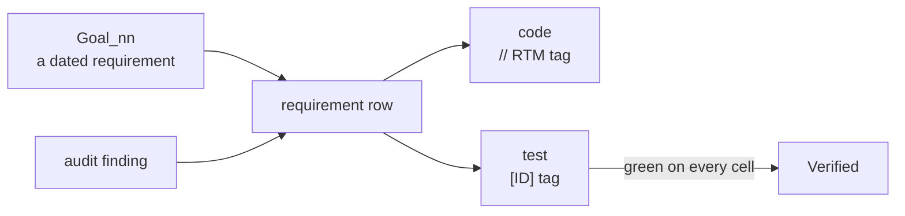

# Requirements Traceability Matrix

Every requirement traces back to the goal it serves and forward to the code
that satisfies it and the tests that prove it. A requirement is **Verified**
only when its tests run green on every CI cell that runs them; code alone is
**Implemented**.

- **Source:** `Goal_nn` (below) · `Dn`, `En`, `Qn`, `Xn` = a decision,
  defect, open question or external dependency of
  [ARCHITECTURE.md](ARCHITECTURE.md) · `C`, `A`, `B` + number and
  "audit Dn" = a finding of
  [the design audit](analysis/design_audit_2026-11-24.md).
- **Sprint:** the [WBS](WBS.md) sprint that delivers the row.
- **Status:** Planned → Implemented → Verified (or Partial / Blocked, with a
  note); Retired when the maintainer drops it (the ID is never reused).
- **Tests:** `Unit` · `Contract` (a public call's promise) · `Integration`
  (the encoder or a binding end to end) · `Hostile` (a damaged or hostile
  stream, under AddressSanitizer) · `Concurrency` (under ThreadSanitizer) ·
  `Static` (a gate that reads the source or settings) · `Benchmark` ·
  `Review` (a document the maintainer reads; no test can prove it).
- **Tags:** a comment line `// RTM <ID>[, <ID>…]` (C++) or `# RTM <ID>[, <ID>…]`
  (Python, CMake, workflows) on the code and the test; Catch2 tests also carry
  the tag `[<ID>]`.

## Goals

| Goal | Requirement, as decided 2026-11-24 (later goals dated in the row) |
|---|---|
| Goal_01 | Iris-Codec is renamed Iris-Slide and is the open-source decoder and encoder of slide files |
| Goal_02 | A decoder sizes its destination buffer from the JPEG stream's own encoded size, so the buffer is exact and cannot overflow; the same sizing applies to every codec |
| Goal_03 | PNG is not used for tiles |
| Goal_04 | Patient information goes only in the clinical (HL7 / FHIR) block, never in the metadata block |
| Goal_05 | Every finding is fixed before the repository is released publicly; until then the work is private |
| Goal_06 | `development/` holds an architecture document recording the governance and provenance of every block of the IFE specification |
| Goal_07 | The proprietary codec may be referenced; it is linked at run time, for those who pay its royalties; every other codec is open |
| Goal_08 | The WBS runs as short agile sprints, each tested and ending in a milestone and a pull request |
| Goal_09 | SVG is the preferred annotation format, and PNG is removed entirely |
| Goal_10 | A separate I2S repository specifies what a scanner records about a slide when it is first scanned (accessioning number, stain, time, date, the scanner's unique device identifier): indelible characteristics of the slide, kept apart from patient HL7 metadata |
| Goal_11 | Re-encoding refuses PNG too |
| Goal_12 | I2S is a JSON specification compiled into C++ source, as IFE is |
| Goal_13 | The accessioning number is named DigitalImageIdentifier (DII) |
| Goal_14 | The DII carries a separate boolean, `DII_is_PHI`, saying whether a de-identifier must scramble it |
| Goal_15 | An absent `DII_is_PHI` flag defaults to true: the DII is scrambled |
| Goal_16 | CI builds Iris-Slide's dependencies prebuilt through vcpkg on the pull requests of every branch, every build cache shared, the compiler cache included, on Blacksmith runners |
| Goal_17 | Every dependency comes from vcpkg; Iris-Slide's CMake fetches nothing itself |
| Goal_18 | Workflows are few and unified; their logic lives in CMake presets and scripts, with little shell in the workflow files |
| Goal_19 | Every pull request is code-reviewed by the Aptix review bot against Iris-Slide's own rules; the bot's repository stays private; a fork's pull request is reviewed by the model only after a maintainer pushes it to an Aptix-Bio branch |
| Goal_20 | Decided 2026-11-25: the AVIF tile encoding is removed from the Iris format; tile encoding 3 is `TILE_ENCODING_AV1`, a bare AV1 sequence in the AV1 Low Overhead Bitstream Format, one shown frame per focal plane, a single-plane tile one key frame, no container; no compatibility path for AVIF tiles; AVIF associated images stay |
| Goal_21 | Decided 2026-11-25: Iris-Slide's encoder takes a slide's I2S attributes from its caller and writes them into the `.iris` file as a `METADATA_I2S` attribute block; Iris-Slide does not depend on I2S, so the caller passes plain key and value text with the I2S version |
| Goal_22 | Decided 2026-11-25: tile encodings 4 and 5 are the GPU block-compressed `TILE_ENCODING_UASTC` (one Zstandard frame of UASTC LDR 4x4 blocks) and `TILE_ENCODING_XUASTC` (one XUASTC LDR bitstream), bare; a UASTC tile written by the encoder is no bigger than its JPEG at the quality bar, within a margin the maintainer sets |

## Requirements

| ID | Requirement | Source | Sprint | Tests | Status |
|---|---|---|---|---|---|
| Governance_01 | Every IFE block Iris-Slide reads or writes has a recorded governing authority, provenance per source, identity class, writer and reader | Goal_06 | DevelopmentDirectory_0 | Review | Planned |
| Process_01 | Work runs in sprints that each end in a milestone and one pull request, every task red first | Goal_08 | DevelopmentDirectory_0 | Review | Planned |
| Testing_01 | `ctest` runs the library's tests on every cell | B4 | TestHarness_1 | Static | Partial: `tests/` with Catch2 (`IRIS_SLIDE_BUILD_TESTS`, on in the `debug` preset) and the `debug` test preset, begun 2026-11-25 for Decode_09; no CI cell runs it yet (CiRunsTests_1.5) |
| Testing_02 | Debug, release, AddressSanitizer/UndefinedBehaviorSanitizer and ThreadSanitizer presets | B4 | TestHarness_1 | Static | Planned |
| Testing_03 | A slide is built, opened and decoded inside the tests, with no slide file checked in | B4 | TestHarness_1 | Integration | Planned |
| Testing_04 | CI runs the tests, cheapest cell first | B4, B5 | TestHarness_1 | Static | Planned |
| Decode_01 | A JPEG tile decode, and a JPEG or AVIF associated-image decode, sizes its destination from the stream's own header and cannot write past it; a tile whose stream is not the tile's extent is refused naming both sizes (AVIF tiles removed 2026-11-25, Goal_20) | Goal_02, D3, C1, C13 | DecodeSafety_3 | Hostile, Unit | Planned |
| Decode_02 | Retired 2026-11-24: PNG is cut (Decode_03), so no PNG decoder remains to size | Goal_02, C2 | — | — | Retired |
| Decode_03 | Iris-Slide neither writes nor decodes PNG; reading a PNG image or annotation, or re-encoding a source that carries one, is refused naming its encoding; SVG is the preferred annotation form | Goal_03, Goal_09, Goal_11, C2 | PngRemoved_4 | Unit, Static | Planned |
| Decode_04 | A decode into a caller's buffer uses it when large enough and sets its size; a smaller one is refused naming both sizes | C13 | DecodeSafety_3 | Contract | Planned |
| Decode_05 | Bytes per pixel is defined once and throws on an undefined format | C6, A4 | DecodeSafety_3 | Hostile | Planned |
| Decode_06 | No buffer passed to a codec library can be reallocated or freed by another allocator | C15 | DecodeSafety_3 | Unit | Planned |
| Decode_07 | A public `decompress_tile` decodes a span into the caller's buffer and returns a `Result`; the CPU library declares no GPU types | A1 | CallerBufferDecode_5 | Contract | Planned |
| Decode_08 | A tile's expected extent is the file's TILE_LENGTH | D3, E3 | DecodeSafety_3 | Hostile | Planned |
| Decode_09 | A tile table declaring `TILE_ENCODING_AV1` is refused with an error naming the encoding, on decode, on encode and as an encoder source, until Q11 decides AV1 tile decoding; no tile stream reaches libavif | Goal_20, D9, Q11 | DecodeSafety_3 (TileEncodingAv1Refused_3.6, built ahead on ReviewBot_17.8) | Unit | Implemented: decode and encode refusals tested (`tests/tile_encoding_test.cpp`, `[Decode_09]`); the encoder's source refusal untested until EndToEndSuite_7.1 [bed76a7](https://github.com/Aptix-Bio/Iris-Slide/commit/bed76a753b09cb1e59b2609e0c8eeaf06ca4237b) |
| Decode_10 | A tile table declaring `TILE_ENCODING_UASTC` or `TILE_ENCODING_XUASTC` is refused with an error naming the encoding, on decode, on encode and as an encoder source, until Q13 and Q14 decide transcoding and encoding | Goal_22, D11, Q13, Q14 | DecodeSafety_3 (TileEncodingBlocksRefused_3.7, built ahead on ReviewBot_17.8) | Unit | Implemented: decode and encode refusals tested (`tests/tile_encoding_test.cpp`, `[Decode_10]`); the encoder's source refusal untested until EndToEndSuite_7.1 [fb00bec](https://github.com/Aptix-Bio/Iris-Slide/commit/fb00becc97da74bb0d1dbf0a980f769a16203e9d) |
| Decode_11 | A UASTC tile's level 0 is transcoded to RGBA8 into a buffer sized from TILE_LENGTH, its Zstandard frame's content first checked against the sum of the 16-byte blocks of the `MIP_LEVELS` levels IFE's tile table declares; XUASTC follows IFE's OD-T3 | Goal_22, D11, Q13 | BlockTileTranscode_5.5 | Unit | Planned |
| Identity_01 | Attributes are written only as `METADATA_I2S` and hold no patient identity, from every source | Goal_04, C3, E1 | PatientIdentity_6 | Integration | Planned |
| Identity_02 | The command line, C++ and Python reach the same identity handling | C3 | PatientIdentity_6 | Integration | Planned |
| Identity_03 | Associated images that show identity (label, macro) are handled as the maintainer decides | Goal_04 | PatientIdentity_6 | Integration | Blocked (Q2) |
| Identity_04 | The clinical stream (HL7 v2, FHIR JSON, FastFHIR) is written as the maintainer's answer to Q6 says | Goal_04 | PatientIdentity_6 | Integration | Blocked (Q6) |
| Identity_05 | Attribute keys come from one allow-list, and from I2S's generated C++ once I2S publishes; no `METADATA_DICOM` or `METADATA_FREE_TEXT` attributes are written | Goal_10, Goal_12, D8, E2, Q5 | PatientIdentity_6 | Integration, Static | Planned; the I2S source Blocked (X3) |
| Identity_06 | The encoder writes the `DigitalImageIdentifier` with its `DII_is_PHI` flag; de-identification scrambles the DII when the flag is true or absent and leaves it unchanged when false | Goal_13, Goal_14, Goal_15, D8, Q10 | PatientIdentity_6 | Integration | Planned; who sets the flag waits on Q10 |
| Identity_07 | The caller's I2S pairs (`EncodeSlideInfo::attributes`) are written as the slide's one `METADATA_I2S` attributes block with the caller's version, in place of the source's pairs; a key that is not ASCII or past 16 bits of size, a value that is not UTF-8, attributes past the 32-bit byte count, another format or version 0 are refused before the source is opened, naming the pair or the value | Goal_21, D2, D10, Q12 | PatientIdentity_6 (EncoderTakesI2S_6.8, built ahead on ReviewBot_17.8) | Integration | Implemented: `tests/encoder_attributes_test.cpp`, `[Identity_07]`; the Python binding's `i2s_attributes` and `i2s_version` reach the same check; the command line waits on CommandLineHonest_7.3 [2d1667b](https://github.com/Aptix-Bio/Iris-Slide/commit/2d1667b8f46696fecbce46e4a3125076757a7ee8) |
| Encode_01 | A tile stream passes through only when its encoding equals the requested one | C5 | EncoderCorrectness_7 | Integration | Planned |
| Encode_02 | Every encode failure is returned or exits non-zero; nothing is printed and skipped | C9, C14 | EncoderCorrectness_7 | Integration | Planned |
| Encode_03 | One source type per input owns its handle and reports its read errors | C10, A4 | SourceInterface_8 | Integration | Planned |
| Encode_04 | Transparent source regions are encoded white | C10 | SourceInterface_8 | Unit | Planned |
| Encode_05 | The scratch file sits beside the destination and is renamed into place; a concurrency of 0 is refused | C16 | EncoderCorrectness_7 | Integration | Planned |
| Encode_06 | Re-encoding a source with annotations or a clinical stream is refused naming the blocks, until they are passed through | E4, Q6, Q7 | EncoderCorrectness_7 | Integration | Planned |
| Encode_07 | A UASTC tile the encoder writes is no bigger than the same tile as JPEG at the quality bar, within the maintainer's margin (size parity) | Goal_22, D11, Q14 | BlockTileEncodeParity_7.7 | Integration | Planned |
| Encode_08 | The encoder writes no more UASTC mip levels than the layer step needs: when its configuration asks for more than round(log2(step)) + 1 (the step 2 under `-d 2x`, 4 under `-d 4x`, or the source pyramid's), it warns that the extra levels waste space, naming the configured count and the cap, and encodes as configured | Goal_22, D11, Q15 | BlockTileEncodeParity_7.7 | Integration | Planned; the warning's channel waits on Q15 |
| Concurrency_01 | The encoder's shared state has no data race under ThreadSanitizer | C8 | EncoderConcurrency_9 | Concurrency | Planned |
| Concurrency_02 | Every encoder thread is owned and joined by its owner; dropping the last handle interrupts and frees everything | C7, C16, A5, A6 | EncoderConcurrency_9 | Concurrency | Planned |
| Concurrency_03 | No exception escapes an encoder boundary | C7 | EncoderConcurrency_9 | Unit | Planned |
| Dicom_01 | A DICOM series with no ICC profile encodes with none | C4 | DicomBridge_10 | Integration | Planned |
| Dicom_02 | The DICOM walk uses a bounded queue and owns every handle and string | C11 | DicomBridge_10 | Hostile | Planned |
| Dicom_03 | Frame positions, scale and transfer syntax are read correctly or refused by name | C12 | DicomBridge_10 | Integration | Planned |
| Api_01 | Every exported declaration has a definition | A2 | ApiSurface_11 | Static | Planned |
| Api_02 | Decoder and encoder are separate libraries; nothing links what it does not use | A3, B2 | ApiSurface_11 | Static | Planned |
| Api_03 | Every public call returns a `Result` and creates objects in the `create_<name>(Desc, out)` form | C14, A1, A4 | ResultBoundaries_12 | Contract | Planned |
| Api_04 | Multi-plane tile streams are readable by plane or refused by name | A9 | ResultBoundaries_12 | Contract | Planned |
| Api_06 | Every call Iris-Slide makes into IFE's read path checks the `Result` it returns (IFE R-8): a damaged file, a missing tile or a missing label fails with IFE's message naming the value | C14 | ResultBoundaries_12 | Integration: the build against IFE's paired branch, IFE's CI `Iris-Slide builds against this branch` | Implemented [ced3309](https://github.com/Aptix-Bio/Iris-Slide/commit/ced330985c19e2c8a7d515db2cc9cfc6e35a1632) |
| Api_05 | `MetadataType` and `ImageOrientation` hold IFE 1.1's values | E1, Q9, X2 | ApiSurface_11 | Static | Planned |
| Hygiene_01 | clang-tidy and warnings-as-errors are silent; no reserved identifiers, macros for constants or `goto` | A7 | CodeHygiene_13 | Static | Planned |
| Hygiene_02 | Comments state what the code does | audit D2 | CodeHygiene_13 | Review | Planned |
| Licensing_01 | A licensed codec is loaded at runtime; without it, its encoding is refused by name; no proprietary code is linked | Goal_07 | LicensedCodecInterface_14 | Contract | Blocked (Q3, Q4) |
| Bindings_01 | Python raises on every failure and releases the interpreter lock while decoding | A8, C14 | PythonBinding_15 | Integration | Planned |
| Bindings_02 | Python stubs are generated and pass `mypy --strict` | A8 | PythonBinding_15 | Static | Planned |
| Bindings_03 | The WASM module opens files of 4 GiB and more and reports every failure one way | C17, A4 | WasmBinding_16 | Unit | Planned |
| Build_01 | Every dependency is pinned by commit SHA or hash | B1 | VcpkgCaching_2, WorkflowRunners_17 | Static | Partial: vcpkg at a commit, each third-party library by a `vcpkg.json` override or a ported archive's SHA-512, Iris-Headers and IFE by commit and SHA-512 (ports/); `pyproject.toml`'s build requirements remain (BuildRequirementsPinned_17.1) |
| Build_02 | Workflows follow `ci_runners.md` and PIPELINE.md: Blacksmith runners, pinned actions, content-keyed caches, timeouts, bounded parallelism, one reusable build, `run:` steps of one command | B5 | VcpkgCaching_2 | Static (`tools/workflow_lint.py`, `tools/tests`) | Implemented |
| Build_03 | Release artifacts are checked for architecture, compression and that they run | B6 | WorkflowRunners_17 | Static | Planned |
| Build_04 | Build settings are scoped to targets; the version is parsed once | B3, B7, A4 | VcpkgCaching_2, WorkflowRunners_17 | Static (`tools/workflow_lint.py`) | Partial: target-scoped and `hwy.cmake` deleted; the version parse remains (VersionParsedOnce_17.2) |
| Build_05 | Every dependency comes from `vcpkg.json`, prebuilt from vcpkg's binary cache, and is found by `find_package(... CONFIG REQUIRED)`; nothing is fetched at configure, for the library, the encoder, the Python modules and the JavaScript module | Goal_17, B5 | VcpkgCaching_2 | Static (`tools/workflow_lint.py`: no ExternalProject), Integration (the encoder round trip) | Implemented [05043cb](https://github.com/Aptix-Bio/Iris-Slide/commit/05043cbc0be17ec4915c446959a00861a2eb01fa) |
| Build_06 | CI shares vcpkg's packages and the compiler's objects through one store on every branch: pull requests write a quarantine main never reads, only `cache.yml` on main writes main's, a fork builds without it, and a broken cache fails the job | Goal_16, Goal_18 | VcpkgCaching_2 | Unit (`tools/tests/test_ci_scripts.py`), Integration (the pull request's `ci` run) | Implemented [a742868](https://github.com/Aptix-Bio/Iris-Slide/commit/a742868a444738e5ffc3266306ffbafd67b1fc53) |
| Review_01 | Every non-draft pull request from an Aptix-Bio branch is reviewed by the review bot against `.github/review/rubric.toml` read from the default branch: `pull_request_target`; only the default branch and the bot's pinned commit checked out, the head read as data through the API; `permissions: {}` and each job's least privilege; the model key and the write token in separate jobs; the bot's read token confined to the step that checks the bot out; a missing secret fails the job naming it; a fork's pull request skipped with a notice; the workflow is the one every public Aptix repository runs, apart from comments and product text | Goal_19 | WorkflowRunners_17 | Static (`cmake/check_review_configuration.cmake`, `tools/tests/test_review_configuration.py`, `tools/workflow_lint.py`) | Implemented [d32cbe6](https://github.com/Aptix-Bio/Iris-Slide/commit/d32cbe6eb6bc6db37e365934ffaffb571929e310) [060a20a](https://github.com/Aptix-Bio/Iris-Slide/commit/060a20a55f1b9a7e8e43eaf6e2a0ef8c13d4d4d0) |
| Performance_01 | Tile reads per second are measured against the paper's figure and held by a gate | audit §4 | ReadBenchmark_18 | Benchmark | Planned |
| Performance_02 | The size and encode time of tile frames on single-plane layers are measured for Q8 | Q8 | ReadBenchmark_18 | Benchmark | Planned |
| Release_01 | The documents describe the code, and a fresh audit finds no open finding | Goal_05, audit D1, audit D3 | PublicRelease_19 | Review | Planned |
| Release_02 | Package names are Aptix's before anything publishes; third-party notices ship | Goal_05 | PublicRelease_19 | Review | Planned |
