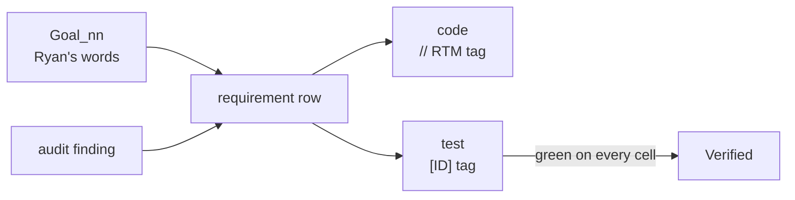

# Requirements Traceability Matrix

Every requirement traces back to the goal it serves and forward to the code
that satisfies it and the tests that prove it. A requirement is **Verified**
only when its tests run green on every CI cell that runs them; code alone is
**Implemented**.

- **Source:** `Goal_nn` (below) · `Dn`, `En`, `Qn`, `Xn` = a decision,
  defect, open question or external dependency of
  [ARCHITECTURE.md](ARCHITECTURE.md) · `C`, `A`, `B` + number and
  "audit Dn" = a finding of
  [the design audit](analysis/design_audit_2026-11-24.md).
- **Sprint:** the [WBS](WBS.md) sprint that delivers the row.
- **Status:** Planned → Implemented → Verified (or Partial / Blocked, with a
  note); Retired when Ryan drops it (the ID is never reused).
- **Tests:** `Unit` · `Contract` (a public call's promise) · `Integration`
  (the encoder or a binding end to end) · `Hostile` (a damaged or hostile
  stream, under AddressSanitizer) · `Concurrency` (under ThreadSanitizer) ·
  `Static` (a gate that reads the source or settings) · `Benchmark` ·
  `Review` (a document Ryan reads; no test can prove it).
- **Tags:** a comment line `// RTM <ID>[, <ID>…]` (C++) or `# RTM <ID>[, <ID>…]`
  (Python, CMake, workflows) on the code and the test; Catch2 tests also carry
  the tag `[<ID>]`.

## Goals

| Goal | Ryan's words (2026-11-24) |
|---|---|
| Goal_01 | "re-name Iris-Codec to Iris-Slide and make that the open source decoder / encoder of slide files" |
| Goal_02 | "It should capture the size of the buffer based upon the JPEG's encoded size so it's exact and can't overflow." · "Fix that sizing too." |
| Goal_03 | "Let's get rid of PNG for tiles, yes? It should only be for annotations (but should be the preferred -- that should be vector (or do you think we should kill PNG all together?)" |
| Goal_04 | "The idea I have is that the patient info does NOT go in the metadata block only the patient info HL7/FFHIR block." |
| Goal_05 | "We should fix all things before we make this repo public" · "it's private while we work. I'll make it public once I like it" |
| Goal_06 | "In the development make a Architecture doc that shows the governance / providence of each block within the IFE spec so we are properly guided." |
| Goal_07 | "We can reference the proprietary codec but it's use will be runtime linked for those that pay royalties to use it. The other codecs are open" |
| Goal_08 | "make sure that the WBS shows a clean workflow with an agile design so that we are testing and developing in short sprints with milestones and PRs at the end of each block" |
| Goal_09 | "SVG preferred and let's just cut the PNG then. Simple is better." |
| Goal_10 | "We will need to make a I2S repo as well … the information that goes into the slide when it is initially scanned by different scanners (acessioning number, stain info, time, date, scanner info like unique device ID). These are the things that need to go into I2S because they're indelible characteristics of the slide and not patient HL7 metadata." |
| Goal_11 | "Yes, refuse PNG on re-encode too." |
| Goal_12 | "let's have I2S be a JSON specification that gets compiled into C++ source like the IFE" |
| Goal_13 | "We'll call the accessioning number DigitalSlideIdentifier(DSI)" |
| Goal_14 | "We can add in the description that DSI has a separate DSI_is_PHI:bool so we know if it needs to be scrambled during deidentification" |
| Goal_15 | "Absent flag should default to true, scramble it" |

## Requirements

| ID | Requirement | Source | Sprint | Tests | Status |
|---|---|---|---|---|---|
| Governance_01 | Every IFE block Iris-Slide reads or writes has a recorded governing authority, provenance per source, identity class, writer and reader | Goal_06 | DevelopmentDirectory_0 | Review | Planned |
| Process_01 | Work runs in sprints that each end in a milestone and one pull request, every task red first | Goal_08 | DevelopmentDirectory_0 | Review | Planned |
| Testing_01 | `ctest` runs the library's tests on every cell | B4 | TestHarness_1 | Static | Planned |
| Testing_02 | Debug, release, AddressSanitizer/UndefinedBehaviorSanitizer and ThreadSanitizer presets | B4 | TestHarness_1 | Static | Planned |
| Testing_03 | A slide is built, opened and decoded inside the tests, with no slide file checked in | B4 | TestHarness_1 | Integration | Planned |
| Testing_04 | CI runs the tests, cheapest cell first | B4, B5 | TestHarness_1 | Static | Planned |
| Decode_01 | A JPEG or AVIF decode sizes its destination from the stream's own header and cannot write past it; a tile whose stream is not the tile's extent is refused naming both sizes | Goal_02, D3, C1, C13 | DecodeSafety_2 | Hostile, Unit | Planned |
| Decode_02 | Retired 2026-11-24: PNG is cut (Decode_03), so no PNG decoder remains to size | Goal_02, C2 | — | — | Retired |
| Decode_03 | Iris-Slide neither writes nor decodes PNG; reading a PNG image or annotation, or re-encoding a source that carries one, is refused naming its encoding; SVG is the preferred annotation form | Goal_03, Goal_09, Goal_11, C2 | PngRemoved_3 | Unit, Static | Planned |
| Decode_04 | A decode into a caller's buffer uses it when large enough and sets its size; a smaller one is refused naming both sizes | C13 | DecodeSafety_2 | Contract | Planned |
| Decode_05 | Bytes per pixel is defined once and throws on an undefined format | C6, A4 | DecodeSafety_2 | Hostile | Planned |
| Decode_06 | No buffer passed to a codec library can be reallocated or freed by another allocator | C15 | DecodeSafety_2 | Unit | Planned |
| Decode_07 | A public `decompress_tile` decodes a span into the caller's buffer and returns a `Result`; the CPU library declares no GPU types | A1 | CallerBufferDecode_4 | Contract | Planned |
| Decode_08 | A tile's expected extent is the file's TILE_LENGTH | D3, E3 | DecodeSafety_2 | Hostile | Planned |
| Identity_01 | Attributes are written only as `METADATA_I2S` and hold no patient identity, from every source | Goal_04, C3, E1 | PatientIdentity_5 | Integration | Planned |
| Identity_02 | The command line, C++ and Python reach the same identity handling | C3 | PatientIdentity_5 | Integration | Planned |
| Identity_03 | Associated images that show identity (label, macro) are handled as Ryan decides | Goal_04 | PatientIdentity_5 | Integration | Blocked (Q2) |
| Identity_04 | The clinical stream (HL7 v2, FHIR JSON, FastFHIR) is written as Ryan's answer to Q6 says | Goal_04 | PatientIdentity_5 | Integration | Blocked (Q6) |
| Identity_05 | Attribute keys come from one allow-list, and from I2S's generated C++ once I2S publishes; no `METADATA_DICOM` or `METADATA_FREE_TEXT` attributes are written | Goal_10, Goal_12, D8, E2, Q5 | PatientIdentity_5 | Integration, Static | Planned; the I2S source Blocked (X3) |
| Identity_06 | The encoder writes the `DigitalSlideIdentifier` with its `DSI_is_PHI` flag; de-identification scrambles the DSI when the flag is true or absent and leaves it unchanged when false | Goal_13, Goal_14, Goal_15, D8, Q10 | PatientIdentity_5 | Integration | Planned; who sets the flag waits on Q10 |
| Encode_01 | A tile stream passes through only when its encoding equals the requested one | C5 | EncoderCorrectness_6 | Integration | Planned |
| Encode_02 | Every encode failure is returned or exits non-zero; nothing is printed and skipped | C9, C14 | EncoderCorrectness_6 | Integration | Planned |
| Encode_03 | One source type per input owns its handle and reports its read errors | C10, A4 | SourceInterface_7 | Integration | Planned |
| Encode_04 | Transparent source regions are encoded white | C10 | SourceInterface_7 | Unit | Planned |
| Encode_05 | The scratch file sits beside the destination and is renamed into place; a concurrency of 0 is refused | C16 | EncoderCorrectness_6 | Integration | Planned |
| Encode_06 | Re-encoding a source with annotations or a clinical stream is refused naming the blocks, until they are passed through | E4, Q6, Q7 | EncoderCorrectness_6 | Integration | Planned |
| Concurrency_01 | The encoder's shared state has no data race under ThreadSanitizer | C8 | EncoderConcurrency_8 | Concurrency | Planned |
| Concurrency_02 | Every encoder thread is owned and joined by its owner; dropping the last handle interrupts and frees everything | C7, C16, A5, A6 | EncoderConcurrency_8 | Concurrency | Planned |
| Concurrency_03 | No exception escapes an encoder boundary | C7 | EncoderConcurrency_8 | Unit | Planned |
| Dicom_01 | A DICOM series with no ICC profile encodes with none | C4 | DicomBridge_9 | Integration | Planned |
| Dicom_02 | The DICOM walk uses a bounded queue and owns every handle and string | C11 | DicomBridge_9 | Hostile | Planned |
| Dicom_03 | Frame positions, scale and transfer syntax are read correctly or refused by name | C12 | DicomBridge_9 | Integration | Planned |
| Api_01 | Every exported declaration has a definition | A2 | ApiSurface_10 | Static | Planned |
| Api_02 | Decoder and encoder are separate libraries; nothing links what it does not use | A3, B2 | ApiSurface_10 | Static | Planned |
| Api_03 | Every public call returns a `Result` and creates objects in the `create_<name>(Desc, out)` form | C14, A1, A4 | ResultBoundaries_11 | Contract | Planned |
| Api_04 | Multi-plane tile streams are readable by plane or refused by name | A9 | ResultBoundaries_11 | Contract | Planned |
| Api_05 | `MetadataType` and `ImageOrientation` hold IFE 1.1's values | E1, Q9, X2 | ApiSurface_10 | Static | Planned |
| Hygiene_01 | clang-tidy and warnings-as-errors are silent; no reserved identifiers, macros for constants or `goto` | A7 | CodeHygiene_12 | Static | Planned |
| Hygiene_02 | Comments state what the code does | audit D2 | CodeHygiene_12 | Review | Planned |
| Licensing_01 | A licensed codec is loaded at runtime; without it, its encoding is refused by name; no proprietary code is linked | Goal_07 | LicensedCodecInterface_13 | Contract | Blocked (Q3, Q4) |
| Bindings_01 | Python raises on every failure and releases the interpreter lock while decoding | A8, C14 | PythonBinding_14 | Integration | Planned |
| Bindings_02 | Python stubs are generated and pass `mypy --strict` | A8 | PythonBinding_14 | Static | Planned |
| Bindings_03 | The WASM module opens files of 4 GiB and more and reports every failure one way | C17, A4 | WasmBinding_15 | Unit | Planned |
| Build_01 | Every dependency is pinned by commit SHA or hash | B1 | DependencyPins_16 | Static | Planned |
| Build_02 | Workflows follow `ci_runners.md` | B5 | WorkflowRunners_17 | Static | Planned |
| Build_03 | Release artifacts are checked for architecture, compression and that they run | B6 | WorkflowRunners_17 | Static | Planned |
| Build_04 | Build settings are scoped to targets; the version is parsed once | B3, B7, A4 | DependencyPins_16 | Static | Planned |
| Performance_01 | Tile reads per second are measured against the paper's figure and held by a gate | audit §4 | ReadBenchmark_18 | Benchmark | Planned |
| Performance_02 | The size and encode time of tile frames on single-plane layers are measured for Q8 | Q8 | ReadBenchmark_18 | Benchmark | Planned |
| Release_01 | The documents describe the code, and a fresh audit finds no open finding | Goal_05, audit D1, audit D3 | PublicRelease_19 | Review | Planned |
| Release_02 | Package names are Aptix's before anything publishes; third-party notices ship | Goal_05 | PublicRelease_19 | Review | Planned |
