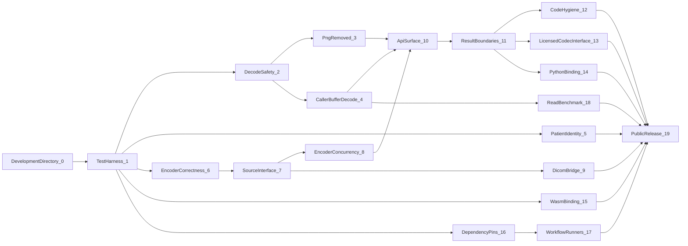

# Work Breakdown Structure

The tracking sheet for Iris-Slide's work, written top down: each **sprint**
states its purpose and the **milestone** that shows it done; each **task**
states what it achieves and the RTM rows it serves in brackets; the **steps**
under it are the checkable implementation, red first. Requirements live in
[RTM.md](RTM.md); block governance and the open questions in
[ARCHITECTURE.md](ARCHITECTURE.md); the findings each task closes in
[analysis/design_audit_2026-11-24.md](analysis/design_audit_2026-11-24.md)
(cited as C1–C17, A1–A9, B1–B8, and "audit D1"–"audit D3", since ARCHITECTURE.md numbers its own decisions D1–D8). E1–E4, Q1–Q10 and X1–X6 are
ARCHITECTURE.md's defects, open questions and external dependencies.

## Conventions

- **A sprint is one work package, one branch, one pull request.** It is sized
  to a few days and three to six tasks *(estimate, not measured)*, ends in a
  milestone that can be run and seen, and closes with **VERIFY** (Ryan
  reviews) and **Gate** (CI green on the pull request). The branch is
  `feature/<SprintName>_<n>`. [README.md](README.md) gives the pull request's
  sections.
- **Shown by** names the command that demonstrates the milestone. Its output
  is pasted into the pull request. The preset and test names are the ones the
  sprint creates, so a command may change while the sprint is built; the
  sprint's last tick records the command as run.
- **A paired branch.** A sprint that changes the public headers has a branch
  of the same name in Iris-Headers, merged first; the sprint's pull request
  then pins that commit. The two count as one block of work.
- **A sprint that grows past six ready tasks is split** before more work
  starts on it (blocked tasks are not counted), and a task found during a sprint that belongs to another sprint is
  written into that sprint.
- **A blocked task does not hold its sprint.** A task that waits on one of
  Ryan's answers or on another repository is marked `blocked` with the
  question or dependency it waits on. The sprint merges without it, and the
  task moves to the sprint that follows the answer.
- **Red first.** A task's first step is the test shown failing, with its
  failure quoted; the task is ticked only with the green evidence and the
  commit that made it. A task whose product is a measurement or a document
  has no red step and is ticked with the numbers or the review. A `blocked`
  task gains its red step when its answer arrives.
- **Status** after a sprint's name: `todo`, `ready` (its dependencies are
  merged), `doing`, `blocked` (with the reason), `done`.
- **One tick, one piece of evidence:** test counts and the command, a
  measurement, or a reviewed document; and the commit, once it exists.
- **Public release** waits on every sprint through PublicRelease_19 (Ryan,
  2026-11-24: "We should fix all things before we make this repo public").

## Sprint plan

Twenty sprints. Each audit finding is closed by one sprint; a finding with
several independent parts (A1, A4, C14, C16, audit D1, audit D3) names the
part each sprint closes. B8 needed no work: the audit searched an IFE checkout
without the rename (X4).

Four lanes run in parallel once TestHarness_1 is merged, since they touch
different files: decode (2, 3, 4, 18), identity (5), encoder (6, 7, 8, 9) and
build (15, 16, 17). The lanes meet at ApiSurface_10, which changes the public
header every lane uses.

| Sprint | Milestone (what is shown working) | Closes | Status |
|---|---|---|---|
| DevelopmentDirectory_0 | this folder reviewed: block governance, sprints, requirements | audit D3 (the design contract) | `doing` |
| TestHarness_1 | `ctest` green under AddressSanitizer on macOS and Linux, with a slide built, opened and decoded in the test | B4 | `blocked` on X4 |
| DecodeSafety_2 | hostile JPEG and AVIF streams refused naming both sizes under AddressSanitizer; every valid stream decoded into a buffer sized from its own header | C1, C6, C13, C15, E3, A4 (pixel layout, destination rule) | `todo` |
| PngRemoved_3 | the library builds without libpng and refuses a PNG image naming its encoding | C2, X6 | `todo` |
| CallerBufferDecode_4 | a program decodes a stream it read through IFE's `Parser` into its own buffer and receives a `Result` | A1 (decode call, GPU types) | `todo` |
| PatientIdentity_5 | a slide encoded from a source with patient fields reads back with none in its attributes, from the command line, C++ and Python; a DSI flagged as PHI is scrambled on de-identification | C3, E1, E2, audit D1 (metadata claims) | `todo`; three tasks `blocked` on Q2, Q6, X3 |
| EncoderCorrectness_6 | `IrisSlideEncoder` run end to end: every output tile decodes with the declared encoding, every failure exits non-zero | C5, C9, C14 (encoder), C16 (scratch file, zero concurrency), E4 | `todo` |
| SourceInterface_7 | one source type per input; a read error from any source fails the encode with that error; every handle closed | C10, A4 (sources, pyramid loops) | `todo` |
| EncoderConcurrency_8 | the encoder's lifecycle suite clean under ThreadSanitizer | C7, C8, C16 (destructor), A5, A6 | `todo` |
| DicomBridge_9 | DICOM fixtures encode correctly or are refused by name under AddressSanitizer | C4, C11, C12 | `todo` |
| ApiSurface_10 | every declaration in `IrisSlideCore.hpp` links against the installed decoder and encoder libraries | A2, A3, B2 | `todo`; one task `blocked` on Q7 |
| ResultBoundaries_11 | every public call returns a `Result`; no test writes to stderr | C14 (API), A1 (`create_` form), A4 (boundary helper), A9 | `todo` |
| CodeHygiene_12 | clang-tidy and warnings-as-errors silent over the tree | A7, audit D2 | `todo` |
| LicensedCodecInterface_13 | a test codec library loaded at run time decodes its encoding; without it, a refusal naming the encoding | Q3, Q4, X5 | `blocked` on Q3, Q4 |
| PythonBinding_14 | `pytest` and `mypy --strict` green; a failed read raises | A8, C14 (Python) | `todo` |
| WasmBinding_15 | the WASM module's prefix fetch passes against a 5 GiB window | C17, A4 (second `Slide_t`) | `todo` |
| DependencyPins_16 | a clean configure fetches every dependency at a recorded commit or hash | B1, B3, B7, A4 (version parse), X4 | `todo` |
| WorkflowRunners_17 | a workflow lint passes; a release-candidate tag produces checked artifacts | B5, B6 | `todo` |
| ReadBenchmark_18 | tiles per second measured against the paper, held by a gate | audit §4 (speed), Q8 | `todo` |
| PublicRelease_19 | the documents match the code, a fresh audit finds nothing open, Ryan makes the repository public | audit D1 (the rest), audit D3 (the rest) | `todo` |

## DevelopmentDirectory_0 — the plan travels with the code `doing`

Purpose: Ryan, 2026-11-24: "Start by making and updating a development
directory", with an architecture document "that shows the governance /
providence of each block within the IFE spec so we are properly guided".
Milestone: this folder, reviewed. Branch `feature/DevelopmentDirectory_0`.

- [x] **AuditKept_0.1** — the design audit of 2026-11-24 kept as written in
  `analysis/`, references to a proprietary consumer rewritten as a viewer's
  needs, B8 marked resolved
- [x] **RulesCopied_0.2** — `style_guide.md` (adapted from the Iris
  repositories' guide) and `ci_runners.md` (Ryan's CI rules)
- [ ] **BlockGovernance_0.3** — `ARCHITECTURE.md`: every IFE block's governing
  authority, provenance per source, identity class, writer and reader, state
  against the rule; decisions; open questions [Governance_01]
- [x] **SprintPlan_0.4** — this WBS, `RTM.md` and `README.md`, every audit
  finding owned by a sprint
- [x] **PlanReview_0.5** — an independent review that the WBS runs as short
  sprints, each ending in a milestone and a pull request (Ryan, 2026-11-24).
  Reviewed 2026-11-24 against the sprint model of five merged pull
  requests Ryan pointed to: 15 sprints became 20 (PNG removal, the source interface, the
  `Result` boundaries, the two bindings and the runners each became their
  own sprint); every task that changes code gained a red step and every sprint a command
  that shows its milestone; E1–E4, Q2–Q10 and X1–X6 each gained a task; the seven
  Mermaid diagrams of this folder render [Process_01]
- [ ] **VERIFY:** Ryan reviews this folder and answers the open questions
- [ ] **Gate:** the pull request merged (documents only, so no CI runs, by
  `ci_runners.md`)

## TestHarness_1 — every later sprint proves itself here `blocked` on X4 · needs DevelopmentDirectory_0

Purpose: the repository has no tests (B4). Milestone: `ctest` green under
AddressSanitizer on macOS and Linux, including a slide built by IFE's
`Builder`, opened and decoded in the test. Blocked until the renamed
Iris-File-Extension and Iris-Headers are merged (X4), since the tree compiles
only against them.

Shown by: `cmake --preset asan && cmake --build --preset asan && ctest --preset asan`

- [ ] **TestTarget_1.1** — `tests/` with Catch2 at the version Iris-Headers
  pins *(to confirm)*, `enable_testing()`, `IRIS_SLIDE_BUILD_TESTS`
  [Testing_01]
  - [ ] Red: `ctest --test-dir build` reports "No tests were found"
  - [ ] Green: one test runs
- [ ] **Presets_1.2** — `CMakePresets.json`: `debug`, `release`, `asan`
  (AddressSanitizer and UndefinedBehaviorSanitizer), `tsan`, each in
  `build/<preset>` [Testing_02]
  - [ ] Red: `cmake --preset asan` reports no such preset
- [ ] **FixtureSlide_1.3** — a 2 × 2-tile JPEG slide with attributes and one
  associated image, written in the test through IFE's `Builder` from
  generated pixels, so no slide file is checked in [Testing_03]
  - [ ] Red: the fixture's test fails to link until the helper exists
- [ ] **RoundTrip_1.4** — open the fixture, validate it, read its info, decode
  every tile, compare tile 0 with the pixels encoded (mean absolute error
  under a named bound) [Testing_03]
  - [ ] Red: the comparison run against a fixture whose tile 0 was replaced
    by another tile's pixels fails, which shows the test can fail
- [ ] **CiRunsTests_1.5** — the Linux workflow runs `ctest --preset asan` on
  Blacksmith (`blacksmith-2vcpu-ubuntu-2404`; Ryan, 2026-11-24: "We should be
  using blacksmith for our CI runners", since GitHub-hosted jobs in Aptix-Bio's
  private repositories stopped starting over billing that day); macOS and
  Windows run only after Linux passes (`ci_runners.md`, cheapest first). The remaining workflow rules are WorkflowRunners_17 [Testing_04]
  - [ ] Red: the pull request's Linux job shows no test step
- [ ] **VERIFY:** Ryan reads the round-trip test
- [ ] **Gate:** CI green on the pull request

## DecodeSafety_2 — a stream cannot write past its buffer `todo` · needs TestHarness_1

Purpose: decoding trusts declared sizes (C1, C13) and a fixed 256-pixel tile
(E3). Ryan, 2026-11-24: "It should capture the size of the buffer based upon
the JPEG's encoded size so it's exact and can't overflow" (ARCHITECTURE D3).
Milestone: under AddressSanitizer, a 512 × 512 JPEG in a 256-pixel tile and a
wrong-sized AVIF are each refused with both sizes, and every valid stream
decodes into a buffer sized from its own header.

Shown by: `ctest --preset asan -R Decode`

- [ ] **JpegSizedFromHeader_2.1** — `tj3DecompressHeader` first; the
  destination is sized from the stream's own width, height and the requested
  format; `TJPARAM_MAXPIXELS` set; `tj3Init` and every `tj3Set` checked; a
  tile whose stream is not the tile's extent is refused naming both sizes
  [Decode_01]
  - [ ] Red: the 512 × 512 stream in a 256 tile reports a heap-buffer-overflow
    under AddressSanitizer
- [ ] **TileLengthFromTheFile_2.2** — a tile's expected extent is the file's
  TILE_LENGTH in place of the constant 256 (E3) [Decode_08]
  - [ ] Red: a fixture with 512-pixel tiles overflows a 256 × 256 buffer
    under AddressSanitizer
- [ ] **OneDestinationRule_2.3** — one function decides the destination for
  every decoder: capacity checked, size set, a destination too small refused
  naming both sizes; `avifRGBImageSetDefaults` from the decoded image after
  its extent is checked (C13, A4) [Decode_01, Decode_04]
  - [ ] Red: a caller's AVIF destination is replaced by another buffer; a
    512 × 300 AVIF associated image fails to decode
- [ ] **PixelLayoutOnce_2.4** — one `bytes_per_pixel(Format)`, throwing on
  `FORMAT_UNDEFINED`, in place of seven switches (C6, A4) [Decode_05]
  - [ ] Red: deriving layers from an `R8G8B8` source over-reads under
    AddressSanitizer
- [ ] **EncoderBuffersOwned_2.5** — `TJPARAM_NOREALLOC` on compression;
  libavif's output copied into a `Buffer` or freed with libavif's own
  allocator (C15) [Decode_06]
  - [ ] Red: a test that compresses into a buffer one byte too small expects
    a refusal naming both sizes and receives a reallocated pointer
- [ ] **VERIFY:** Ryan reviews the hostile-stream tests
- [ ] **Gate:** CI green on the pull request

## PngRemoved_3 — one fewer codec to defend `todo` · needs DecodeSafety_2

Purpose: Ryan, 2026-11-24: "SVG preferred and let's just cut the PNG then.
Simple is better" (ARCHITECTURE D7). Removing the PNG decoder closes C2.
Milestone: the library builds with no libpng and refuses a PNG associated
image naming its encoding. Follows DecodeSafety_2 because both edit
`src/IrisSlideContext.cpp`.

Shown by: `ctest --preset asan -R Png`, and `cmake --build --preset release`
with no libpng on the link line

- [ ] **PngRefusedByName_3.1** — reading a PNG associated image or
  annotation returns a failure naming the image and `IMAGE_ENCODING_PNG`;
  re-encoding a source that carries one is refused the same way (Ryan,
  2026-11-24: "Yes, refuse PNG on re-encode too.") [Decode_03]
  - [ ] Red: a fixture with a PNG associated image decodes today, and
    re-encodes with the PNG passed through
- [ ] **AssociatedImagesAsJpegOrAvif_3.2** — the encoder writes associated
  images as JPEG or AVIF only [Decode_03]
  - [ ] Red: an encode that requests a PNG associated image succeeds today
- [ ] **LibpngLeavesTheBuild_3.3** — `cmake/png.cmake`, zlib-ng and the PNG
  codec removed from every target, the wheels and `licenses/` [Decode_03]
  - [ ] Red: a static check finds `png` in the link line of the decoder
- [ ] **EnumerationsFollowIfe_3.4** — Iris-Slide's enumerations follow IFE's
  retirement of the PNG values once it lands (X6) — `blocked` on that IFE
  change; the three tasks above do not wait on it
- [ ] **VERIFY:** Ryan reviews the refusal's message
- [ ] **Gate:** CI green on the pull request

## CallerBufferDecode_4 — a viewer decodes the streams it fetched `todo` · needs DecodeSafety_2

Purpose: decoding is reachable only through a slide opened from a path (A1).
Milestone: a program reads a tile stream through IFE's `Parser`, hands the
span to `IrisSlide::decompress_tile`, and receives its pixels in its own
buffer.

Shown by: `ctest --preset asan -R DecompressTile`, and the example program
in `examples/` decoding tile 0 of the fixture

- [ ] **DecompressTilePublic_4.1** — `[[nodiscard]] Result
  decompress_tile(const DecompressTileDesc&, Buffer& decoded) noexcept` over
  `std::span<const std::byte>`, JPEG and AVIF, RGB and RGBA [Decode_07]
  - [ ] Red: the contract test that the returned buffer is the caller's, its
    size set, for every encoding and format, fails to compile until the call
    exists
- [ ] **NoGpuTypesInCpuLibrary_4.2** — `Iris::Instance`, `Device` and `Queue`
  removed from `IrisSlideTypes.hpp`, in the paired Iris-Headers branch
  [Decode_07]
  - [ ] Red: a translation unit that declares its own `Iris::Device` and
    includes `IrisSlideTypes.hpp` fails to compile
- [ ] **DecodeExample_4.3** — a 30-line example that maps a file with IFE's
  `Parser` and decodes one tile, built and run by `ctest` [Decode_07]
  - [ ] Red: the example's test is registered before the example exists
- [ ] **VERIFY:** Ryan reviews the public signature
- [ ] **Gate:** CI green on both pull requests, Iris-Headers' first

## PatientIdentity_5 — patient identity lives only in the clinical stream `todo` · needs TestHarness_1

Purpose: asking to strip identifiers does nothing (C3). Ryan, 2026-11-24:
"The idea I have is that the patient info does NOT go in the metadata block
only the patient info HL7/FFHIR block" (ARCHITECTURE D2). Milestone: a fixture
with identifying vendor properties, encoded through the command line, C++ and
Python, reads back with attributes that hold no identity, and a
`DigitalSlideIdentifier` flagged as PHI is scrambled on de-identification.

Shown by: `ctest --preset asan -R Identity`, and the encoder's report listing
the properties it dropped

- [ ] **AttributesNeverIdentify_5.1** — the encoder writes attributes only as
  `METADATA_I2S`, from an allow-list of acquisition keys, for OpenSlide and
  DICOM sources alike; a source property off the list is dropped and counted
  in the encoder's report. This closes E1 on the writing side (no
  `METADATA_FREE_TEXT` is written) and E2 (no `METADATA_DICOM` keys are
  written). The allow-list is Q5's proposal and is the subject of this
  sprint's VERIFY, and it stands in for I2S's generated keys until 5.7
  [Identity_01, Identity_05]
  - [ ] Red: an OpenSlide-style source with `aperio.Filename` and a patient
    name property encodes both into its attributes
- [ ] **OneSwitchEveryPath_5.2** — the command line, C++ and Python reach the
  same behaviour; the dead `-sm` local and Python's unused `strip_metadata`
  removed [Identity_02]
  - [ ] Red: the same fixture encoded three ways gives three different
    attribute sets
- [ ] **ReadmeTruthful_5.3** — the README's metadata claims match the code
  (audit D1, the metadata claims) [Identity_02]
  - [ ] Red: a documentation test that runs the README's "strip metadata"
    example finds the patient property in the output
- [ ] **AssociatedImagesWithIdentity_5.4** — the label and macro images
  handled as Ryan's answer to Q2 says [Identity_03] — `blocked` on Q2
- [ ] **ClinicalStreamWritten_5.5** — the clinical stream written as Ryan's
  answer to Q6 says, through IFE's block tier (X1) [Identity_04] — `blocked`
  on Q6
- [ ] **DigitalSlideIdentifier_5.6** — Ryan, 2026-11-24: "We'll call the
  accessioning number DigitalSlideIdentifier(DSI)"; "We can add in the
  description that DSI has a separate DSI_is_PHI:bool so we know if it needs
  to be scrambled during deidentification" (ARCHITECTURE D8). The encoder
  writes the `DigitalSlideIdentifier` with its `DSI_is_PHI` flag, and the
  de-identify path scrambles the DSI when the flag is true or absent (Ryan,
  2026-11-24: "Absent flag should default to true, scramble it"). Who sets
  the flag at encode time follows Ryan's answer to Q10; until then the
  encoder writes the flag its caller gives and omits it otherwise
  [Identity_06]
  - [ ] Red: a fixture with `DSI_is_PHI` true de-identifies to the same DSI;
    so does a fixture with a DSI and no flag. Green when both de-identify
    to a different DSI and a fixture with the flag false keeps its DSI
    unchanged
- [ ] **AttributesFromI2S_5.7** — the allow-list of 5.1 replaced by the keys
  in the C++ source that I2S's generator emits from its JSON specification
  (Ryan, 2026-11-24: "let's have I2S be a JSON specification that gets
  compiled into C++ source like the IFE"), pinned by commit (X3)
  [Identity_05] — `blocked` until I2S publishes its first version
- [ ] **VERIFY:** Ryan reviews the allow-list and the fixture
- [ ] **Gate:** CI green on the pull request

## EncoderCorrectness_6 — the encoder writes what it declares `todo` · needs TestHarness_1

Purpose: the encoder can label JPEG tiles AVIF (C5), exit 0 on failure (C9),
drop an associated image with a printed line (C14), and lose a source's
annotations and clinical stream on a re-encode (E4). Milestone: a suite that
runs `IrisSlideEncoder` on a generated tiled TIFF and on the fixture slide
and checks every output tile decodes with the encoding the table declares,
and every failure exits non-zero.

Shown by: `ctest --preset asan -R EncoderEndToEnd`

- [ ] **EndToEndSuite_6.1** — the suite itself: the encoder run as a process,
  its exit code, its output file opened and every tile decoded [Encode_01,
  Encode_02]
  - [ ] Red: a failing encode exits 0
- [ ] **EncodingsAgree_6.2** — a stream passes through only when the source's
  encoding equals the requested one; otherwise it is decoded and recompressed
  (C5) [Encode_01]
  - [ ] Red: JPEG `.iris` source, AVIF requested, with and without
    derivation: tiles fail to decode
- [ ] **CommandLineHonest_6.3** — one `try` in `main`, a non-zero exit on
  every failure, an argument table, case-insensitive values, no locale
  assumed, `ioctl` checked (C9) [Encode_02]
  - [ ] Red: `-e avif` is refused; the tool aborts under the `C` locale
- [ ] **AssociatedImageFailuresReported_6.4** — a failed associated image
  fails the encode with its label and the reason (C14) [Encode_02]
  - [ ] Red: an image that cannot be compressed is skipped and the encode
    succeeds
- [ ] **ScratchBesideDestination_6.5** — the scratch file in the
  destination's directory, renamed into place; a concurrency of 0 refused by
  name (C16) [Encode_05]
  - [ ] Red: with the temp directory on another volume the slide is written
    twice; a concurrency of 0 fails with a message about unappended tiles
- [ ] **ReencodeRefusesWhatItWouldDrop_6.6** — re-encoding an `.iris` source
  that has annotations or a clinical stream is refused naming the blocks
  (E4). Passing them through waits on Q6 and Q7 [Encode_06]
  - [ ] Red: a source with one annotation re-encodes to a file with none and
    reports success
- [ ] **VERIFY:** Ryan encodes a vendor slide of his choosing with the new
  command line
- [ ] **Gate:** CI green on the pull request

## SourceInterface_7 — one source type per input `todo` · needs EncoderCorrectness_6

Purpose: five places switch on the source kind, raw handles are copied into
every thread, and a read error from OpenSlide is encoded as a black tile
(A4, C10). Milestone: OpenSlide, DICOM and `.iris` inputs each sit behind one
source type that owns its handle, and a read error from any of them fails
the encode with that error. The end-to-end suite of EncoderCorrectness_6
stays green throughout, which is what makes this refactor safe.

Shown by: `ctest --preset asan -R Source`

- [ ] **SourceType_7.1** — one type per input with `extent`, `encoding`,
  `stream`, `pixels`, `metadata`, `images`, each owning its handle through
  RAII (A4, C10) [Encode_03]
  - [ ] Red: a leak check shows the OpenSlide handle open after an encode
- [ ] **OnePyramidLoop_7.2** — the pass-through loop and the derive loop
  merged into one claim, read, hand-on loop (A4) [Encode_03]
  - [ ] Red: none; the end-to-end suite is the proof that behaviour is kept,
    and the pull request reports the lines removed
- [ ] **SourceErrorsReported_7.3** — the source's error is checked after each
  read and fails the encode (C10) [Encode_03]
  - [ ] Red: a fake source whose read reports an error produces a slide with
    a black tile and a successful exit
- [ ] **TransparentRegionsWhite_7.4** — pre-multiplied ARGB composited on
  white before compression (C10) [Encode_04] *(to confirm against a sparse
  vendor slide)*
  - [ ] Red: a source tile with zero alpha encodes black
- [ ] **VERIFY:** Ryan reviews the source type's interface
- [ ] **Gate:** CI green on the pull request

## EncoderConcurrency_8 — every encoder thread has an owner `todo` · needs SourceInterface_7

Purpose: reuse terminates the process and shared state races (C7, C8).
Milestone: a lifecycle suite under ThreadSanitizer: dispatch twice, poll
while an encode fails, interrupt then reset during start-up, drop the last
handle mid-encode.

Shown by: `ctest --preset tsan -R EncoderLifecycle`

- [ ] **LifecycleSuite_8.1** — the four cases above [Concurrency_01]
  - [ ] Red: each case reports a data race under ThreadSanitizer or ends in
    `std::terminate`
- [ ] **WorkersOwnedByTheirThread_8.2** — the dispatching thread creates and
  joins its workers in a local container, or one `Iris::Async` pool serves
  readers and workers; the choice follows a benchmark at real tile cost (A6)
  [Concurrency_02] *(to measure)*
  - [ ] Red: the second dispatch on one encoder terminates the process
- [ ] **ProgressPublishedAtomically_8.3** — the error text published once by
  an atomic state change; the destination path fixed before dispatch (C8)
  [Concurrency_01]
  - [ ] Red: the poll-while-failing case of 8.1
- [ ] **CatchAtEveryEncoderBoundary_8.4** — `const std::exception&` then
  `...` through one helper; the null-encoder dereference removed (C7)
  [Concurrency_03]
  - [ ] Red: a source that throws `std::logic_error` terminates the process;
    `dispatch_encoder` on a null encoder crashes
- [ ] **DropInterrupts_8.5** — dropping the last handle interrupts the encode
  (C16); a `std::weak_ptr` test drops every owner in each order and shows
  everything freed (A5) [Concurrency_02]
  - [ ] Red: dropping the handle blocks until the encode completes
- [ ] **VERIFY:** Ryan reviews the ThreadSanitizer run
- [ ] **Gate:** CI green on the pull request, the `tsan` preset included

## DicomBridge_9 — DICOM series read correctly or refused `todo` · needs SourceInterface_7

Purpose: the DICOM bridge recurses, leaks, and writes wrong positions and
scales (C4, C11, C12). Milestone: the fixtures below encode correctly or are
refused by name, under AddressSanitizer. Fixtures are generated in the test,
or come from public test data once Ryan approves the download. Runs in
parallel with EncoderConcurrency_8.

Shown by: `ctest --preset asan -R Dicom`

- [ ] **NoIccProfile_9.1** — a series with no ICC profile encodes with none
  (C4) [Dicom_01]
  - [ ] Red: the series crashes at the metadata step
- [ ] **SequencesQueued_9.2** — the sequence walk is a loop over an explicit
  queue with a bound (C11) [Dicom_02]
  - [ ] Red: a sequence 10,000 deep overflows the stack
- [ ] **DicomHandlesOwned_9.3** — RAII for file handles and libdicom strings;
  iterators taken from `erase`; the empty check ahead of `back()` (C11)
  [Dicom_02]
  - [ ] Red: LeakSanitizer reports the handles of a series whose thumbnail
    level was dropped
- [ ] **SparseSeriesRefused_9.4** — frame positions read per frame, or a
  sparse series refused by name; one-tile levels kept; 12-bit and lossless
  transfer syntaxes refused by name (C12) [Dicom_03]
  - [ ] Red: a sparse fixture encodes with tiles at the wrong positions
- [ ] **OneScaleNormalization_9.5** — microns per pixel and magnification
  normalized by one function every source uses (C12) [Dicom_03]
  - [ ] Red: a fixture with a known pixel spacing reads back with a different
    microns per pixel from DICOM than from the same pixels as a tiled TIFF
- [ ] **VERIFY:** Ryan encodes a DICOM series he trusts
- [ ] **Gate:** CI green on the pull request

## ApiSurface_10 — the API offers what is built `todo` · needs PngRemoved_3, CallerBufferDecode_4, EncoderConcurrency_8

Purpose: declarations with no definition, a library that cannot encode, and
a CPU decoder that needs Vulkan (A2, A3, B2). Milestone: every declaration in
`IrisSlideCore.hpp` links against the installed libraries. It follows the
three sprints above because each of them edits the public header.

Shown by: `ctest --preset release -R ExportedSymbols`

- [ ] **ExportedSymbols_10.1** — the test, modelled on IFE's
  `tests/exported_symbols.cmake` [Api_01]
  - [ ] Red: `read_cache_entry`, `cache_store_entry`, `set_encoder_src_cache`
    and every encoder function fail to link against the installed library
- [ ] **UnbuiltSurfaceRemoved_10.2** — the cache, the GPU fields, the stream
  encoder and the ignored fields deleted, in the paired Iris-Headers branch
  (A2) [Api_01]
  - [ ] Red: 10.1
- [ ] **DecoderAndEncoderLibraries_10.3** — two targets, the encoder linking
  the decoder; Vulkan, VMA and GLM dropped; libdicom only in the encoder
  (A3, B2) [Api_02]
  - [ ] Red: a static check finds Vulkan headers on the decoder's include
    path
- [ ] **HeadersTakeIfeEnumerations_10.4** — `MetadataType` and
  `ImageOrientation` take IFE 1.1's values in the paired Iris-Headers branch
  (E1 on the reading side, Q9's proposal, X2) [Api_05]
  - [ ] Red: a static assertion that each Iris-Headers value equals IFE's
    fails for `METADATA_FREE_TEXT` and `ORIENTATION_minus_90`
- [ ] **AnnotationSurface_10.5** — the annotation stubs removed, or replaced
  by a read call over IFE's lifted annotations, as Ryan's answer to Q7 says
  [Api_01] — `blocked` on Q7
- [ ] **VERIFY:** Ryan reviews the public header's diff
- [ ] **Gate:** CI green on both pull requests, Iris-Headers' first

## ResultBoundaries_11 — every public call returns a `Result` `todo` · needs ApiSurface_10

Purpose: failures are returned as null with the reason on stderr (C14), and
objects are created outside the `create_<name>(Desc, out) -> Result` form
(A1). Milestone: opening a missing file returns a `Result` carrying the
path, and no test writes to stderr.

Shown by: `ctest --preset asan -R Boundary`, with the suite's stderr capture
empty

- [ ] **BoundaryHelper_11.1** — one helper wraps every public function: it
  catches by type, then `...`, and returns a `Result` with the place (A4)
  [Api_03]
  - [ ] Red: a decoder that throws `std::bad_alloc` terminates the process
- [ ] **CreateForm_11.2** — `create_slide`, `create_context` and
  `create_encoder` in the `create_<name>(const <Name>Desc&, <Name>& out) ->
  Result` form, `[[nodiscard]]`; the encoder's description taken by const
  reference; the optional derivation a `std::optional` (A1) [Api_03]
  - [ ] Red: opening a missing file returns null and writes to stderr
- [ ] **ReadsReturnResult_11.3** — tile and associated-image reads return a
  `Result` and write into an output `Buffer`; the `assert(false)` paths
  return a failure naming the encoding (C14) [Api_03]
  - [ ] Red: reading tile 9 of a 4-tile layer returns null
- [ ] **ZStackRead_11.4** — a plane on the tile read description, or a
  refusal of multi-plane streams naming the plane count (A9) [Api_04]
  - [ ] Red: a two-plane fixture's tile decodes as one image
- [ ] **VERIFY:** Ryan reviews the public header's diff
- [ ] **Gate:** CI green on both pull requests, Iris-Headers' first

## CodeHygiene_12 — the tree passes its own rules `todo` · needs ResultBoundaries_11

Purpose: macros, reserved names, `goto`, bare numbers (A7); comments that
state the opposite of the code (audit D2). Milestone: clang-tidy and
`-Werror` silent over the tree on every cell. It runs after the API sprints
so that it renames code once.

Shown by: `cmake --build --preset tidy`

- [ ] **ClangTidy_12.1** — `.clang-tidy` with `bugprone-reserved-identifier`;
  warnings as errors; a `tidy` preset [Hygiene_01]
  - [ ] Red: the reserved identifiers the audit lists
- [ ] **MacrosAndNumbersNamed_12.2** — `constexpr` in place of the cast
  macros and `#define _Float16`; named constants for every bare number; no
  `goto`; no assignment inside a condition (A7) [Hygiene_01]
  - [ ] Red: 12.1's run
- [ ] **NamesToTheGuide_12.3** — functions in `snake_case`, accessors without
  `get_`, `using namespace` out of headers, each private header including
  what it uses (A7) [Hygiene_01]
  - [ ] Red: a test that compiles each private header alone fails
- [ ] **CommentsTrue_12.4** — every comment the audit lists made true or
  deleted (audit D2) [Hygiene_02]
- [ ] **VERIFY:** Ryan skims the diff
- [ ] **Gate:** CI green on the pull request

## LicensedCodecInterface_13 — the proprietary codec, loaded at run time `blocked` on Q3, Q4 · needs ResultBoundaries_11

Purpose: Ryan, 2026-11-24: "We can reference the proprietary codec but it's
use will be runtime linked for those that pay royalties to use it. The other
codecs are open" (ARCHITECTURE D5). Milestone: with a test codec library
loaded at run time, its encoding decodes; without it, decoding refuses by
naming the encoding. The test library is a stand-in written for the test;
the licensed module itself is outside this repository (X5).

Shown by: `ctest --preset asan -R LicensedCodec`

- [ ] **AbsentCodecRefused_13.1** — without a module, decode and encode of
  that encoding return a `Result` naming the encoding, in place of today's
  `assert(false)` [Licensing_01]
  - [ ] Red: decoding a `TILE_ENCODING_IRIS` fixture in a release build
    reports "nonsense encoding"
- [ ] **LoaderInterface_13.2** — the smallest interface that loads a codec
  library the caller names and asks it to decode one encoding, as Ryan's
  answers to Q3 and Q4 say [Licensing_01]
  - [ ] Red: the test codec's encoding is refused with the module loaded
- [ ] **VERIFY:** Ryan reviews the interface
- [ ] **Gate:** CI green on the pull request

13.1 does not depend on Q3 or Q4 beyond the encoding's name; if the answers
are late, it moves into ResultBoundaries_11 and this sprint keeps 13.2.

## PythonBinding_14 — Python fails loudly `todo` · needs ResultBoundaries_11

Purpose: the binding swallows failures, holds the interpreter lock, and
ships hand-written stubs (A8, C14). Milestone: `pytest` and `mypy --strict`
green, with a failed read raising.

Shown by: `pytest python/tests && mypy --strict python/Iris`

- [ ] **PythonTests_14.1** — `pytest` over the installed module, run by CI
  [Bindings_01]
  - [ ] Red: reading an out-of-range tile returns an uninitialized array
- [ ] **PythonRaises_14.2** — every `Result` becomes a specific exception;
  `encode_slide_file` raises in place of printing (A8, C14) [Bindings_01]
  - [ ] Red: 14.1; opening a missing file returns `None`
- [ ] **PythonReleasesLock_14.3** — the interpreter lock released during
  decode; one extension module; slide information read once per slide
  [Bindings_01]
  - [ ] Red: four Python threads decode no faster than one *(to measure)*
- [ ] **StubsGenerated_14.4** — stubs generated from the module; `mypy
  --strict` [Bindings_02]
  - [ ] Red: `mypy --strict` over the hand-written stubs
- [ ] **VERIFY:** Ryan runs the Python example from the README
- [ ] **Gate:** CI green on the pull request

## WasmBinding_15 — the browser module opens large files `todo` · needs TestHarness_1

Purpose: the WASM module carries file sizes in 32 bits and fails in three
different ways (C17). Milestone: the module's prefix fetch tested natively
against a 5 GiB window. Independent of every other sprint: the module links
IFE alone.

Shown by: `ctest --preset asan -R RemotePrefix`

- [ ] **PrefixFetchTested_15.1** — the prefix fetch moved to a function a
  native test can call with a fake window [Bindings_03]
  - [ ] Red: a 5 GiB window is opened with a wrapped size
- [ ] **SixtyFourBitSizes_15.2** — file sizes carried as 64-bit values across
  the JavaScript boundary (C17) [Bindings_03]
  - [ ] Red: 15.1
- [ ] **OneFailurePath_15.3** — `NULL_TILE` entries answered without a range
  request; every failure returned the same way; the range probe's timeout a
  named constant; validate and open share one fetch (C17) [Bindings_03]
  - [ ] Red: a `NULL_TILE` entry requests the range `bytes=o-(o-1)`
- [ ] **OneSlideType_15.4** — the module's own `Slide_t` renamed so that one
  class name has one definition across the repository (A4) [Bindings_03]
- [ ] **VERIFY:** Ryan opens a slide over HTTP in a browser
- [ ] **Gate:** CI green on the pull request

## DependencyPins_16 — what is fetched is recorded `todo` · needs TestHarness_1

Purpose: Iris-Headers and IFE are fetched at the tip of a branch, and build
settings are global (B1, B3, B7). Milestone: a clean configure fetches every
dependency at a commit or hash recorded in one file, and a second configure
a day later fetches the same bytes.

Shown by: `ctest --preset release -R Pins`

- [ ] **PinnedSources_16.1** — Iris-Headers and IFE fetched by commit SHA
  from one pin file, at revisions that carry the rename (X4); hashes on
  every archive; `pyproject.toml` build requirements pinned (B1) [Build_01]
  - [ ] Red: a static check finds `origin/main` and an archive with no hash
- [ ] **HighwayModule_16.2** — `cmake/hwy.cmake` rewritten for highway, or
  removed if only its headers are used (B3) [Build_04]
  - [ ] Red: a static check finds `libavif` in `hwy.cmake`
- [ ] **BuildStateScoped_16.3** — target-scoped include paths and
  definitions (B7) [Build_04]
  - [ ] Red: a static check finds `include_directories(` at directory scope
- [ ] **VersionParsedOnce_16.4** — one version source for CMake, Python and
  the WASM build (A4) [Build_04]
  - [ ] Red: a test that compares the three reported versions after a bump of
    one of them
- [ ] **VERIFY:** Ryan reviews the pin file
- [ ] **Gate:** CI green on the pull request

## WorkflowRunners_17 — runners follow `ci_runners.md` `todo` · needs DependencyPins_16

Purpose: unpinned images, no timeouts, four ungated workflows, mislabelled
and uncompressed artifacts (B5, B6); every job on Blacksmith (Ryan,
2026-11-24: "We should be using blacksmith for our CI runners"). Labels read
2026-11-24 from https://docs.blacksmith.sh/blacksmith-runners/overview:
`blacksmith-{2,4,8,16,32}vcpu-ubuntu-2404` (and `-arm`),
`blacksmith-{2..32}vcpu-windows-2025` (public beta), `blacksmith-{6,12}vcpu-macos-{15,26,27}`
(Apple M4; a macOS minute costs twenty 2-vCPU Linux minutes, so macOS runs last). Milestone: a workflow lint passes and a
release-candidate tag produces artifacts whose architecture, compression and
first run are checked.

Shown by: `python tools/lint_workflows.py`, and the run of a release-candidate
tag

- [ ] **WorkflowLint_17.1** — a lint over `.github/workflows/` [Build_02]
  - [ ] Red: it fails on a runner label that is not Blacksmith's, on `-latest`,
    on a job with no `timeout-minutes`, on an unbounded `-j`, and on a cache
    key with no content hash
- [ ] **OneReusableBuild_17.2** — one reusable build workflow called per
  operating system, Linux first; pinned images and actions; timeouts;
  bounded parallelism; content-keyed caches saved as soon as filled (B5)
  [Build_02]
  - [ ] Red: 17.1
- [ ] **WheelsBuildDependenciesOnce_17.3** — the wheels' dependencies built
  once per platform and reused for every Python version (B5) [Build_02]
  *(to measure: runner minutes before and after)*
- [ ] **ArtifactsChecked_17.4** — each archive's architecture matches its
  name; archives compressed; each binary run once; a release reads what CI
  saved and also runs on a release-candidate tag (B6) [Build_03]
  - [ ] Red: `file` on the binary inside `ubuntu-aarch64` reports x86-64
- [ ] **VERIFY:** Ryan reviews the workflows
- [ ] **Gate:** CI green on the pull request

## ReadBenchmark_18 — the speed the paper reports, held `todo` · needs CallerBufferDecode_4

Purpose: the paper reports 6,400 to 8,100 tiles a second through Python on
an M1; nothing here measures it (audit §4). Milestone: a benchmark of JPEG
and AVIF tiles per second at one and N threads, and a budget constant from
the first measurement that a gate holds.

Shown by: `cmake --build --preset release --target read_benchmark && build/release/read_benchmark`

- [ ] **Benchmark_18.1** — tiles decoded from a generated slide at real tile
  cost [Performance_01]
  - [ ] Red: the gate run against a budget set 10 times above the first
    measurement fails, which shows the gate can fail
- [ ] **HandleReuse_18.2** — a per-thread decoder handle, kept only if it
  measures faster [Performance_01] *(to measure)*
- [ ] **TileFrameCost_18.3** — the size and encode time of a real slide with
  and without tile frames on single-plane layers, for Ryan's answer to Q8
  [Performance_02] *(to measure)*
- [ ] **VERIFY:** Ryan reviews the numbers and answers Q8
- [ ] **Gate:** CI green on the pull request

## PublicRelease_19 — public when it is right `todo` · needs every sprint above

Purpose: Ryan, 2026-11-24: "it's private while we work. I'll make it public
once I like it" (ARCHITECTURE D4). Milestone: the repository is public.

Shown by: the fresh audit's findings table, every row of the 2026-11-24
audit marked closed with its commit

- [ ] **DocumentsMatchCode_19.1** — README, Python and JavaScript READMEs and
  `ARCHITECTURE.md` describe what the code does (audit D1, audit D3)
  [Release_01]
  - [ ] Red: a documentation test that builds and runs each README example
- [ ] **BlockedTasksSettled_19.2** — every task still `blocked` in this file
  is built, or retired by Ryan with a date [Release_01]
- [ ] **FreshAudit_19.3** — a new design audit of the tree finds no open
  finding of the 2026-11-24 audit and no open defect of ARCHITECTURE §5
  [Release_01]
- [ ] **PackageNames_19.4** — PyPI `Iris-Slide`, npm `iris-slide`, conda-forge
  `iris-slide` claimed by Aptix *(to confirm before publishing)*; `NOTICE`
  with third-party notices [Release_02]
- [ ] **VERIFY:** Ryan likes it
- [ ] **Gate:** Ryan makes the repository public

## Where each question, dependency and defect lands

| Item | Task |
|---|---|
| Q1 | resolved by ARCHITECTURE D7; built by PngRemoved_3 |
| Q2 | AssociatedImagesWithIdentity_5.4 (`blocked`) |
| Q3, Q4 | LicensedCodecInterface_13 (`blocked`) |
| Q5 | AttributesNeverIdentify_5.1, answered at that sprint's VERIFY; AttributesFromI2S_5.7 (`blocked`) |
| Q6 | ClinicalStreamWritten_5.5 (`blocked`); ReencodeRefusesWhatItWouldDrop_6.6 until then |
| Q7 | AnnotationSurface_10.5 (`blocked`); ReencodeRefusesWhatItWouldDrop_6.6 until then |
| Q8 | TileFrameCost_18.3 |
| Q9 | HeadersTakeIfeEnumerations_10.4 |
| Q10 | DigitalSlideIdentifier_5.6 (who sets the flag at encode time) |
| X1 | ClinicalStreamWritten_5.5, AnnotationSurface_10.5 |
| X2 | HeadersTakeIfeEnumerations_10.4 |
| X3 | AttributesFromI2S_5.7 (`blocked`), DigitalSlideIdentifier_5.6 |
| X4 | TestHarness_1 (waits on it), PinnedSources_16.1 |
| X5 | LicensedCodecInterface_13 |
| X6 | EnumerationsFollowIfe_3.4 (`blocked`) |
| E1 | AttributesNeverIdentify_5.1 (writing), HeadersTakeIfeEnumerations_10.4 (values) |
| E2 | AttributesNeverIdentify_5.1 |
| E3 | TileLengthFromTheFile_2.2 |
| E4 | ReencodeRefusesWhatItWouldDrop_6.6 |

## Session log

- **2026-11-24.** Iris-Codec's tree moved to Aptix-Bio/Iris-Slide as one
  commit (75f4949), renamed throughout, built against Aptix-Bio/Iris-Headers#5
  and Aptix-Bio/Iris-File-Extension#1, and round-tripped: a synthetic
  8192 × 6144 tiled TIFF encoded with derived layers, all 1028 tiles of its 9
  layers decoded, tile 0 within JPEG error of its source. A design audit found
  37 findings; Ryan decided the decode sizing, the clinical-stream rule and
  the licensed codec's runtime linking, and asked for this folder and the
  sprint plan.
- **2026-11-24, plan review.** PlanReview_0.5: the sprint plan was checked
  against Ryan's model of a sprint (blocks of
  two to ten commits, each task red first, a VERIFY step for Ryan, a gate of
  CI green). 15 sprints became 20, every task that changes code gained a red step, every sprint
  a command that shows its milestone, and ARCHITECTURE's E1–E4, Q2–Q10 and
  X1–X6 each gained a task.
