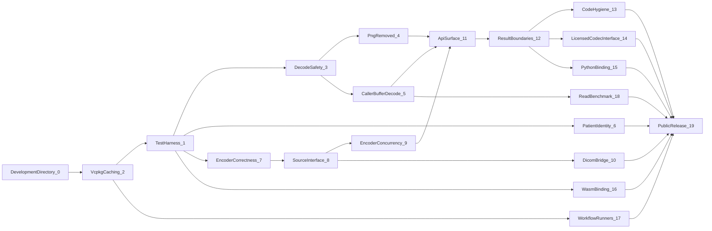

# Work Breakdown Structure

The tracking sheet for Iris-Slide's work, written top down: each **sprint**
states its purpose and the **milestone** that shows it done; each **task**
states what it achieves and the RTM rows it serves in brackets; the **steps**
under it are the checkable implementation, red first. Requirements live in
[RTM.md](RTM.md); block governance and the open questions in
[ARCHITECTURE.md](ARCHITECTURE.md); the findings each task closes in
[analysis/design_audit_2026-11-24.md](analysis/design_audit_2026-11-24.md)
(cited as C1–C17, A1–A9, B1–B8, and "audit D1"–"audit D3", since ARCHITECTURE.md numbers its own decisions D1–D10). E1–E4, Q1–Q12 and X1–X7 are
ARCHITECTURE.md's defects, open questions and external dependencies.

## Conventions

- **A sprint is one work package, one branch, one pull request.** It is sized
  to a few days and three to six tasks *(estimate, not measured)*, ends in a
  milestone that can be run and seen, and closes with **VERIFY** (the maintainer
  reviews) and **Gate** (CI green on the pull request). The branch is
  `feature/<SprintName>_<n>`. [README.md](README.md) gives the pull request's
  sections.
- **Shown by** names the command that demonstrates the milestone. Its output
  is pasted into the pull request. The preset and test names are the ones the
  sprint creates, so a command may change while the sprint is built; the
  sprint's last tick records the command as run.
- **A paired branch.** A sprint that changes the public headers has a branch
  of the same name in Iris-Headers, merged first; the sprint's pull request
  then pins that commit. The two count as one block of work.
- **A sprint that grows past six ready tasks is split** before more work
  starts on it (blocked tasks are not counted), and a task found during a sprint that belongs to another sprint is
  written into that sprint.
- **A blocked task does not hold its sprint.** A task that waits on one of
  the maintainer's answers or on another repository is marked `blocked` with the
  question or dependency it waits on. The sprint merges without it, and the
  task moves to the sprint that follows the answer.
- **Red first.** A task's first step is the test shown failing, with its
  failure quoted; the task is ticked only with the green evidence and the
  commit that made it. A task whose product is a measurement or a document
  has no red step and is ticked with the numbers or the review. A `blocked`
  task gains its red step when its answer arrives.
- **Status** after a sprint's name: `todo`, `ready` (its dependencies are
  merged), `doing`, `blocked` (with the reason), `done`.
- **One tick, one piece of evidence:** test counts and the command, a
  measurement, or a reviewed document; and the commit, once it exists.
- **Public release** waits on every sprint through PublicRelease_19
  (decided 2026-11-24: every finding is fixed before the public release).

## Sprint plan

Twenty sprints. VcpkgCaching_2 runs first, before TestHarness_1 (decided
2026-11-24: CI uses vcpkg on every branch, with every build cache shared): every
later sprint's pull request then builds from prebuilt dependencies and a shared
compiler cache. It took over DependencyPins_16 and the first two tasks of
WorkflowRunners_17, and the sprints that followed TestHarness_1 were numbered
up by one (DecodeSafety_2 became DecodeSafety_3, through WasmBinding_15 to
WasmBinding_16); the IDs DependencyPins_16 and WorkflowLint_17.1 are retired.
Each audit finding is closed by one sprint; a finding with
several independent parts (A1, A4, C14, C16, audit D1, audit D3) names the
part each sprint closes. B8 needed no work: the audit searched an IFE checkout
without the rename (X4).

Four lanes run in parallel once TestHarness_1 is merged, since they touch
different files: decode (3, 4, 5, 18), identity (6), encoder (7, 8, 9, 10) and
build (16, 17). The lanes meet at ApiSurface_11, which changes the public
header every lane uses.

| Sprint | Milestone (what is shown working) | Closes | Status |
|---|---|---|---|
| DevelopmentDirectory_0 | this folder reviewed: block governance, sprints, requirements | audit D3 (the design contract) | `doing` |
| VcpkgCaching_2 | every dependency prebuilt from vcpkg.json and nothing fetched at configure; CI on every branch's pull requests on Blacksmith, vcpkg's packages and the compiler's objects shared through one GCS store | B1 (first-party pins), B3, B5 (runners, caches), B7, X4 (pins the rename branches) | `doing` |
| TestHarness_1 | `ctest` green under AddressSanitizer on macOS and Linux, with a slide built, opened and decoded in the test | B4 | `blocked` on X4 |
| DecodeSafety_3 | hostile JPEG tiles and JPEG or AVIF associated images refused naming both sizes under AddressSanitizer; every valid stream decoded into a buffer sized from its own header; a tile declared `TILE_ENCODING_AV1` refused naming it | C1, C6, C13, C15, E3, A4 (pixel layout, destination rule), D9 | `todo`; TileEncodingAv1Refused_3.6 built ahead |
| PngRemoved_4 | the library builds without libpng and refuses a PNG image naming its encoding | C2, X6 | `todo` |
| CallerBufferDecode_5 | a program decodes a stream it read through IFE's `Parser` into its own buffer and receives a `Result` | A1 (decode call, GPU types) | `todo` |
| PatientIdentity_6 | a slide encoded from a source with patient fields reads back with none in its attributes, from the command line, C++ and Python; a DII flagged as PHI is scrambled on de-identification | C3, E1, E2, audit D1 (metadata claims) | `todo`; three tasks `blocked` on Q2, Q6, X3; EncoderTakesI2S_6.8 built ahead |
| EncoderCorrectness_7 | `IrisSlideEncoder` run end to end: every output tile decodes with the declared encoding, every failure exits non-zero | C5, C9, C14 (encoder), C16 (scratch file, zero concurrency), E4 | `todo` |
| SourceInterface_8 | one source type per input; a read error from any source fails the encode with that error; every handle closed | C10, A4 (sources, pyramid loops) | `todo` |
| EncoderConcurrency_9 | the encoder's lifecycle suite clean under ThreadSanitizer | C7, C8, C16 (destructor), A5, A6 | `todo` |
| DicomBridge_10 | DICOM fixtures encode correctly or are refused by name under AddressSanitizer | C4, C11, C12 | `todo` |
| ApiSurface_11 | every declaration in `IrisSlideCore.hpp` links against the installed decoder and encoder libraries | A2, A3, B2 | `todo`; one task `blocked` on Q7 |
| ResultBoundaries_12 | every public call returns a `Result`; no test writes to stderr | C14 (API), A1 (`create_` form), A4 (boundary helper), A9 | `doing`: IfeReadResults_12.5 on pull request #4, forced by IFE R-8 |
| CodeHygiene_13 | clang-tidy and warnings-as-errors silent over the tree | A7, audit D2 | `todo` |
| LicensedCodecInterface_14 | a test codec library loaded at run time decodes its encoding; without it, a refusal naming the encoding | Q3, Q4, X5 | `blocked` on Q3, Q4 |
| PythonBinding_15 | `pytest` and `mypy --strict` green; a failed read raises | A8, C14 (Python) | `todo` |
| WasmBinding_16 | the WASM module's prefix fetch passes against a 5 GiB window | C17, A4 (second `Slide_t`) | `todo` |
| WorkflowRunners_17 | a release-candidate tag produces checked artifacts; the remaining pins and the cache identities' own project; every pull request from an Aptix-Bio branch reviewed by the review bot against Iris-Slide's rubric | B1 (the rest), B5 (wheels), B6, A4 (version parse) | `doing` |
| ReadBenchmark_18 | tiles per second measured against the paper, held by a gate | audit §4 (speed), Q8 | `todo` |
| PublicRelease_19 | the documents match the code, a fresh audit finds nothing open, the maintainer makes the repository public | audit D1 (the rest), audit D3 (the rest) | `todo` |

## DevelopmentDirectory_0 — the plan travels with the code `doing`

Purpose: a development directory, with an architecture document recording the
governance and provenance of every block of the IFE specification (required
2026-11-24).
Milestone: this folder, reviewed. Branch `feature/DevelopmentDirectory_0`.

- [x] **AuditKept_0.1** — the design audit of 2026-11-24 kept as written in
  `analysis/`, references to a proprietary consumer rewritten as a viewer's
  needs, B8 marked resolved
- [x] **RulesCopied_0.2** — `style_guide.md` (adapted from the Iris
  repositories' guide) and `ci_runners.md` (the maintainer's CI rules)
- [ ] **BlockGovernance_0.3** — `ARCHITECTURE.md`: every IFE block's governing
  authority, provenance per source, identity class, writer and reader, state
  against the rule; decisions; open questions [Governance_01]
- [x] **SprintPlan_0.4** — this WBS, `RTM.md` and `README.md`, every audit
  finding owned by a sprint
- [x] **PlanReview_0.5** — an independent review that the WBS runs as short
  sprints, each ending in a milestone and a pull request (2026-11-24).
  Reviewed 2026-11-24 against the sprint model of five merged pull
  requests the maintainer pointed to: 15 sprints became 20 (PNG removal, the source interface, the
  `Result` boundaries, the two bindings and the runners each became their
  own sprint); every task that changes code gained a red step and every sprint a command
  that shows its milestone; E1–E4, Q2–Q10 and X1–X6 each gained a task; the seven
  Mermaid diagrams of this folder render [Process_01]
- [ ] **VERIFY:** the maintainer reviews this folder and answers the open questions
- [ ] **Gate:** the pull request merged (documents only, so no CI runs, by
  `ci_runners.md`)

## VcpkgCaching_2 — prebuilt dependencies and shared caches on every branch `doing` · needs DevelopmentDirectory_0

Purpose: every CI run built every dependency from source (Aptix-Bio/Iris-Headers
run 45422510046, job 138562152373, Iris-Slide on ubuntu-24.04: Highway,
libjpeg-turbo, libavif, libpng and libdicom each "NOT FOUND. Set to clone and
build during the build process"). Required 2026-11-24 (Goal_16 to Goal_18):
CI uses vcpkg on every branch with every build cache shared, the compiler
cache included; CI runs on Blacksmith runners; every dependency comes from
vcpkg, with no FetchContent; and the workflows are few and unified, their logic
in CMake presets and scripts instead of shell in the workflow files. Milestone: a clean configure restores every dependency from vcpkg's
binary cache and fetches nothing else; every pull request into any branch
builds on Blacksmith through one reusable workflow, reading main's store and
writing its own quarantine. The rules this sprint set are
[PIPELINE.md](PIPELINE.md).

The sprint grew past six tasks when the maintainer added the first-party ports, Python,
WASM and the downstream cell to it on 2026-11-24 and asked for them in the
same pull request.

Shown by: `cmake --workflow --preset release` (the first run builds the
packages; a second build folder restores all of them), and the pull request's
`ci` run.

- [x] **VcpkgManifest_2.1** — `vcpkg.json` in manifest mode at vcpkg's release
  2026.10.16 (`9eec002df1cd109f8f104cd966a763daf9751489`), overrides equal to
  Iris-Headers' pins; triplets that build release libraries and OpenSlide
  shared; `cmake/toolchains/vcpkg.cmake`, which fetches the pinned vcpkg itself
  (`scripts/bootstrap_vcpkg.cmake`, a treeless partial clone, since overrides
  read old port trees a shallow clone lacks); `CMakePresets.json` [Build_05]
  - [x] Red: the Iris-Headers run above, each library built from source
  - [x] Green: `cmake --preset release` on arm64 macOS installed 20 packages;
    a fresh build folder (`cmake --preset ci`) restored 20 of 20 from the
    binary cache in 2.0 s; `IrisSlideEncoder` encoded a synthetic 8192 × 6144
    tiled TIFF and all 1028 tiles of its 9 layers decoded (tile 0 mean absolute
    error 7.68) (05043cb)
- [x] **HighwayModule_2.2** — moved from DependencyPins_16 (was 16.2):
  `cmake/hwy.cmake`, a half-renamed copy of `avif.cmake` (B3), deleted with
  the other ExternalProject modules; Highway comes from vcpkg [Build_04]
  - [x] Red: `tools/workflow_lint.py` found 6 `ExternalProject_Add` calls
  - [x] Green: none (05043cb)
- [x] **BuildStateScoped_2.3** — moved from DependencyPins_16 (was 16.3):
  include paths and definitions on the targets (B7) [Build_04]
  - [x] Red: the lint found 8 directory-scope `include_directories(` and
    `add_compile_definitions(` calls
  - [x] Green: none (05043cb)
- [x] **WorkflowLint_2.4** — moved from WorkflowRunners_17 (was 17.1):
  `tools/workflow_lint.py` over the workflows, the composite actions and the
  CMake files: Blacksmith labels, actions pinned by commit SHA, content-hashed
  cache keys, timeouts, bounded parallelism, pull requests of every branch,
  no ExternalProject, no directory-scope build state, and `run:` steps of at
  most `MAX_RUN_LINES` (2) lines [Build_02]
  - [x] Red: 91 violations on the tree (fcfd368), then 16 more `run-length`
    once that rule was added
  - [x] Green: 0 violations; 38 tests in `tools/tests` pass (a742868)
- [x] **OneReusableBuild_2.5** — moved from WorkflowRunners_17 (was 17.2):
  `_build.yml`, called once per platform by `ci.yml`, `cache.yml` and the
  release workflows, each step one CMake preset or `cmake -P` call; Linux
  first, Windows and macOS after it; the composite action `caches`
  (`scripts/ci_caches.cmake`) and the report that fails a broken cache
  (`scripts/cache_report.cmake`) [Build_02, Build_06]
  - [x] Red: the lint's 25 `runner` and 9 `timeout` violations
  - [x] Built: a742868
  - [x] Green: PR #2's `ci` run 45441187867 at [38d4e12](https://github.com/Aptix-Bio/Iris-Slide/commit/38d4e12b341dc2ac596e7f4843c166dfb19ca57f), every cell green on
    Blacksmith; the Linux, macOS and JavaScript cells restored every vcpkg package
    from the store (20 of 20; 4 of 4) with 13 of 13 sccache hits, each in under a
    minute; Windows built its packages cold in 4 min 36 s (6b9943e, 243621d, 38d4e12)
- [x] **CacheIdentities_2.6** — `tools/cloud_federation.sh`: a provider of
  Iris-Slide's own admitting only repository 1470307364 of owner 353521923,
  a reader and a writer account, IAM bindings on gs://iris-vcpkg-cache
  confined to `iris-slide/`, a 7-day rule on `iris-slide/pr/` [Build_06]
  - [x] Run by the maintainer 2026-11-24 and checked ([68f5773](https://github.com/Aptix-Bio/Iris-Slide/commit/68f577369fc299e8cd74e460b4bb5e02b40b4c93)): the provider active, each account
    with its one principal set and no keys, three conditioned bindings, the
    lifecycle rule
  - [x] The repository variables `IRIS_SLIDE_GCP_PROVIDER` and `IRIS_SLIDE_GCP_PROJECT` set by the maintainer 2026-11-24 ([68f5773](https://github.com/Aptix-Bio/Iris-Slide/commit/68f577369fc299e8cd74e460b4bb5e02b40b4c93)); PR #2's `ci` run 45441187867
    restored every package from the store, which needs both
- [x] **FirstPartyPorts_2.7** — Iris-Headers and Iris-File-Extension as overlay
  ports pinned by commit and SHA-512 (closing B1 for these two, which were
  fetched at `origin/main`); `cmake/iris-repositories.cmake` deleted;
  OpenSlide as `openslide-bin` 4.0.1.2 prebuilt and libdicom with a CMake
  config, so every dependency is found by `find_package(... CONFIG REQUIRED)`
  [Build_01, Build_05]
  - [x] Red: vcpkg's openslide port needs autoconf, automake and libtool on the
    system (its gperf dependency, measured on macOS)
  - [x] Green: as VcpkgManifest_2.1; the IFE port pins the paired branch
    (Aptix-Bio/Iris-File-Extension `feature/VcpkgCaching_2`, 45845fb), which
    installs `IFE_Window.hpp` for Emscripten (05043cb, c0f42a7)
- [x] **PythonThroughVcpkg_2.8** — pybind11 from an overlay port without vcpkg's
  CPython; the wheels build every Python version of a platform in one job
  [Build_05]
  - [x] Red: vcpkg's pybind11 port depends on its python3 port
  - [x] Built: 05043cb, a742868
  - [ ] Green: a release-candidate run of `distribute-pypi.yml` *(not run: it
    runs on a release or by hand from main)*
- [x] **WasmThroughVcpkg_2.9** — the JavaScript module from the same
  `vcpkg.json`, triplet `wasm32-emscripten`, the Emscripten SDK 6.0.13 pinned
  by commit (`scripts/bootstrap_emsdk.cmake`) [Build_05]
  - [x] Red: "'IFE_Window.hpp' file not found" against IFE's install
  - [x] Green: `cmake --workflow --preset wasm` (javascript/) wrote
    `iris-slide.wasm` (356,394 bytes) (c0f42a7)
- [x] **DownstreamThroughPorts_2.10** — `scripts/local_ports.cmake` writes
  overlay ports from local checkouts, and Iris-Headers' downstream cell
  builds Iris-Slide through them with its verdict in
  `cmake/downstream_verdict.cmake` (Aptix-Bio/Iris-Headers
  `feature/VcpkgCaching_2`, 6d4be31) [Build_05]
  - [x] Red: `-DFETCHCONTENT_SOURCE_DIR_IRISHEADERS` reported unused, and the
    pinned port built instead of the change
  - [x] Green: the verdict script, run locally against that branch and IFE's,
    "change: green" (a742868)
- [ ] **VERIFY:** the maintainer reviews `vcpkg.json`, the ports and `PIPELINE.md`
- [x] **Gate:** CI green on the pull request (run 45441187867 at [38d4e12](https://github.com/Aptix-Bio/Iris-Slide/commit/38d4e12b341dc2ac596e7f4843c166dfb19ca57f))

## TestHarness_1 — every later sprint proves itself here `blocked` on X4 · needs VcpkgCaching_2

Purpose: the repository has no tests (B4). Milestone: `ctest` green under
AddressSanitizer on macOS and Linux, including a slide built by IFE's
`Builder`, opened and decoded in the test. Blocked until the renamed
Iris-File-Extension and Iris-Headers are merged (X4), since the tree compiles
only against them.

Shown by: `cmake --preset asan && cmake --build --preset asan && ctest --preset asan`

- [ ] **TestTarget_1.1** — `tests/` with Catch2 from `vcpkg.json`'s `tests`
  feature (3.15.1, Iris-Headers' pin), `enable_testing()`, `IRIS_SLIDE_BUILD_TESTS`
  [Testing_01]
  - [ ] Red: `ctest --test-dir build` reports "No tests were found"
  - [ ] Green: one test runs
- [ ] **Presets_1.2** — `asan` (AddressSanitizer and
  UndefinedBehaviorSanitizer) and `tsan` added to the `CMakePresets.json`
  VcpkgCaching_2 made (`debug`, `release`, `ci`), each in `build/<preset>`, with
  test presets [Testing_02]
  - [ ] Red: `cmake --preset asan` reports no such preset
- [ ] **FixtureSlide_1.3** — a 2 × 2-tile JPEG slide with attributes and one
  associated image, written in the test through IFE's `Builder` from
  generated pixels, so no slide file is checked in [Testing_03]
  - [ ] Red: the fixture's test fails to link until the helper exists
- [ ] **RoundTrip_1.4** — open the fixture, validate it, read its info, decode
  every tile, compare tile 0 with the pixels encoded (mean absolute error
  under a named bound) [Testing_03]
  - [ ] Red: the comparison run against a fixture whose tile 0 was replaced
    by another tile's pixels fails, which shows the test can fail
- [ ] **CiRunsTests_1.5** — `_build.yml` (VcpkgCaching_2) runs the tests
  through a test preset, `ctest --preset asan` on Linux; macOS and Windows run
  only after Linux passes (`ci_runners.md`, cheapest first) [Testing_04]
  - [ ] Red: the pull request's Linux job shows no test step
- [ ] **VERIFY:** the maintainer reads the round-trip test
- [ ] **Gate:** CI green on the pull request

## DecodeSafety_3 — a stream cannot write past its buffer `todo` · needs TestHarness_1

Purpose: decoding trusts declared sizes (C1, C13) and a fixed 256-pixel tile
(E3). Decided 2026-11-24: the buffer is sized from the JPEG stream's own
encoded size, so it is exact and cannot overflow (ARCHITECTURE D3).
Milestone: under AddressSanitizer, a 512 × 512 JPEG in a 256-pixel tile and a
wrong-sized AVIF associated image are each refused with both sizes, and every
valid stream decodes into a buffer sized from its own header. Decided
2026-11-25, the AVIF tile encoding is removed and tile encoding 3 is
`TILE_ENCODING_AV1` (ARCHITECTURE D9): AVIF remains an associated-image
encoding only, and an AV1 tile is refused by name until Q11 is answered.

Shown by: `ctest --preset asan -R Decode`

- [ ] **JpegSizedFromHeader_3.1** — `tj3DecompressHeader` first; the
  destination is sized from the stream's own width, height and the requested
  format; `TJPARAM_MAXPIXELS` set; `tj3Init` and every `tj3Set` checked; a
  tile whose stream is not the tile's extent is refused naming both sizes
  [Decode_01]
  - [ ] Red: the 512 × 512 stream in a 256 tile reports a heap-buffer-overflow
    under AddressSanitizer
- [ ] **TileLengthFromTheFile_3.2** — a tile's expected extent is the file's
  TILE_LENGTH in place of the constant 256 (E3) [Decode_08]
  - [ ] Red: a fixture with 512-pixel tiles overflows a 256 × 256 buffer
    under AddressSanitizer
- [ ] **OneDestinationRule_3.3** — one function decides the destination for
  every decoder: capacity checked, size set, a destination too small refused
  naming both sizes; `avifRGBImageSetDefaults` from the decoded image after
  its extent is checked (C13, A4) [Decode_01, Decode_04]
  - [ ] Red: a caller's AVIF destination is replaced by another buffer; a
    512 × 300 AVIF associated image fails to decode
- [ ] **PixelLayoutOnce_3.4** — one `bytes_per_pixel(Format)`, throwing on
  `FORMAT_UNDEFINED`, in place of seven switches (C6, A4) [Decode_05]
  - [ ] Red: deriving layers from an `R8G8B8` source over-reads under
    AddressSanitizer
- [ ] **EncoderBuffersOwned_3.5** — `TJPARAM_NOREALLOC` on compression;
  libavif's output copied into a `Buffer` or freed with libavif's own
  allocator (C15) [Decode_06]
  - [ ] Red: a test that compresses into a buffer one byte too small expects
    a refusal naming both sizes and receives a reallocated pointer
- [x] **TileEncodingAv1Refused_3.6** — decided 2026-11-25 (ARCHITECTURE D9):
  the AVIF tile path is removed (the encoder's `-e AVIF`, Python's
  `TILE_ENCODING_AVIF`, the AVIF tile decode and encode), and a tile table
  declaring `TILE_ENCODING_AV1` is refused naming the encoding on decode, on
  encode and as an encoder source; AVIF associated images and libavif stay.
  Built ahead of this sprint on ReviewBot_17.8, with the paired Iris-Headers
  pin (X7); it starts `tests/` (TestTarget_1.1) [Decode_09]
  - [x] Red: `ctest --preset debug`, 0 of 2 pass, each "no exception was thrown
    where one was expected": the decode hands a two-byte AV1 temporal delimiter
    to libavif ("BMFF parsing failed") and returns no buffer, the encode writes
    AVIF for a tile requested as AV1 ([3cf21bc](https://github.com/Aptix-Bio/Iris-Slide/commit/3cf21bc825c0cf97ed9a81dedbfea97b4b752cb3))
  - [x] Green: the same command, 2 of 2 pass; `cmake --build --preset debug`
    (library, encoder, tests) and the Python modules build with no new warning;
    `tools/tests` 51 pass, `tools/workflow_lint.py` 0 violations
    [bed76a7](https://github.com/Aptix-Bio/Iris-Slide/commit/bed76a753b09cb1e59b2609e0c8eeaf06ca4237b)
  - [ ] The encoder's source refusal (an `.iris` source whose table declares
    AV1) gains its test with EndToEndSuite_7.1, which runs the encoder on a
    fixture slide
- [x] **TileEncodingBlocksRefused_3.7** — decided 2026-11-25 (ARCHITECTURE
  D11): tile encodings 4 and 5 are the GPU block-compressed
  `TILE_ENCODING_UASTC` and `TILE_ENCODING_XUASTC`, and a tile table declaring
  either is refused naming the encoding on decode, on encode and as an encoder
  source, through the one `unbuilt_tile_encoding` that AV1's refusal now uses
  too; the Python and JavaScript enumerations, the stubs and both READMEs name
  them. Built ahead of this sprint on ReviewBot_17.8, with the paired
  Iris-Headers pin (X8) [Decode_10]
  - [x] Red: `ctest --preset debug`, 4 of 5 pass: the new test fails on decode
    for both encodings with "decompress_tile failed with nonsense encoding
    format in DecompressTileInfo", which names neither, and the build warns
    that neither is handled in `compress_tile`'s or `decompress_tile`'s switch
    ([e718bd2](https://github.com/Aptix-Bio/Iris-Slide/commit/e718bd221901ca227ea237e9fede4208a2248b38))
  - [x] Green: the same command, 5 of 5 pass; `cmake --build --preset debug` (library, encoder, tests) with no warning, and the Python modules with only the known `METADATA_FREE_TEXT` warning, `Encoding.TILE_ENCODING_UASTC` 4 and `TILE_ENCODING_XUASTC` 5 from Python; `tools/tests` 51 pass, `tools/workflow_lint.py` 0 violations [fb00bec](https://github.com/Aptix-Bio/Iris-Slide/commit/fb00becc97da74bb0d1dbf0a980f769a16203e9d)
  - [ ] The encoder's source refusal gains its test with EndToEndSuite_7.1,
    as AV1's does
- [ ] **VERIFY:** the maintainer reviews the hostile-stream tests
- [ ] **Gate:** CI green on the pull request

## PngRemoved_4 — one fewer codec to defend `todo` · needs DecodeSafety_3

Purpose: decided 2026-11-24, SVG is the preferred annotation format and PNG is
removed (ARCHITECTURE D7). Removing the PNG decoder closes C2.
Milestone: the library builds with no libpng and refuses a PNG associated
image naming its encoding. Follows DecodeSafety_3 because both edit
`src/IrisSlideContext.cpp`.

Shown by: `ctest --preset asan -R Png`, and `cmake --build --preset release`
with no libpng on the link line

- [ ] **PngRefusedByName_4.1** — reading a PNG associated image or
  annotation returns a failure naming the image and `IMAGE_ENCODING_PNG`;
  re-encoding a source that carries one is refused the same way (decided
  2026-11-24) [Decode_03]
  - [ ] Red: a fixture with a PNG associated image decodes today, and
    re-encodes with the PNG passed through
- [ ] **AssociatedImagesAsJpegOrAvif_4.2** — the encoder writes associated
  images as JPEG or AVIF (`IMAGE_ENCODING_AVIF`) only; AVIF is an
  associated-image encoding alone since the AVIF tile encoding was removed
  (decided 2026-11-25, ARCHITECTURE D9) [Decode_03]
  - [ ] Red: an encode that requests a PNG associated image succeeds today
- [ ] **LibpngLeavesTheBuild_4.3** — `cmake/png.cmake`, zlib-ng and the PNG
  codec removed from every target, the wheels and `licenses/` [Decode_03]
  - [ ] Red: a static check finds `png` in the link line of the decoder
- [ ] **EnumerationsFollowIfe_4.4** — Iris-Slide's enumerations follow IFE's
  retirement of the PNG values once it lands (X6) — `blocked` on that IFE
  change; the three tasks above do not wait on it
- [ ] **VERIFY:** the maintainer reviews the refusal's message
- [ ] **Gate:** CI green on the pull request

## CallerBufferDecode_5 — a viewer decodes the streams it fetched `todo` · needs DecodeSafety_3

Purpose: decoding is reachable only through a slide opened from a path (A1).
Milestone: a program reads a tile stream through IFE's `Parser`, hands the
span to `IrisSlide::decompress_tile`, and receives its pixels in its own
buffer.

Shown by: `ctest --preset asan -R DecompressTile`, and the example program
in `examples/` decoding tile 0 of the fixture

- [ ] **DecompressTilePublic_5.1** — `[[nodiscard]] Result
  decompress_tile(const DecompressTileDesc&, Buffer& decoded) noexcept` over
  `std::span<const std::byte>`, JPEG (and AV1 if Q11 adds it), RGB and RGBA [Decode_07]
  - [ ] Red: the contract test that the returned buffer is the caller's, its
    size set, for every encoding and format, fails to compile until the call
    exists
- [ ] **NoGpuTypesInCpuLibrary_5.2** — `Iris::Instance`, `Device` and `Queue`
  removed from `IrisSlideTypes.hpp`, in the paired Iris-Headers branch
  [Decode_07]
  - [ ] Red: a translation unit that declares its own `Iris::Device` and
    includes `IrisSlideTypes.hpp` fails to compile
- [ ] **DecodeExample_5.3** — a 30-line example that maps a file with IFE's
  `Parser` and decodes one tile, built and run by `ctest` [Decode_07]
  - [ ] Red: the example's test is registered before the example exists
- [ ] **Av1TileDecode_5.4** — AV1 tiles (ARCHITECTURE D9) decoded as the
  maintainer's answer to Q11 says (the proposal: dav1d from vcpkg, sized by
  the destination rule of OneDestinationRule_3.3), replacing the refusal of
  TileEncodingAv1Refused_3.6 [Decode_09] — `blocked` on Q11
- [ ] **BlockTileTranscode_5.5** — UASTC tiles (ARCHITECTURE D11) transcoded
  to RGBA8 as the maintainer's answer to Q13 says (the proposal: vcpkg's
  `basisu` port at the baseline, 2.50, in its own target; the Zstandard
  frame's content checked at 16 bytes a block for TILE_LENGTH before the
  transcode), replacing the refusal of TileEncodingBlocksRefused_3.7; XUASTC
  after IFE settles its footprint and bitstream stability (IFE OD-T3); the
  frame's content holds the `MIP_LEVELS` levels IFE's tile table declares
  (IFE D29, 2026-11-25), level 0 first [Decode_11] — `blocked` on Q13
- [ ] **VERIFY:** the maintainer reviews the public signature
- [ ] **Gate:** CI green on both pull requests, Iris-Headers' first

## PatientIdentity_6 — patient identity lives only in the clinical stream `todo` · needs TestHarness_1

Purpose: asking to strip identifiers does nothing (C3). Decided 2026-11-24:
patient information goes only in the clinical (HL7 / FHIR) block, never in the
metadata block (ARCHITECTURE D2). Milestone: a fixture
with identifying vendor properties, encoded through the command line, C++ and
Python, reads back with attributes that hold no identity, and a
`DigitalImageIdentifier` flagged as PHI is scrambled on de-identification.

Shown by: `ctest --preset asan -R Identity`, and the encoder's report listing
the properties it dropped

- [ ] **AttributesNeverIdentify_6.1** — the encoder writes attributes only as
  `METADATA_I2S`, from an allow-list of acquisition keys, for OpenSlide and
  DICOM sources alike; a source property off the list is dropped and counted
  in the encoder's report. This closes E1 on the writing side (no
  `METADATA_FREE_TEXT` is written) and E2 (no `METADATA_DICOM` keys are
  written). The allow-list is Q5's proposal and is the subject of this
  sprint's VERIFY, and it stands in for I2S's generated keys until 6.7
  [Identity_01, Identity_05]
  - [ ] Red: an OpenSlide-style source with `aperio.Filename` and a patient
    name property encodes both into its attributes
- [ ] **OneSwitchEveryPath_6.2** — the command line, C++ and Python reach the
  same behaviour; the dead `-sm` local and Python's unused `strip_metadata`
  removed [Identity_02]
  - [ ] Red: the same fixture encoded three ways gives three different
    attribute sets
- [ ] **ReadmeTruthful_6.3** — the README's metadata claims match the code
  (audit D1, the metadata claims) [Identity_02]
  - [ ] Red: a documentation test that runs the README's "strip metadata"
    example finds the patient property in the output
- [ ] **AssociatedImagesWithIdentity_6.4** — the label and macro images
  handled as the maintainer's answer to Q2 says [Identity_03] — `blocked` on Q2
- [ ] **ClinicalStreamWritten_6.5** — the clinical stream written as the maintainer's
  answer to Q6 says, through IFE's block tier (X1) [Identity_04] — `blocked`
  on Q6
- [ ] **DigitalImageIdentifier_6.6** — decided 2026-11-24: the accessioning
  number is the DigitalImageIdentifier (DII), with a separate boolean
  `DII_is_PHI` saying whether it must be scrambled during de-identification
  (ARCHITECTURE D8). The encoder writes the `DigitalImageIdentifier` with its
  `DII_is_PHI` flag, and the de-identify path scrambles the DII when the flag
  is true or absent (an absent flag defaults to true). Who sets the flag at
  encode time follows the maintainer's answer to Q10; until then the
  encoder writes the flag its caller gives and omits it otherwise
  [Identity_06]
  - [ ] Red: a fixture with `DII_is_PHI` true de-identifies to the same DII;
    so does a fixture with a DII and no flag. Green when both de-identify
    to a different DII and a fixture with the flag false keeps its DII
    unchanged
- [ ] **AttributesFromI2S_6.7** — the allow-list of 6.1 replaced by the keys
  in the C++ source that I2S's generator emits from its JSON specification
  (decided 2026-11-24), pinned by commit (X3)
  [Identity_05] — `blocked` until I2S publishes its first version
- [x] **EncoderTakesI2S_6.8** — decided 2026-11-25 (ARCHITECTURE D10): the
  encoder takes a slide's I2S attributes from its caller,
  `EncodeSlideInfo::attributes` (the paired Iris-Headers branch), as key and
  value text with `METADATA_I2S` and the I2S version, and writes them as the
  slide's one attributes block in place of the source's pairs. It refuses,
  naming the pair and before the source is opened, what IFE's attribute
  blocks cannot hold, another format and version 0; the version's packing is
  Q12. Built ahead of this sprint on ReviewBot_17.8; the allow-list of 6.1
  and 6.7 still governs the source's own pairs [Identity_07]
  - [x] Red: `ctest --preset debug`, 2 of 4 pass; the two `[Identity_07]`
    cases fail 16 of 29 assertions: the output carries the source's one
    free-text pair at version 0 in place of the two I2S pairs at version 1,
    and a non-ASCII key, a value that is not UTF-8, an unversioned I2S claim
    and a free-text format each encode with no error ([ad35821](https://github.com/Aptix-Bio/Iris-Slide/commit/ad35821b4e70be2d6d07824987e592c991c70083))
  - [x] Green: the same command, 4 of 4 pass (29 of 29 assertions in
    `[Identity_07]`), and 50 repeats pass; the library, encoder, tests and
    Python modules build with no new warning; the Python binding's
    `i2s_attributes` and `i2s_version` reach the same refusals, naming the key
    [2d1667b](https://github.com/Aptix-Bio/Iris-Slide/commit/2d1667b8f46696fecbce46e4a3125076757a7ee8)
  - [ ] The command line takes the pairs once CommandLineHonest_7.3 gives it
    an argument table. Until the encoder can check a key against I2S's
    generated source (6.7), a `--i2s key=value` typed at the command line
    would be written under the I2S claim with no vocabulary check, which the
    C++ and Python callers make with I2S's own `Attributes`
- [x] **I2sVersionPacked_6.9** — [7b184b0](https://github.com/Aptix-Bio/Iris-Slide/commit/7b184b050b8185ff1f0aaf07c466699c14b9a9a2) decided 2026-11-25 (ARCHITECTURE D10,
  amended; Q12 resolved): IFE's 16-bit `ATTRIBUTES.VERSION` holds the I2S
  version as `major << 8 | minor` (I2S 0.1 is 1). The encoder already writes
  the caller's u16 and refuses 0, and a half above 255 cannot be passed in a
  u16 the caller packs, so no code changes: the README, the Python binding's
  `i2s_version` docstring and the stubs say how the caller packs it
  [Identity_07]
- [ ] **VERIFY:** the maintainer reviews the allow-list and the fixture
- [ ] **Gate:** CI green on the pull request

## EncoderCorrectness_7 — the encoder writes what it declares `todo` · needs TestHarness_1

Purpose: the encoder can label JPEG tiles with another requested encoding (C5; AVIF when the audit found it, AV1 is refused since 2026-11-25), exit 0 on failure (C9),
drop an associated image with a printed line (C14), and lose a source's
annotations and clinical stream on a re-encode (E4). Milestone: a suite that
runs `IrisSlideEncoder` on a generated tiled TIFF and on the fixture slide
and checks every output tile decodes with the encoding the table declares,
and every failure exits non-zero.

Shown by: `ctest --preset asan -R EncoderEndToEnd`

- [ ] **EndToEndSuite_7.1** — the suite itself: the encoder run as a process,
  its exit code, its output file opened and every tile decoded [Encode_01,
  Encode_02]
  - [ ] Red: a failing encode exits 0
- [ ] **EncodingsAgree_7.2** — a stream passes through only when the source's
  encoding equals the requested one; otherwise it is decoded and recompressed
  (C5) [Encode_01]
  - [ ] Red: a JPEG `.iris` source re-encoded under another requested
    encoding, with and without derivation: tiles fail to decode. JPEG is the
    only tile encoding the encoder writes since the AVIF tile encoding was
    removed (D9); the red step uses the first second encoding that exists
    (AV1 per Q11, or IRIS per Q3), and until then the rule is held by the
    refusals of TileEncodingAv1Refused_3.6
- [ ] **CommandLineHonest_7.3** — one `try` in `main`, a non-zero exit on
  every failure, an argument table, case-insensitive values, no locale
  assumed, `ioctl` checked (C9) [Encode_02]
  - [ ] Red: `-e jpeg` (lower case) is refused; the tool aborts under the `C` locale
- [ ] **AssociatedImageFailuresReported_7.4** — a failed associated image
  fails the encode with its label and the reason (C14) [Encode_02]
  - [ ] Red: an image that cannot be compressed is skipped and the encode
    succeeds
- [ ] **ScratchBesideDestination_7.5** — the scratch file in the
  destination's directory, renamed into place; a concurrency of 0 refused by
  name (C16) [Encode_05]
  - [ ] Red: with the temp directory on another volume the slide is written
    twice; a concurrency of 0 fails with a message about unappended tiles
- [ ] **ReencodeRefusesWhatItWouldDrop_7.6** — re-encoding an `.iris` source
  that has annotations or a clinical stream is refused naming the blocks
  (E4). Passing them through waits on Q6 and Q7 [Encode_06]
  - [ ] Red: a source with one annotation re-encodes to a file with none and
    reports success
- [ ] **BlockTileEncodeParity_7.7** — the encoder writes UASTC (and, after
  IFE's OD-T3, XUASTC) tiles as the maintainer's answer to Q14 says, with
  rate-distortion control tuned until a tile is no bigger than its JPEG at
  the quality bar within the maintainer's margin (ARCHITECTURE D11) [Encode_07]
  — `blocked` on Q14
  - [ ] Measure first: each fixture tile's UASTC and XUASTC bytes against its
    JPEG at the quality bar, with a quality metric against the source
    *(to measure)*; the margin is set from these numbers
  - [ ] Red: a test that encodes the fixture tiles as UASTC and fails on any
    tile above the margin
  - [ ] **Levels capped at the layer step** (decided 2026-11-25, D11): the encoder writes
    `MIP_LEVELS` levels into each UASTC frame, back to back, finest first,
    and warns when its configuration asks for more than
    round(log2(step)) + 1, the step being 2 under `-d 2x`, 4 under `-d 4x`,
    or the source pyramid's; the warning reaches the caller as Q15 decides
    (the proposal: a `Result::warning` from `dispatch_encoder`) [Encode_08]
  - [ ] Red (planned for when block encoding is built): encoding a fixture
    under `-d 2x` with 3 levels configured returns a warning naming 3 levels
    and the cap of 2 and writes 3; with 2 configured it returns no warning;
    under `-d 4x` the cap is 3
- [ ] **VERIFY:** the maintainer encodes a vendor slide of the maintainer's choosing with the new
  command line
- [ ] **Gate:** CI green on the pull request

## SourceInterface_8 — one source type per input `todo` · needs EncoderCorrectness_7

Purpose: five places switch on the source kind, raw handles are copied into
every thread, and a read error from OpenSlide is encoded as a black tile
(A4, C10). Milestone: OpenSlide, DICOM and `.iris` inputs each sit behind one
source type that owns its handle, and a read error from any of them fails
the encode with that error. The end-to-end suite of EncoderCorrectness_7
stays green throughout, which is what makes this refactor safe.

Shown by: `ctest --preset asan -R Source`

- [ ] **SourceType_8.1** — one type per input with `extent`, `encoding`,
  `stream`, `pixels`, `metadata`, `images`, each owning its handle through
  RAII (A4, C10) [Encode_03]
  - [ ] Red: a leak check shows the OpenSlide handle open after an encode
- [ ] **OnePyramidLoop_8.2** — the pass-through loop and the derive loop
  merged into one claim, read, hand-on loop (A4) [Encode_03]
  - [ ] Red: none; the end-to-end suite is the proof that behaviour is kept,
    and the pull request reports the lines removed
- [ ] **SourceErrorsReported_8.3** — the source's error is checked after each
  read and fails the encode (C10) [Encode_03]
  - [ ] Red: a fake source whose read reports an error produces a slide with
    a black tile and a successful exit
- [ ] **TransparentRegionsWhite_8.4** — pre-multiplied ARGB composited on
  white before compression (C10) [Encode_04] *(to confirm against a sparse
  vendor slide)*
  - [ ] Red: a source tile with zero alpha encodes black
- [ ] **VERIFY:** the maintainer reviews the source type's interface
- [ ] **Gate:** CI green on the pull request

## EncoderConcurrency_9 — every encoder thread has an owner `todo` · needs SourceInterface_8

Purpose: reuse terminates the process and shared state races (C7, C8).
Milestone: a lifecycle suite under ThreadSanitizer: dispatch twice, poll
while an encode fails, interrupt then reset during start-up, drop the last
handle mid-encode.

Shown by: `ctest --preset tsan -R EncoderLifecycle`

- [ ] **LifecycleSuite_9.1** — the four cases above [Concurrency_01]
  - [ ] Red: each case reports a data race under ThreadSanitizer or ends in
    `std::terminate`
- [ ] **WorkersOwnedByTheirThread_9.2** — the dispatching thread creates and
  joins its workers in a local container, or one `Iris::Async` pool serves
  readers and workers; the choice follows a benchmark at real tile cost (A6)
  [Concurrency_02] *(to measure)*
  - [ ] Red: the second dispatch on one encoder terminates the process
- [ ] **ProgressPublishedAtomically_9.3** — the error text published once by
  an atomic state change; the destination path fixed before dispatch (C8)
  [Concurrency_01]
  - [ ] Red: the poll-while-failing case of 9.1
- [ ] **CatchAtEveryEncoderBoundary_9.4** — `const std::exception&` then
  `...` through one helper; the null-encoder dereference removed (C7)
  [Concurrency_03]
  - [ ] Red: a source that throws `std::logic_error` terminates the process;
    `dispatch_encoder` on a null encoder crashes
- [ ] **DropInterrupts_9.5** — dropping the last handle interrupts the encode
  (C16); a `std::weak_ptr` test drops every owner in each order and shows
  everything freed (A5) [Concurrency_02]
  - [ ] Red: dropping the handle blocks until the encode completes
- [ ] **VERIFY:** the maintainer reviews the ThreadSanitizer run
- [ ] **Gate:** CI green on the pull request, the `tsan` preset included

## DicomBridge_10 — DICOM series read correctly or refused `todo` · needs SourceInterface_8

Purpose: the DICOM bridge recurses, leaks, and writes wrong positions and
scales (C4, C11, C12). Milestone: the fixtures below encode correctly or are
refused by name, under AddressSanitizer. Fixtures are generated in the test,
or come from public test data once the maintainer approves the download. Runs in
parallel with EncoderConcurrency_9.

Shown by: `ctest --preset asan -R Dicom`

- [ ] **NoIccProfile_10.1** — a series with no ICC profile encodes with none
  (C4) [Dicom_01]
  - [ ] Red: the series crashes at the metadata step
- [ ] **SequencesQueued_10.2** — the sequence walk is a loop over an explicit
  queue with a bound (C11) [Dicom_02]
  - [ ] Red: a sequence 10,000 deep overflows the stack
- [ ] **DicomHandlesOwned_10.3** — RAII for file handles and libdicom strings;
  iterators taken from `erase`; the empty check ahead of `back()` (C11)
  [Dicom_02]
  - [ ] Red: LeakSanitizer reports the handles of a series whose thumbnail
    level was dropped
- [ ] **SparseSeriesRefused_10.4** — frame positions read per frame, or a
  sparse series refused by name; one-tile levels kept; 12-bit and lossless
  transfer syntaxes refused by name (C12) [Dicom_03]
  - [ ] Red: a sparse fixture encodes with tiles at the wrong positions
- [ ] **OneScaleNormalization_10.5** — microns per pixel and magnification
  normalized by one function every source uses (C12) [Dicom_03]
  - [ ] Red: a fixture with a known pixel spacing reads back with a different
    microns per pixel from DICOM than from the same pixels as a tiled TIFF
- [ ] **VERIFY:** the maintainer encodes a trusted DICOM series
- [ ] **Gate:** CI green on the pull request

## ApiSurface_11 — the API offers what is built `todo` · needs PngRemoved_4, CallerBufferDecode_5, EncoderConcurrency_9

Purpose: declarations with no definition, a library that cannot encode, and
a CPU decoder that needs Vulkan (A2, A3, B2). Milestone: every declaration in
`IrisSlideCore.hpp` links against the installed libraries. It follows the
three sprints above because each of them edits the public header.

Shown by: `ctest --preset release -R ExportedSymbols`

- [ ] **ExportedSymbols_11.1** — the test, modelled on IFE's
  `tests/exported_symbols.cmake` [Api_01]
  - [ ] Red: `read_cache_entry`, `cache_store_entry`, `set_encoder_src_cache`
    and every encoder function fail to link against the installed library
- [ ] **UnbuiltSurfaceRemoved_11.2** — the cache, the GPU fields, the stream
  encoder and the ignored fields deleted, in the paired Iris-Headers branch
  (A2) [Api_01]
  - [ ] Red: 10.1
- [ ] **DecoderAndEncoderLibraries_11.3** — two targets, the encoder linking
  the decoder; Vulkan, VMA and GLM dropped; libdicom only in the encoder
  (A3, B2) [Api_02]
  - [ ] Red: a static check finds Vulkan headers on the decoder's include
    path
- [ ] **HeadersTakeIfeEnumerations_11.4** — `MetadataType` and
  `ImageOrientation` take IFE 1.1's values in the paired Iris-Headers branch
  (E1 on the reading side, Q9's proposal, X2) [Api_05]
  - [ ] Red: a static assertion that each Iris-Headers value equals IFE's
    fails for `METADATA_FREE_TEXT` and `ORIENTATION_minus_90`
- [ ] **AnnotationSurface_11.5** — the annotation stubs removed, or replaced
  by a read call over IFE's lifted annotations, as the maintainer's answer to Q7 says
  [Api_01] — `blocked` on Q7
- [ ] **VERIFY:** the maintainer reviews the public header's diff
- [ ] **Gate:** CI green on both pull requests, Iris-Headers' first

## ResultBoundaries_12 — every public call returns a `Result` `doing` (IfeReadResults_12.5, ahead of ApiSurface_11) · needs ApiSurface_11

Purpose: failures are returned as null with the reason on stderr (C14), and
objects are created outside the `create_<name>(Desc, out) -> Result` form
(A1). Milestone: opening a missing file returns a `Result` carrying the
path, and no test writes to stderr.

Shown by: `ctest --preset asan -R Boundary`, with the suite's stderr capture
empty

- [ ] **BoundaryHelper_12.1** — one helper wraps every public function: it
  catches by type, then `...`, and returns a `Result` with the place (A4)
  [Api_03]
  - [ ] Red: a decoder that throws `std::bad_alloc` terminates the process
- [ ] **CreateForm_12.2** — `create_slide`, `create_context` and
  `create_encoder` in the `create_<name>(const <Name>Desc&, <Name>& out) ->
  Result` form, `[[nodiscard]]`; the encoder's description taken by const
  reference; the optional derivation a `std::optional` (A1) [Api_03]
  - [ ] Red: opening a missing file returns null and writes to stderr
- [ ] **ReadsReturnResult_12.3** — tile and associated-image reads return a
  `Result` and write into an output `Buffer`; the `assert(false)` paths
  return a failure naming the encoding (C14) [Api_03]
  - [ ] Red: reading tile 9 of a 4-tile layer returns null
- [ ] **ZStackRead_12.4** — a plane on the tile read description, or a
  refusal of multi-plane streams naming the plane count (A9) [Api_04]
  - [ ] Red: a two-plane fixture's tile decodes as one image
- [x] **IfeReadResults_12.5** — every call Iris-Slide makes into IFE's read path checks the `Result` it returns, and an IFE failure reaches the caller with IFE's domain and code (IFE R-8) ([ced3309](https://github.com/Aptix-Bio/Iris-Slide/commit/ced330985c19e2c8a7d515db2cc9cfc6e35a1632), [4aee40d](https://github.com/Aptix-Bio/Iris-Slide/commit/4aee40d5defff83abc388d3872c73cf2ce93de33)) [Api_06]
  IFE's read calls return a `Result` and write their value through a reference
  (IFE R-8, decided 2026-11-25): IFE's `create_parser` (in place of
  `Parser::open`, IFE decided 2026-11-26), the Parser's `abstraction`, `tile`,
  `tile_planes` and `image`, and the JavaScript module's
  `abstract_file_structure`. A path IFE cannot map returns IFE's own `Result`
  from `is_iris_slide_file` and `validate_slide`. Decided 2026-11-26: inside
  the library an IFE failure is thrown as a `ResultFailure`
  (`throw_if_failed`, `src/IrisSlidePriv.hpp`) carrying IFE's domain, code,
  message and place, and the Result-returning public calls of
  `src/IrisSlide.cpp` return it as it came, instead of re-wrapping it under
  Iris-Slide's domain; this is the IFE part of BoundaryHelper_12.1, whose one
  boundary helper is still owed. `Slide_t` keeps a pointer to the parser's one
  cached lift (`abstraction()`). The IFE port pins IFE's paired branch. Made on
  the branch `feature/BoundaryResults_R-8`, named after IFE's work item instead
  of this sprint, because IFE's `downstream` job builds the Iris-Slide branch
  named like its own pull request's head. Done ahead of the sprint, since IFE's
  change breaks this tree's build.
  - [x] Red: on main ([a3242cb](https://github.com/Aptix-Bio/Iris-Slide/commit/a3242cb258dedafeb1dcc2ed7d84eaaa12fae2ff)) with its pinned IFE 45845fb, `tests/ife_read_results_test.cpp` does not compile ("no member named 'NOT_MAPPED' in 'Iris::File::FileError'"); with that code check reduced to the domain, 2 of 11 assertions fail ("A path IFE cannot map": the domain is Iris-Slide's); the damaged-block and missing-label cases pass there, recording behaviour the change keeps. Main also does not compile against IFE 56f8c83: 21 errors, the first "too few arguments to function call, expected 2, have 1" (`Parser::open`)
  - [x] Red: at [adb1a39](https://github.com/Aptix-Bio/Iris-Slide/commit/adb1a391efee91835fcbac12553f903420ad1f61) against IFE 06ec6f2 through an overlay port, the ResultFailure case does not compile ("no type named 'ResultFailure' in namespace 'IrisSlide'"), nor does `src/IrisSlide.cpp` ("no member named 'open' in 'Iris::File::Parser'")
  - [x] Green: ctest 9 of 9, `[Api_06]` 4 of 4 test cases (15 assertions), against the pinned IFE 06ec6f2 (arm64 macOS, Release, `IRIS_SLIDE_BUILD_TESTS=ON`); `tools/tests` 51 passed, `tools/workflow_lint.py` 0 violations; at bd4b7f2, CI run 45829164326 green on every cell, the wasm32-emscripten module included ([ced3309](https://github.com/Aptix-Bio/Iris-Slide/commit/ced330985c19e2c8a7d515db2cc9cfc6e35a1632), [4aee40d](https://github.com/Aptix-Bio/Iris-Slide/commit/4aee40d5defff83abc388d3872c73cf2ce93de33))
- [ ] **VERIFY:** the maintainer reviews the public header's diff
- [ ] **Gate:** CI green on both pull requests, Iris-Headers' first

## CodeHygiene_13 — the tree passes its own rules `todo` · needs ResultBoundaries_12

Purpose: macros, reserved names, `goto`, bare numbers (A7); comments that
state the opposite of the code (audit D2). Milestone: clang-tidy and
`-Werror` silent over the tree on every cell. It runs after the API sprints
so that it renames code once.

Shown by: `cmake --build --preset tidy`

- [ ] **ClangTidy_13.1** — `.clang-tidy` with `bugprone-reserved-identifier`;
  warnings as errors; a `tidy` preset [Hygiene_01]
  - [ ] Red: the reserved identifiers the audit lists
- [ ] **MacrosAndNumbersNamed_13.2** — `constexpr` in place of the cast
  macros and `#define _Float16`; named constants for every bare number; no
  `goto`; no assignment inside a condition (A7) [Hygiene_01]
  - [ ] Red: 13.1's run
- [ ] **NamesToTheGuide_13.3** — functions in `snake_case`, accessors without
  `get_`, `using namespace` out of headers, each private header including
  what it uses (A7) [Hygiene_01]
  - [ ] Red: a test that compiles each private header alone fails
- [ ] **CommentsTrue_13.4** — every comment the audit lists made true or
  deleted (audit D2) [Hygiene_02]
- [ ] **VERIFY:** the maintainer skims the diff
- [ ] **Gate:** CI green on the pull request

## LicensedCodecInterface_14 — the proprietary codec, loaded at run time `blocked` on Q3, Q4 · needs ResultBoundaries_12

Purpose: decided 2026-11-24, the proprietary codec may be referenced and is
linked at run time, for those who pay its royalties; the other codecs are
open (ARCHITECTURE D5). Milestone: with a test codec library
loaded at run time, its encoding decodes; without it, decoding refuses by
naming the encoding. The test library is a stand-in written for the test;
the licensed module itself is outside this repository (X5).

Shown by: `ctest --preset asan -R LicensedCodec`

- [ ] **AbsentCodecRefused_14.1** — without a module, decode and encode of
  that encoding return a `Result` naming the encoding, in place of today's
  `assert(false)` [Licensing_01]
  - [ ] Red: decoding a `TILE_ENCODING_IRIS` fixture in a release build
    reports "nonsense encoding"
- [ ] **LoaderInterface_14.2** — the smallest interface that loads a codec
  library the caller names and asks it to decode one encoding, as the maintainer's
  answers to Q3 and Q4 say [Licensing_01]
  - [ ] Red: the test codec's encoding is refused with the module loaded
- [ ] **VERIFY:** the maintainer reviews the interface
- [ ] **Gate:** CI green on the pull request

13.1 does not depend on Q3 or Q4 beyond the encoding's name; if the answers
are late, it moves into ResultBoundaries_12 and this sprint keeps 14.2.

## PythonBinding_15 — Python fails loudly `todo` · needs ResultBoundaries_12

Purpose: the binding swallows failures, holds the interpreter lock, and
ships hand-written stubs (A8, C14). Milestone: `pytest` and `mypy --strict`
green, with a failed read raising.

Shown by: `pytest python/tests && mypy --strict python/Iris`

- [ ] **PythonTests_15.1** — `pytest` over the installed module, run by CI
  [Bindings_01]
  - [ ] Red: reading an out-of-range tile returns an uninitialized array
- [ ] **PythonRaises_15.2** — every `Result` becomes a specific exception;
  `encode_slide_file` raises in place of printing (A8, C14) [Bindings_01]
  - [ ] Red: 15.1; opening a missing file returns `None`
- [ ] **PythonReleasesLock_15.3** — the interpreter lock released during
  decode; one extension module; slide information read once per slide
  [Bindings_01]
  - [ ] Red: four Python threads decode no faster than one *(to measure)*
- [ ] **StubsGenerated_15.4** — stubs generated from the module; `mypy
  --strict` [Bindings_02]
  - [ ] Red: `mypy --strict` over the hand-written stubs
- [ ] **ModuleRenamed_15.5** — the module and its texts named for Iris-Slide:
  the extension is still `iris_core`, and `python/IrisTypesPython.hpp`,
  `IrisSlidePython.cpp`, `IrisSlidePython.hpp` and `python/Iris/*.pyi` still
  say "Iris Core" (found 2026-11-24, VcpkgCaching_2) [Bindings_02]
  - [ ] Red: a search of `python/` for `iris_core` and "Iris Core"
- [ ] **VERIFY:** the maintainer runs the Python example from the README
- [ ] **Gate:** CI green on the pull request

## WasmBinding_16 — the browser module opens large files `todo` · needs TestHarness_1

Purpose: the WASM module carries file sizes in 32 bits and fails in three
different ways (C17). Milestone: the module's prefix fetch tested natively
against a 5 GiB window. Independent of every other sprint: the module links
IFE alone.

Shown by: `ctest --preset asan -R RemotePrefix`

- [ ] **PrefixFetchTested_16.1** — the prefix fetch moved to a function a
  native test can call with a fake window [Bindings_03]
  - [ ] Red: a 5 GiB window is opened with a wrapped size
- [ ] **SixtyFourBitSizes_16.2** — file sizes carried as 64-bit values across
  the JavaScript boundary (C17) [Bindings_03]
  - [ ] Red: 16.1
- [ ] **OneFailurePath_16.3** — `NULL_TILE` entries answered without a range
  request; every failure returned the same way; the range probe's timeout a
  named constant; validate and open share one fetch (C17) [Bindings_03]
  - [ ] Red: a `NULL_TILE` entry requests the range `bytes=o-(o-1)`
- [ ] **OneSlideType_16.4** — the module's own `Slide_t` renamed so that one
  class name has one definition across the repository (A4) [Bindings_03]
- [ ] **VERIFY:** the maintainer opens a slide over HTTP in a browser
- [ ] **Gate:** CI green on the pull request

## WorkflowRunners_17 — releases checked, the remaining pins, every pull request reviewed `doing` · needs VcpkgCaching_2

Purpose: release artifacts are mislabelled and unchecked (B6); the Python build
requirements and the version source are not yet pinned or single (B1, A4); the
CI's cache identities live in a host project for now. VcpkgCaching_2 took this
sprint's lint (was WorkflowLint_17.1) and reusable build (was
OneReusableBuild_17.2), and DependencyPins_16's Highway and build-scope tasks;
DependencyPins_16's other two tasks moved here. Milestone: a release-candidate
tag produces artifacts whose architecture, compression and first run are
checked, from a tree whose every pin is recorded.

Shown by: the run of a release-candidate tag; the review bot's comment on a
pull request opened after ReviewBot_17.8 merges

- [ ] **BuildRequirementsPinned_17.1** — moved from DependencyPins_16 (the
  rest of PinnedSources_16.1, whose Iris-Headers and IFE pins
  FirstPartyPorts_2.7 made): `pyproject.toml`'s build requirements pinned
  (B1) [Build_01]
  - [ ] Red: a static check finds an unpinned requirement
- [ ] **VersionParsedOnce_17.2** — moved from DependencyPins_16 (was 16.4): one
  version source for CMake, Python, the WASM build and `vcpkg.json` (A4)
  [Build_04]
  - [ ] Red: a test that compares the reported versions after a bump of one
- [ ] **WheelsBuildDependenciesOnce_17.3** — the wheels' first release-candidate
  run (VcpkgCaching_2 builds every Python version of a platform in one job, the
  dependencies once); the manylinux jobs bootstrap vcpkg inside the container
  and read no GCS store yet (B5) [Build_02] *(to measure: runner minutes
  before and after)*
- [ ] **ArtifactsChecked_17.4** — each archive's architecture matches its
  name; each binary run once; the archives carry the public headers and the
  OpenSlide library the encoder needs (`scripts/package.cmake` installs
  neither today); a release also runs on a release-candidate tag (B6)
  [Build_03]
  - [ ] Red: `file` on the binary inside `ubuntu-aarch64` reports x86-64
- [ ] **CacheProjectMoved_17.5** — move the cache identities to Iris-Slide's own
  CI project: re-run `tools/cloud_federation.sh` with `PROJECT` set to it, and
  update the repository variables `IRIS_SLIDE_GCP_PROJECT` and
  `IRIS_SLIDE_GCP_PROVIDER` [Build_06] `blocked` on the project's billing
- [ ] **PortsPinMain_17.6** — re-pin the iris-headers and iris-file-extension
  ports to their main commits once the rename and IFE's `feature/VcpkgCaching_2`
  merge (X4), and once Iris-Headers' `feature/TileEncodingAv1_1` merges (X7:
  the iris-headers port is pinned to its `635afbb` since 2026-11-25, which
  adds `EncodeSlideInfo::attributes` and UASTC and XUASTC (X8) to `4c78915`'s
  AV1; the
  Iris-Headers rename is already in main), and remove the duplicate third-party pins in Iris-Headers'
  `cmake/dependencies.cmake`, whose versions `vcpkg.json` now states, by a
  paired change there [Build_01] `blocked` on X4
- [ ] **DownstreamCached_17.7** — Iris-Headers' downstream cell builds
  Iris-Slide's dependencies from source on every run; give it the store, read
  only, or a binary cache of its own [Build_06]
- [ ] **ReviewBot_17.8** — every non-draft pull request from an Aptix-Bio branch is
  reviewed by the review bot against Iris-Slide's own rules (Goal_19):
  `.github/workflows/review.yml` on `pull_request_target`, the rubric
  `.github/review/rubric.toml` read from the default branch, `.github/CODEOWNERS`,
  `.github/pull_request_template.md`; the bot's private repository checked out at a
  pinned commit with a read-only token confined to that checkout; a fork's pull
  request skipped with a notice (PIPELINE.md rule 10) [Review_01, Build_02]
  - [x] Red: `python3 -m unittest discover -s tools/tests`: 22 errors in `test_review_configuration.py` (no workflow, rubric, template, code owners or `require_secrets.py`) and 2 failures of the cache-key rule on the bot's keys; the 39 earlier tests pass ([6227f3c](https://github.com/Aptix-Bio/Iris-Slide/commit/6227f3c7fe5636569de3fa9338853099663386f4))
  - [x] Green: the same command, 63 tests pass; `tools/workflow_lint.py` 0 violations; the rubric and CODEOWNERS load with the bot's own `load_rubric` and `code_owners`; PIPELINE.md's two Mermaid diagrams render with mermaid-cli [d32cbe6](https://github.com/Aptix-Bio/Iris-Slide/commit/d32cbe6eb6bc6db37e365934ffaffb571929e310)
  - Aligned: the review workflow is the one every public Aptix repository runs
    (Iris-Headers, Iris-File-Extension), apart from comments and product text: the
    settings check `cmake/require_settings.cmake` in place of `tools/require_secrets.py`,
    its variables named after the secrets, the `fork-skipped` job last, `RULES_SHA` and
    `BOT_REF`, and the review step failing without a verdict; the rubric's shared
    items in the shared order, with AbiAndConsumers added; `cmake/check_review_configuration.cmake`
    in the `lint` job holds all of it
    - [x] Red: `cmake -P cmake/check_review_configuration.cmake` fails with 23 problems, each divergence named (jobs `fork;review;code-review`, no `fork-skipped`, the `_SET` flags, `tools/require_secrets.py`, `RUBRIC_COMMIT`, no `BOT_REF`, `run: >` without `test -s verdict.json`); `python3 -m unittest discover -s tools/tests` fails 5 and errors 1 of 51 (rubric order, template, settings step, run-length) ([5da42ff](https://github.com/Aptix-Bio/Iris-Slide/commit/5da42ff8f4508359bfc99273482dd021c2459ff3))
    - [x] Green: the same check passes, and passes unchanged on Iris-Headers' main and on Iris-File-Extension's pull request 6; 51 tests pass; `tools/workflow_lint.py` 0 violations; actionlint 1.7.12 clean; the pinned bot's `load_rubric` reads 13 items in order and `code_owners` the catch-all's owner; review.yml equals the shared workflow apart from comments [060a20a](https://github.com/Aptix-Bio/Iris-Slide/commit/060a20a55f1b9a7e8e43eaf6e2a0ef8c13d4d4d0)
  - [ ] The maintainer sets the repository secrets `ANTHROPIC_KEY` and
    `GOVERNANCE_READ_TOKEN`; until then both review jobs fail naming the missing one
  - [ ] First review: a pull request opened after this task merges carries the bot's
    comment and ticked boxes (`pull_request_target` runs the default branch's
    workflow, so the pull request that adds it is not reviewed by it)
- [ ] **VERIFY:** the maintainer reviews the release run
- [ ] **Gate:** CI green on the pull request

## ReadBenchmark_18 — the speed the paper reports, held `todo` · needs CallerBufferDecode_5

Purpose: the paper reports 6,400 to 8,100 tiles a second through Python on
an M1; nothing here measures it (audit §4). Milestone: a benchmark of JPEG
tiles per second (AV1 too once Q11 adds its decode) at one and N threads, and a budget constant from
the first measurement that a gate holds.

Shown by: `cmake --build --preset release --target read_benchmark && build/release/read_benchmark`

- [ ] **Benchmark_18.1** — tiles decoded from a generated slide at real tile
  cost [Performance_01]
  - [ ] Red: the gate run against a budget set 10 times above the first
    measurement fails, which shows the gate can fail
- [ ] **HandleReuse_18.2** — a per-thread decoder handle, kept only if it
  measures faster [Performance_01] *(to measure)*
- [ ] **TileFrameCost_18.3** — the size and encode time of a real slide with
  and without tile frames on single-plane layers, for the maintainer's answer to Q8
  [Performance_02] *(to measure)*
- [ ] **VERIFY:** the maintainer reviews the numbers and answers Q8
- [ ] **Gate:** CI green on the pull request

## PublicRelease_19 — public when it is right `todo` · needs every sprint above

Purpose: the repository stays private while the work continues and is
released when the maintainer approves it (decided 2026-11-24; ARCHITECTURE D4). Milestone: the repository is public.

Shown by: the fresh audit's findings table, every row of the 2026-11-24
audit marked closed with its commit

- [ ] **DocumentsMatchCode_19.1** — README, Python and JavaScript READMEs and
  `ARCHITECTURE.md` describe what the code does (audit D1, audit D3)
  [Release_01]
  - [ ] Red: a documentation test that builds and runs each README example
- [ ] **BlockedTasksSettled_19.2** — every task still `blocked` in this file
  is built, or retired by the maintainer with a date [Release_01]
- [ ] **FreshAudit_19.3** — a new design audit of the tree finds no open
  finding of the 2026-11-24 audit and no open defect of ARCHITECTURE §5
  [Release_01]
- [ ] **PackageNames_19.4** — PyPI `Iris-Slide`, npm `iris-slide`, conda-forge
  `iris-slide` claimed by Aptix *(to confirm before publishing)*; `NOTICE`
  with third-party notices [Release_02]
- [ ] **VERIFY:** the maintainer approves it
- [ ] **Gate:** the maintainer makes the repository public

## Where each question, dependency and defect lands

| Item | Task |
|---|---|
| Q1 | resolved by ARCHITECTURE D7; built by PngRemoved_4 |
| Q2 | AssociatedImagesWithIdentity_6.4 (`blocked`) |
| Q3, Q4 | LicensedCodecInterface_14 (`blocked`) |
| Q5 | AttributesNeverIdentify_6.1, answered at that sprint's VERIFY; AttributesFromI2S_6.7 (`blocked`) |
| Q6 | ClinicalStreamWritten_6.5 (`blocked`); ReencodeRefusesWhatItWouldDrop_7.6 until then |
| Q7 | AnnotationSurface_11.5 (`blocked`); ReencodeRefusesWhatItWouldDrop_7.6 until then |
| Q8 | TileFrameCost_18.3 |
| Q9 | HeadersTakeIfeEnumerations_11.4 |
| Q10 | DigitalImageIdentifier_6.6 (who sets the flag at encode time) |
| Q11 | Av1TileDecode_5.4 (`blocked`); TileEncodingAv1Refused_3.6 until then |
| Q13 | BlockTileTranscode_5.5 (`blocked`); TileEncodingBlocksRefused_3.7 until then |
| Q14 | BlockTileEncodeParity_7.7 (`blocked`); TileEncodingBlocksRefused_3.7 until then |
| Q15 | BlockTileEncodeParity_7.7 (the warning when levels exceed the layer step) |
| X1 | ClinicalStreamWritten_6.5, AnnotationSurface_11.5 |
| X2 | HeadersTakeIfeEnumerations_11.4 |
| X3 | AttributesFromI2S_6.7 (`blocked`), DigitalImageIdentifier_6.6 |
| X4 | TestHarness_1 (waits on it), FirstPartyPorts_2.7 (pins the rename branches), PortsPinMain_17.6 |
| X5 | LicensedCodecInterface_14 |
| X6 | EnumerationsFollowIfe_4.4 (`blocked`) |
| X7 | TileEncodingAv1Refused_3.6 (pins the paired branch), PortsPinMain_17.6 |
| X8 | TileEncodingBlocksRefused_3.7 (pins the paired branch), PortsPinMain_17.6 |
| E1 | AttributesNeverIdentify_6.1 (writing), HeadersTakeIfeEnumerations_11.4 (values) |
| E2 | AttributesNeverIdentify_6.1 |
| E3 | TileLengthFromTheFile_3.2 |
| E4 | ReencodeRefusesWhatItWouldDrop_7.6 |

## Session log

- **2026-11-24.** Iris-Codec's tree moved to Aptix-Bio/Iris-Slide as one
  commit (75f4949), renamed throughout, built against Aptix-Bio/Iris-Headers#5
  and Aptix-Bio/Iris-File-Extension#1, and round-tripped: a synthetic
  8192 × 6144 tiled TIFF encoded with derived layers, all 1028 tiles of its 9
  layers decoded, tile 0 within JPEG error of its source. A design audit found
  37 findings; the maintainer decided the decode sizing, the clinical-stream rule and
  the licensed codec's runtime linking, and asked for this folder and the
  sprint plan.
- **2026-11-24, plan review.** PlanReview_0.5: the sprint plan was checked
  against the maintainer's model of a sprint (blocks of
  two to ten commits, each task red first, a VERIFY step for the maintainer, a gate of
  CI green). 15 sprints became 20, every task that changes code gained a red step, every sprint
  a command that shows its milestone, and ARCHITECTURE's E1–E4, Q2–Q10 and
  X1–X6 each gained a task.
- **2026-11-24, VcpkgCaching_2.** An Iris-Headers downstream run of
  Iris-Slide built every dependency from source; the maintainer asked for vcpkg and
  compiler caching on every branch, on Blacksmith, first in the order. The
  sprint was placed before TestHarness_1 (the later sprints numbered up by
  one), took DependencyPins_16's and WorkflowRunners_17's build tasks, and
  grew as the maintainer added the first-party ports, Python, WASM, the downstream cell
  and CMake-only workflow steps. vcpkg's openslide port needs system
  autotools, so OpenSlide stays the prebuilt openslide-bin, now a port.
  The maintainer ran `tools/cloud_federation.sh`. Three CI fixes followed
  on Blacksmith: NASM and arm64's system tools on Linux; Visual Studio's own
  vcpkg ignored on Windows; and the override port trees fetched by the
  bootstrap, since vcpkg's git could not resolve github.com on Windows.
- **2026-11-24, plain requirements.** The goals and decisions are stated as
  dated requirements instead of quotations, with "the maintainer" where an
  owner is needed; the DigitalSlideIdentifier (DSI) was renamed
  DigitalImageIdentifier (DII), its flag `DII_is_PHI`, an absent flag still
  meaning PHI.
- **2026-11-24, ReviewBot_17.8.** The Aptix review bot reviews every pull
  request from an Aptix-Bio branch against `.github/review/rubric.toml` (Goal_19).
  GitHub lets only private repositories use an action kept in a private
  repository, so each job checks the bot out at a pinned commit with a read-only
  token and runs it from that path; a fork's pull request is left to a
  maintainer, who pushes it to an Aptix-Bio branch (PIPELINE.md rule 10). The
  lint's cache-key rule admits the bot's content-addressed conversation keys.
- **2026-11-24, ReviewBot_17.8.** Every public Aptix repository runs one review
  workflow, so a property proved for one holds for all: Iris-Slide's
  `review.yml` matches Iris-Headers' and Iris-File-Extension's apart from
  comments and product text, and shares their configuration check
  (`cmake/check_review_configuration.cmake`) and settings check
  (`cmake/require_settings.cmake`). The rubric lists the shared items in the
  shared order, AbiAndConsumers among them, before Iris-Slide's own. The
  run-length rule counts a backslash-continued line with its command.
- **2026-11-25, AV1 tiles.** Decided 2026-11-25: the AVIF tile encoding is
  removed from the Iris format and tile encoding 3 is `TILE_ENCODING_AV1`, a
  bare AV1 sequence with no container (ARCHITECTURE D9). Iris-Slide removed
  its AVIF tile path and refuses AV1 tiles by name (TileEncodingAv1Refused_3.6,
  built on ReviewBot_17.8 with the first Catch2 target); AVIF associated
  images and libavif stay. The iris-headers port moved to the paired branch
  `feature/TileEncodingAv1_1` (X7); IFE's port did not move, since Iris-Slide
  names none of IFE's tile enumerators. Whether Iris-Slide decodes AV1 is Q11
  (Av1TileDecode_5.4). Moving to Iris-Headers' main line brought one new
  compiler warning outside this change: `METADATA_FREE_TEXT` is not handled in
  the Python binding's metadata-type switch (`python/IrisSlidePython.hpp`),
  which HeadersTakeIfeEnumerations_11.4 and PythonBinding_15 cover.
- **2026-11-25, I2S attributes from the caller.** Decided 2026-11-25: the
  encoder takes a slide's I2S attributes and writes them as a `METADATA_I2S`
  attributes block (ARCHITECTURE D10, Goal_21). I2S is not yet published and
  Iris-Slide's build is, so the caller passes I2S's pairs as text in the
  Iris-Headers type `EncodeSlideInfo::attributes` (paired branch
  `feature/TileEncodingAv1_1`, the port moved to `9fa8a26`); the encoder
  checks only what IFE's attribute blocks require, and the caller's pairs
  replace the source's, since a slide holds one attributes block. How an I2S
  version packs into IFE's 16-bit VERSION is open (Q12): the caller passes it,
  and version 0 is refused. The first end-to-end test writes its fixture
  through IFE's Builder, which FixtureSlide_1.3 can grow from
  (EncoderTakesI2S_6.8).
- **2026-11-25, the I2S version's packing decided.** Q12 is resolved (D10,
  amended): IFE's `ATTRIBUTES.VERSION` holds the I2S version as
  `major << 8 | minor`, so I2S 0.1 is 1. The encoder's behaviour is
  unchanged (it writes the caller's value and refuses 0); the README, the
  Python docstring and the stubs now say how the caller packs it
  (I2sVersionPacked_6.9).
- **2026-11-25, GPU block-compressed tile encodings.** Decided 2026-11-25:
  tile encodings 4 and 5 are `TILE_ENCODING_UASTC` and `TILE_ENCODING_XUASTC`,
  bare codec streams a viewer transcodes to its GPU's block format
  (ARCHITECTURE D11, Goal_22). Iris-Slide refuses both by name, as it refuses
  AV1, through one `unbuilt_tile_encoding` that the AV1 refusal now shares
  (TileEncodingBlocksRefused_3.7). Transcoding to RGBA through Basis
  Universal's transcoder from vcpkg's `basisu` port is Q13
  (BlockTileTranscode_5.5); encoding with size parity against JPEG, the
  encoder's requirement, is Q14 (BlockTileEncodeParity_7.7). The iris-headers
  port moved to `635afbb` (X8); IFE leaves the mip-level layout and XUASTC's
  footprint and stability open (its OD-T2, OD-T3).
- **2026-11-25, mip levels fixed per slide and capped at the layer step.** Decided
  2026-11-25: a block-compressed slide records a fixed number of mip levels
  once, in IFE's `TILE_TABLE.MIP_LEVELS` (IFE D29, resolving its OD-T2),
  instead of per-tile fields in the tile frame. A UASTC frame holds the
  levels back to back, finest first, each offset computed from TILE_LENGTH;
  XUASTC holds level 0 alone, since its bitstream records no total length
  (IFE OD-T4). A reader uses min(`MIP_LEVELS`, round(log2(step)) + 1)
  levels, so the encoder warns, without refusing, when configured for more
  (D11, Encode_08); how a warning reaches the caller is Q15. D11, Q13, Q14,
  BlockTileTranscode_5.5 and BlockTileEncodeParity_7.7 updated; no code
  changes.
- **2026-11-26, IFE's read calls return a Result.** IFE's read path stopped
  throwing across its API (IFE R-8, Aptix-Bio/Iris-File-Extension#11), so
  every call Iris-Slide makes into it checks the `Result`, and the IFE port
  pins IFE's paired branch (IfeReadResults_12.5, pull request #4, on the
  branch `feature/BoundaryResults_R-8` that IFE's `downstream` job pairs).
  The review findings on #4 and the maintainer's decisions of 2026-11-26
  followed: IFE's `create_parser` replaces `Parser::open`; an IFE failure
  reaches the caller with IFE's domain and code (`ResultFailure`, the IFE part
  of BoundaryHelper_12.1); ResultBoundaries_12 is `doing`. IFE's `downstream`
  job fails #11 as a coordinated change until this merges.
  **Next:** merge IFE#11, re-pin the IFE port to its commit on IFE `main` if
  the merge rewrote it, and merge #4; then BoundaryHelper_12.1's one boundary
  helper.
