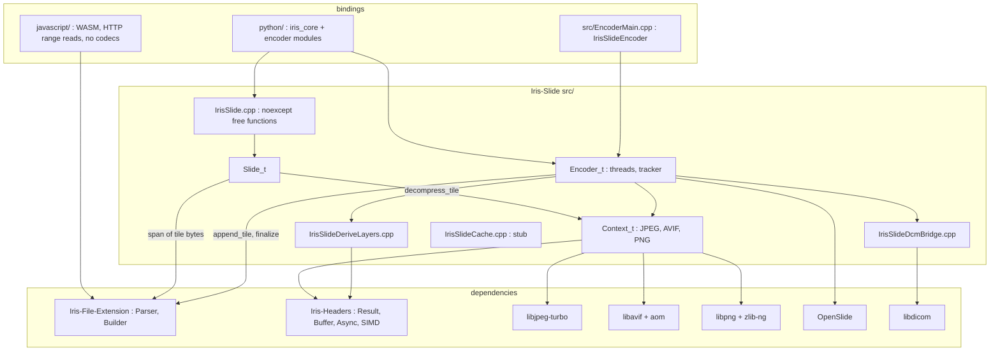
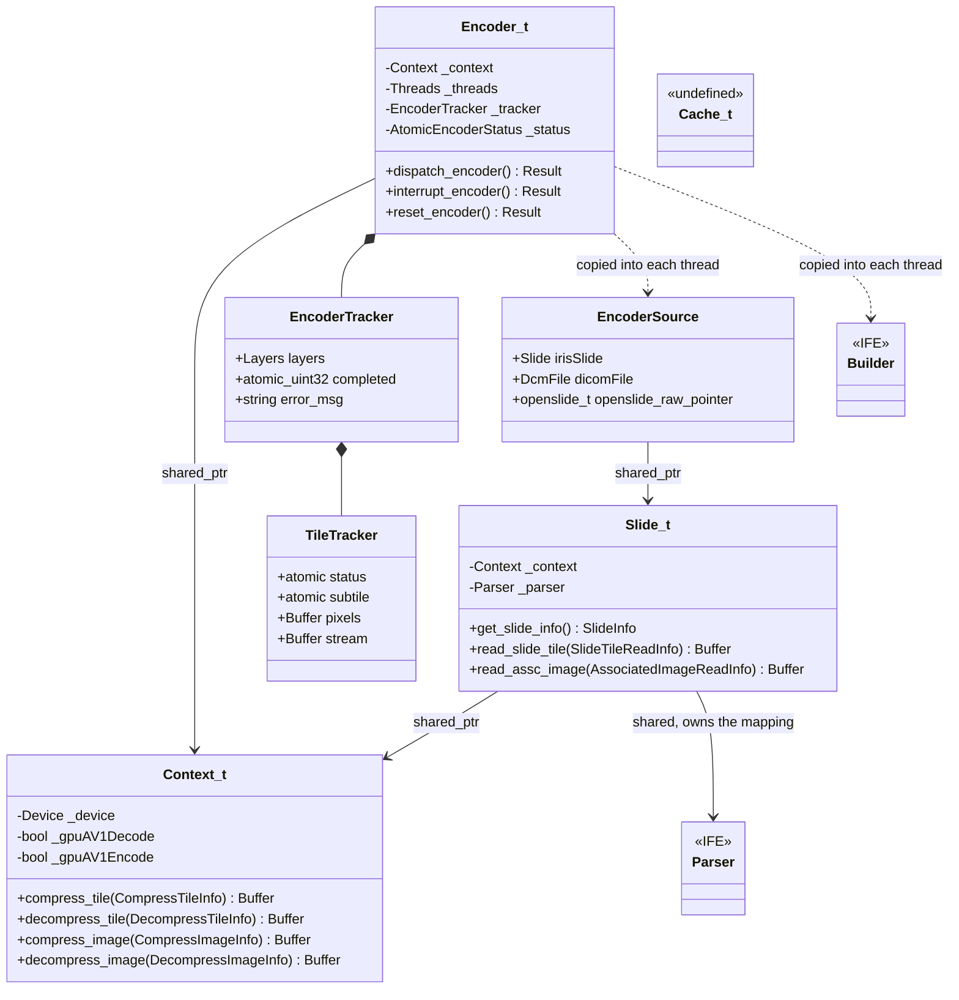

# Iris-Slide: Design and Code Audit

Date: 2026-11-24. Read-only audit; no repository was edited.

**Status after review (2026-11-24).** Kept as written, with references to a
proprietary consumer rewritten as a viewer's needs. B8 does not hold: the
auditor searched an IFE checkout without the rename; this tree builds against
Aptix-Bio/Iris-File-Extension#1, which renames the call. The maintainer's decisions of
the same day refine three fixes (C1, C2: size the decode from the stream's own
header; C3: patient identity only in the clinical stream). Each finding is
tracked as a WBS task in [../WBS.md](../WBS.md); the audit itself is not
edited again.

**Scope.** The tree of this repository as committed in 75f4949 (`src/`,
`python/`, `javascript/`, `cmake/`, `CMakeLists.txt`, `.github/workflows/`,
`README.md`), its public API in Iris-Headers (Aptix-Bio/Iris-Headers#5)
(`include/IrisSlideCore.hpp`, `include/IrisSlideTypes.hpp`, `priv/`, `src/`),
and the Iris-File-Extension (IFE) `Parser` and `Builder` it reads and writes
through. The rename itself is out of scope, except where it broke a call
(finding B8). Paths below are relative to the Iris-Slide tree unless prefixed
`headers/` or `IFE/`.

**Judged against.** `development/style_guide.md` (cited as *SG §Section*),
`development/ci_runners.md` (*CI §Section*), the needs of a GPU slide viewer
that reads tile streams itself and decodes them on its own threads into its
own staging memory, and the paper *The Iris File Extension* (Landvater, Olp, Yousif, Balis; J
Pathol Inform 2025;18:100461; https://pmc.ncbi.nlm.nih.gov/articles/PMC12309590/,
read 2026-11-24; the first ~40,000 characters were read verbatim, the rest
through a summary, so paper claims from the Discussion are marked *(to confirm)*).

**Evidence marks.** Every finding was verified by reading the cited lines
unless it says otherwise. *(inference)* marks a consequence reasoned from the
code and not reproduced. *(to measure)* marks anything unmeasured. *(to
confirm)* marks an external fact not checked against a primary source. Nothing
was compiled or run: the audit has no reproduction of any crash.

External facts checked (all read 2026-11-24):

| Fact | Source |
|---|---|
| `TJPARAM_JPEGWIDTH`/`HEIGHT` are read-only on a decompression handle; `tj3Decompress8` needs `pitch * destinationHeight` samples, the height being the JPEG's own | local `/opt/homebrew/include/turbojpeg.h` (libjpeg-turbo 3.2.1) and `godot/thirdparty/libjpeg-turbo/src/turbojpeg.c:698-706` |
| Without `TJPARAM_NOREALLOC`, `tj3Compress8` may reallocate the caller's buffer and the old one is then invalid | https://raw.githubusercontent.com/libjpeg-turbo/libjpeg-turbo/main/src/turbojpeg.h |
| `dcm_element_value_to_string()` returns a string the caller frees with `free()`, and may return NULL; NULL-element behaviour of the getters and `DcmFilehandle` thread safety are undocumented | https://raw.githubusercontent.com/ImagingDataCommons/libdicom/main/include/dicom/dicom.h |
| `openslide_read_region()` writes pre-multiplied ARGB and clears the destination on error; every function but `openslide_close()` is thread-safe | https://raw.githubusercontent.com/openslide/openslide/main/src/openslide.h |
| `avifRGBImage` width and height must match the `avifImage` or conversion fails; `imageDimensionLimit` defaults to 32768 | https://raw.githubusercontent.com/AOMediaCodec/libavif/main/include/avif/avif.h |

---

## 1. Architecture as it is

Iris-Slide is three things in one repository: a **decoder** (open an `.iris`
file, hand back decoded tiles and associated images), an **encoder** (read a
vendor slide, a DICOM series or another `.iris` file and write an `.iris`
file), and two **bindings** (pybind11; an Emscripten module that fetches
tiles over HTTP ranges and decodes nothing).

Read path: `open_slide` maps the file through `Iris::File::Parser::open`;
`Slide_t::read_slide_tile` takes a zero-copy `std::span` from `Parser::tile`,
wraps it in a weak `Buffer`, and `Context_t::decompress_tile` decodes it into a
caller's `Buffer` or a new one. No thread is started on the read path.

Write path: `Encoder_t::dispatch_encoder` opens the source, creates an IFE
`Builder` over a scratch file in the temp directory, and starts
`_concurrency + 1` `std::thread`s. Each worker claims tiles by
compare-and-swap, takes the source's compressed stream where one exists or
decodes and recompresses, and calls `Builder::append_tile`. With derivation
on, the workers read only the highest-resolution layer and an `Iris::Async`
pool downsamples into the layers below. Thread 0 then writes the structure
blocks, finalizes, and moves the scratch file to the destination.

The ownership web is acyclic: a `Slide_t` holds its `Context` and its
`Parser`; an `Encoder_t` holds its `Context`. `Context_t` holds nothing (its
`_device` is always null). The encoder's threads reach the encoder through raw
`this`, `&_tracker` and `&_status`, kept alive by the destructor's join.

---

## 2. Good design choices worth keeping

| # | Choice | Evidence | Why it is good |
|---|---|---|---|
| G1 | The file belongs to IFE. The slide holds a `Parser` that owns the read-only mapping, lifts the structure once at open so a damaged file is refused there, and reads tiles as zero-copy spans | `src/IrisSlide.cpp:47-49, 150-157, 183-187` | SG §Modules and Reuse (reuse before writing); the division of labour "the file owns the bytes, the codec owns the pixels"; the paper's low-instruction-count read |
| G2 | `Slide` / `Slide_t`, `Context` / `Context_t`, `Encoder` / `Encoder_t`: the shared pointer takes the plain name, and a dependent object holds a `shared_ptr` to what it needs | `headers/include/IrisSlideTypes.hpp:104-107`, `src/IrisSlide.hpp:11-13` | SG §Naming (shared types) and §Resources (ownership webs) |
| G3 | `codec_failure` builds every `Result` with domain, a scoped `SlideError` code, the offending value and `std::source_location`; the file-level functions are `noexcept` and catch `std::exception` | `src/IrisSlidePriv.hpp:59-63`, `src/IrisSlide.cpp:11-34`, `headers/include/IrisSlideTypes.hpp:44-60` | SG §Errors (Result at every boundary, offending value) and §Typing (named values) |
| G4 | Compressed tiles of a tiled source pass through unchanged, with the plane count their frame records | `src/IrisSlideEncoder.cpp:659-680` | The paper's lossless transfer of already-tiled input. The check that the encodings agree is missing (C5) |
| G5 | Each tile is claimed by one compare-and-swap on its status; a derived tile's completion is an atomic bit mask of its sub-tiles. No lock is held while a tile is read, compressed or written | `src/IrisSlideEncoder.cpp:651-654`, `src/IrisSlideDeriveLayers.cpp:224-236, 261-272` | the maintainer's claim-and-move-on rule; pairs with the Builder's lock-free append |
| G6 | Derivation of the next layer is queued as a task on the pool instead of called recursively, and the reader is held back by a named bound on pending work | `src/IrisSlideDeriveLayers.cpp:303-310`, `src/IrisSlideEncoder.cpp:16, 1079-1080` | SG §Control Flow (never recurse; queue the calls). The bound is polled with a sleep (A6) |
| G7 | The slide is written to a scratch file removed by an RAII guard, declared ahead of the Builder so the mapping is released first, and moved into place only after `finalize` | `src/IrisSlideEncoder.cpp:916-925, 1043-1044, 1104-1112` | SG §Resources (self-cleaning); a failed encode leaves no partial `.iris` file. Where the scratch file lives is finding C16 |
| G8 | The encoder decides the block layout, stable blocks ahead of those an edit replaces; the Builder writes where it is told | `src/IrisSlideEncoder.cpp:821-892` | One owner per decision; matches IFE's stated split |
| G9 | Third-party versions are pinned once, in Iris-Headers' `cmake/dependencies.cmake`; the OpenSlide URL and directory derive from one variable; the fetch owner has no silent fallback and fails with the value git returned | `cmake/iris-repositories.cmake:42-49, 90`, `cmake/openslide.cmake:19-21` | SG §Typing (define conventions once), §Principles (fail loudly) |
| G10 | Workflows are reusable (`workflow_call`), run on non-draft pull requests and by hand, ignore docs-only changes, and cancel a superseded run | `.github/workflows/cmake-linux-CI.yml:3-15`, `build-linux.yml:3` | CI §When a runner runs, §Modular reuse |
| G11 | The codecs run single-threaded per call (`maxThreads = 1`), and the read path starts no thread and keeps no state | `src/IrisSlideContext.cpp:24, 484, 496, 555` | a viewer's own decode pool owns the threads |
| G12 | The cache stub says it is unimplemented and creates no file | `src/IrisSlideCache.cpp:11-22` | SG §Principles (fail loudly). The surface around it should go (A2) |
| G13 | Most `switch` statements over the project's enums are exhaustive with no `default:` | e.g. `src/IrisSlideContext.cpp:598-622`, `src/IrisSlideEncoder.cpp:580-596` | SG §Typing |

---

## 3. Poor design choices and defects

Counts: 17 correctness and safety (C), 9 API and design (A), 8 build, CI and
packaging (B), 3 documentation (D). 37 in all.

### 3.1 Correctness and safety

**C1. JPEG decode writes the JPEG's own dimensions into a buffer sized for the
declared ones. Critical.**
`src/IrisSlideContext.cpp:417-458`. The buffer is `width * height * bytes`
for the dimensions the caller declares (256 x 256 for a tile, line 426). Lines
436-437 call `tj3Set(TJPARAM_JPEGWIDTH/HEIGHT)`, which is read-only on a
decompression handle and returns an error that is not checked; `tj3Init` is
not checked either. `tj3Decompress8` (line 438) then decodes whatever size the
stream's header states, with `pitch = 0`.
Breaks: SG §Principles (fail loudly), §Errors (a vendor error is thrown).
Failure: a tile stream whose JPEG header says 4096 x 4096, in a corrupt or
hostile `.iris` file or a DICOM frame passed through, writes about 67 MB past
a 262,144-byte heap buffer, or past a caller's staging memory or NumPy array.
A smaller JPEG leaves the rest of the tile uninitialized and reports success.
*(overflow is inference from the TurboJPEG contract above; not reproduced.)*
Fix: call `tj3DecompressHeader`, compare `TJPARAM_JPEGWIDTH/HEIGHT` with the
expected extent, throw with both sizes on a mismatch, and set
`TJPARAM_MAXPIXELS`. The maintainer, 2026-11-24, set the rule: size the buffer from
the JPEG's own header, so it is exact and cannot overflow.

**C2. PNG decode trusts the declared size and source format, and ignores the
requested format. Critical.**
`src/IrisSlideContext.cpp:277-367`. Row pointers cover `height` rows of
`width * bpp` bytes from the file's `AssociatedImageInfo` (lines 307-328);
`png_read_png` with `PNG_TRANSFORM_IDENTITY` (line 348) writes the rows the
PNG's own IHDR describes. `desiredFormat` is unused: the conversion is
commented out behind `int enable_convert_format = 0; // Cause compiler
warning` (lines 351-357).
Failure: (a) a PNG taller, wider or deeper than declared writes past the row
array and the pixel buffer *(inference)*. (b) `Slide_t::read_assc_image` sizes
the destination for the desired format (`src/IrisSlide.cpp:249-267`) but the
decoder fills it in the source format: an RGB PNG read as RGBA returns three
quarters of a buffer of 3-byte pixels labelled RGBA, and a BGRA label image
(every OpenSlide source, `src/IrisSlideEncoder.cpp:421`) returns with red and
blue swapped. Python's `read_associated_image` always asks for RGBA
(`python/IrisSlidePython.hpp:146-151`).
Fix: read IHDR first, refuse a mismatch with the sizes, and use libpng's own
transforms (`png_set_bgr`, `png_set_add_alpha`, `png_set_strip_alpha`) to
produce the requested format.

**C3. Asking for patient identifiers to be stripped does nothing on three
paths. Critical (privacy, silent).**
(a) CLI: `-sm/--strip_metadata` sets a local `strip_metadata`
(`src/EncoderMain.cpp:97, 137-139`) that is never copied to `info.anonymize`.
(b) OpenSlide sources: `READ_OPENSLIDE_METADATA` takes `anonymize` and never
reads it (`src/IrisSlideEncoder.cpp:347-407`); every vendor property is
copied and every associated image, the label and macro included, is encoded.
(c) Python: `encode_slide_file(strip_metadata=...)` is never used
(`python/Iris/Encoder/__init__.py:22`); only `anonymize` reaches the encoder.
`README.md:154, 458, 488` documents all three as working.
Breaks: SG §Principles (fail loudly), §State (no dead writes).
Failure: `IrisSlideEncoder -s case.svs -sm` writes a file carrying the
scanner's patient fields and the slide label, and exits as if it had not.
Fix: one `anonymize` field honoured by every source through one function that
drops attributes and associated images; a test that reads the output back and
finds neither.

**C4. A DICOM series with no ICC profile dereferences null.**
`src/IrisSlideDcmBridge.cpp:367-388`. When the element is missing the block
prints a warning (which names the wrong tag) and falls through to
`std::string((const char*)data, dcm_element_get_length(element))` with both
null.
Failure: any DICOM whose optical path carries no `ICCProfile` crashes the
encoder at the metadata step, after every tile has been encoded.
*(libdicom's behaviour on a NULL element is undocumented; the `std::string`
construction from null with a non-zero length is undefined either way.)*
Fix: early return when there is no profile.

**C5. The tile table is labelled with the requested encoding while source
streams pass through in the source's encoding. High (wrong output).**
The table takes `_encoding` (`src/IrisSlideEncoder.cpp:988-990`). Pass-through
streams are appended as they are (`:659-680`; derive mode `:729` and
`src/IrisSlideDeriveLayers.cpp:314-326`). Nothing compares `source.encoding`
with `_encoding`.
Failure: `-e AVIF` on a JPEG DICOM series, or on a JPEG `.iris` file, writes
JPEG streams into a file that declares AVIF: no tile decodes. With derivation
the top layer is JPEG and the derived layers AVIF in one file.
Fix: a pass-through is taken only when the encodings are equal; otherwise
decode and recompress, or refuse naming both encodings.

**C6. Derivation treats every format as four channels.**
`src/IrisSlideDeriveLayers.cpp:198-206`: `channels = 3;` has no `break`, so
it falls through to `channels = 4`. The `assert` on line 214 then insists on
4, so 3 was never reachable.
Failure: deriving layers from an `.iris` source whose format is `R8G8B8` or
`B8G8R8` allocates 196,608-byte canvases (`:97-112`) and downsamples them as
262,144 bytes: heap over-read of the source tile and overflow of the derived
one *(inference; needs a 3-channel source, which this encoder does not itself
write)*.
Fix: one `bytes_per_pixel(Format)` function (A4), thrown on `UNDEFINED`.

**C7. Encoder lifecycle: reuse terminates the process, and failures escape
`noexcept`.**
(a) After a successful encode the status returns to `ENCODER_INACTIVE` with
every thread still joinable (`src/IrisSlideEncoder.cpp:1123-1127`). A second
`dispatch_encoder` assigns `_threads = Threads(...)` (`:1031, 1034`), which
destroys joinable `std::thread`s: `std::terminate`. The API invites reuse
(`set_encoder_src`, "must complete before reuse", `:943-944`).
(b) `dispatch_encoder` catches a null encoder's exception and then calls
`encoder->reset_encoder()` on it (`:84-92`).
(c) The encoder's boundary functions catch `std::runtime_error` only
(`:69, 80, 89, 99, 108`), while the Builder throws `std::logic_error` kinds
(the code's own comment, `:689`), `std::stoll` throws `std::invalid_argument`
(`src/IrisSlideDcmBridge.cpp:106`), and allocation throws `std::bad_alloc`.
Each terminates through `noexcept`.
Breaks: SG §Errors (catch by type at the boundary, `catch (...)` last, never
silent).
Fix: join in the completion path or before reassigning; check before use;
catch `const std::exception&` then `...` at every boundary through one helper
(A4).

**C8. Data races on the encoder's shared state.**
(a) `get_encoder_progress` reads `_tracker.error_msg` and `_tracker.dst_path`
with no lock while active (`src/IrisSlideEncoder.cpp:215-216`), while workers
append to `error_msg` under the mutex (`:691-693`); the error case takes the
mutex through `const_cast` (`:220`).
(b) `reset_encoder` and the destructor join `_threads[i]` (`:182-183,
265-266`) while thread 0 may still be assigning `_threads[i]` (`:1061-1089`).
(c) `_dstPath` is rewritten in `dispatch_encoder` (`:972-978`) and read by
`get_dst_path` without synchronization.
Failure: a progress poll during a failing encode reads a `std::string` being
reallocated; `interrupt` followed by `reset` during start-up joins a thread
object being move-assigned. Undefined behaviour in both *(inference; no
ThreadSanitizer run exists)*.
Fix: thread 0 creates and joins its own workers in a local container (or one
`Iris::Async` pool, A6); the error text is published once through an atomic
state change; a ThreadSanitizer test covers poll, interrupt and reset.

**C9. The command-line encoder reports success on failure.**
`src/EncoderMain.cpp`. (a) On `ENCODER_ERROR` it prints the message and falls
off the end of `main`, returning 0 (`:254-261`). (b) `toupper(c)` and
`tolower(c)` discard their results (`:75, 84`), so `-e avif` and `-d 2X` are
rejected. (c) `std::locale("en_US.UTF-8")` (`:93`) throws where the locale is
not installed, a stock container for one, and `main` has no handler. (d)
`ioctl` is unchecked (`:186-187`), so with stdout piped the bar width is
uninitialized. (e) `-sm` is finding C3.
Breaks: SG §Errors (a non-zero exit at a command line's `main`).
Fix: one `try` in `main`, a non-zero exit on every failure, and an argument
table.

**C10. OpenSlide source: errors unchecked, handle never closed, alpha
pre-multiplied.**
`src/IrisSlideEncoder.cpp:314-333, 425-432, 559-570`. `openslide_get_error`
is never called, and OpenSlide clears the destination on error, so a read
error encodes a black tile and the encode succeeds. `openslide_close` appears
nowhere: `EncoderSource::openslide` is a raw pointer copied into every thread
(`src/IrisSlidePrivTypes.hpp:76-91`). The pre-multiplied ARGB is compressed
as `B8G8R8A8` with alpha ignored (`src/IrisSlideContext.cpp:482`), so
unscanned regions, which OpenSlide leaves transparent, encode black *(to
confirm against a sparse vendor slide)*. `READ_OPENSLIDE_TILE` takes the
source by value and copies its `Extent` again on line 318, two vector copies
per tile.
Breaks: SG §Resources (RAII always), §Principles (fail loudly).
Fix: a `unique_ptr<openslide_t, closer>` inside a source object (A4); check
the error after each read and throw it; composite on white.

**C11. DICOM bridge: recursion, leaks and undefined behaviour.**
`src/IrisSlideDcmBridge.cpp`.
- `PARSE_NESTED_ELEMENT` calls itself (`:176-220`, with a comment conceding
  it), and `COLLECT_SEQ` and `COLLECT_SEQ_TAG` recurse through libdicom's
  callbacks to the depth the file dictates (`:272-307`). SG §Control Flow
  forbids both, "including through a callback". A file with deeply nested
  sequences overflows the stack.
- `:71-77` clears the error, then reads its message; `std::string + nullptr`.
- `dcm_element_value_to_string` results are never freed and never checked for
  NULL (`:232, 256, 297, 330, 353`): one leak per attribute, and a null
  dereference where the library returns NULL.
- File handles leak when a level is dropped (`:446, 473, 481, 494`) and when
  `GET_STUDY_INSTANCE_UID` throws (`:146-151`); `DicomLevelDimension` holds a
  raw handle.
- `levels.erase(l_it); continue;` reuses the erased iterator (`:473, 481,
  494`).
- `levels.back()` is read before the empty check (`:454` against `:500`).
- `substr(1, ',')` passes a character as a length (`:235`); the JSON written
  for sequences is not escaped (`:297-300`).
- `NOW` and `YMD` are namespace-scope objects initialized at load (`:337-338`).
Fix: RAII handle types; an explicit queue for the sequence walk; free and
check each string; `l_it = levels.erase(l_it)`.

**C12. DICOM bridge: wrong output.**
(a) A level's frames are assumed to fill the grid in row-major order: frame
`tile + 1` (`src/IrisSlideEncoder.cpp:484`), guarded only by an `assert`
(`:468`). A sparsely tiled series in a release build writes tiles to the
wrong positions or fails on a frame number.
(b) Microns per pixel is divided by the downsample
(`src/IrisSlideEncoder.cpp:500`) where the OpenSlide path multiplies
(`:370-372`). The specification normalizes it to layer scale 1
(`IFE/spec/ife_spec.adoc:429-432`), which is the multiplication: a
DICOM-sourced slide's measurements are wrong by the square of the downsample
*(inference from the two paths and the spec; no slide measured)*.
(c) A level one tile wide or tall is discarded as a thumbnail (`:444-446`).
(d) Transfer syntaxes `.51` (12-bit) and `.70` (lossless) are labelled JPEG
(`:158-171`) and then decoded with the 8-bit call.
Fix: read the per-frame positions or refuse a sparse series by name; one
normalization function used by both sources, with a test on a known spacing.

**C13. The caller's destination is honoured for JPEG only, and AVIF
associated images cannot be decoded.**
`DECOMPRESS_AVIF_CPU` and `DECOMPRESS_PNG` test `dst_buffer->size()` where
JPEG tests `capacity()` (`src/IrisSlideContext.cpp:539, 323` against `:431`).
A new strong buffer has size 0 (`headers/src/IrisBuffer.cpp:74-77`), so
`Slide_t::read_slide_tile`'s own allocation (`src/IrisSlide.cpp:210`) is
thrown away and made again for every AVIF tile, a caller's buffer with
capacity and no size is silently replaced, and the result's size is never
set. For images, the decoder limits dimensions to 256
(`src/IrisSlideContext.cpp:556`) and converts into an `avifRGBImage` whose
width and height stay 256 from the blank constant (`:13-27, 543-547`), which
libavif refuses unless the image is exactly 256 x 256.
Fix: one destination rule (A4): capacity checked, size set, a destination
that is too small is an error naming both sizes; `avifRGBImageSetDefaults`
from the decoded image after checking its extent.

**C14. Failures are printed and swallowed.**
- `get_slide_annotations` returns success and an empty list in a release
  build, behind `assert(false)` (`src/IrisSlide.cpp:135-149`). A slide with
  annotations reports none. `annotate_slide`, `compress_tile` and
  `decompress_tile` have the same `assert(false)` then fall-through shape
  (`src/IrisSlide.cpp:128`, `src/IrisSlideContext.cpp:611, 620, 639, 646`).
- `open_slide`, `read_slide_tile`, `read_associated_image` and
  `create_encoder` return null and write the reason to `std::cerr`
  (`src/IrisSlide.cpp:35-57, 71-89, 106-121`); the JPEG and AVIF decoders
  drop the vendor's message the same way (`src/IrisSlideContext.cpp:450-454,
  517-521, 579-583`).
- An associated image that fails to encode is reported on stdout and skipped
  (`src/IrisSlideEncoder.cpp:816-819`).
- Python: an out-of-range tile returns the uninitialized array
  (`python/IrisSlidePython.hpp:73-82`); a failed read returns an empty array
  and prints that the buffer was too small (`:61-64, 92-95`).
Breaks: SG §Errors (Result at every boundary; a Result becomes a Python
exception in the bindings), §Principles ("never returns empty and hopes the
caller notices").
Fix: finding A1's signatures.

**C15. Buffer ownership across library allocators.**
`COMPRESS_JPEG` passes a `Buffer`'s `malloc` pointer to `tj3Compress8`
without `TJPARAM_NOREALLOC` (`src/IrisSlideContext.cpp:376-407`): if the
library reallocates, the `Buffer` holds a freed pointer and the new block is
never released. The buffer is sized by `tjBufSize`, so this should not occur,
and the code says so; the parameter makes it impossible. `COMPRESS_AVIF_CPU`
adopts libavif's allocation into a `Buffer` that calls `free`
(`:513-515`) *(to confirm that the allocators match on every platform)*.
libpng's error handler throws a C++ exception through C frames (`:164-169`)
*(to confirm for each toolchain, the Emscripten build in particular)*.

**C16. Scratch file, shutdown and thread count.**
(a) The scratch file is the whole slide, written to
`std::filesystem::temp_directory_path()` (`src/IrisSlideEncoder.cpp:999-1001`).
Where that is a RAM-backed tmpfs the slide is held in memory *(to confirm per
distribution)*; where it is another volume, the fallback `copy_file`
(`:1109-1112`) writes the slide twice and is not atomic. Fix: create the
scratch file beside the destination and rename.
(b) The destructor waits for an active encode to finish instead of
interrupting it (`:167-184`): dropping the last handle blocks for the rest of
the encode.
(c) `Threads(_concurrency + 1)` (`:1034`) with a concurrency of 0, which
`hardware_concurrency()` may return, starts no worker; the Builder then
refuses unappended tiles, so it fails loudly but with a misleading message.

**C17. JavaScript module.**
`javascript/IrisSlideJavascript.cpp`. (a) The file size is carried in
`size_t` (`:60, 357, 407`), 32 bits in this build (no `-sMEMORY64`,
`javascript/CMakeLists.txt:79-104`): a slide of 4 GiB or more is opened with
a wrapped size and fails validation *(inference)*. (b) A `NULL_TILE` entry
builds the range `bytes=o-(o-1)` (`:264-266`). (c) `_openSlide` throws
through the binding on one failure and returns `undefined` on the others
(`:406-420`). (d) Range support is probed with a bare one-second timeout
(`:92`). (e) Validate then open fetches everything twice.

### 3.2 API and design

**A1. The public API does not offer the one call a viewer needs.**
`headers/include/IrisSlideCore.hpp`. Decoding is reachable only through a
`Slide` opened from a path; `Context_t::decompress_tile` is private
(`src/IrisSlideContext.hpp`). A viewer that reads streams through IFE's `Parser`
itself and decodes into its own staging memory as RGB needs the signature the
library lacks:
`[[nodiscard]] Result decompress_tile(const DecompressTileInfo&, Buffer&
decoded) noexcept`. `IrisSlideTypes.hpp` also declares `Iris::Device` as
`std::shared_ptr<struct Device_t>` (`headers/include/IrisSlideTypes.hpp:31-35`),
which collides with any consumer's own `Iris::Device` in a file including
both. None of the creation functions follow `create_<name>(const <Name>Desc&,
<Name>& out) -> Result` (SG §Naming); `create_encoder` takes its info by
non-const reference and rewrites its context and destination
(`src/IrisSlideEncoder.cpp:42-74`); the optional derivation is a raw pointer
(`headers/include/IrisSlideTypes.hpp`, `EncodeSlideInfo::derivation`).
Fix: publish stateless `decompress_tile` and `compress_tile` over
`std::span` and a destination `Buffer`, returning `Result`; remove the
`Iris::Instance/Device/Queue` declarations from a CPU library; adopt the
`create_` form with `[[nodiscard]]`.

**A2. Surface declared and never built.**
SG §Principles (minimum code surface), §Comments (dead code is deleted).
- Cache: `read_cache_entry`, `cache_store_entry` and `set_encoder_src_cache`
  are exported declarations with no definition anywhere; `Cache_t` is never
  defined; five cache types sit in the public header; `CACHE_ACCESS_COMPRESS_TILE`
  and `CACHE_ACCESS_DECOMPRESS_TILE` are both 0.
- Annotations: two functions and `Slide_t::write_slide_annotation`.
- `SlideOpenInfo::writeAccess`, `EncodeSlideInfo::srcFormat` and
  `desiredFormat`, `EncoderDerivation::method`, `EncodeStreamInfo`: accepted
  and ignored. Python's `desired_byte_format` therefore does nothing.
- `Context_t::get_quality/set_quality/get_subsampling/set_subsampling`:
  declared, never defined (`src/IrisSlideContext.hpp:21-24`). There is no way
  to set quality: every tile is encoded at `QUALITY_DEFAULT`.
- `_device`, `_gpuAV1Decode`, `_gpuAV1Encode` are never set; `ENCODER_SRC_APERIO`
  and `TIFF* svs`; the `Tile` alias; the unreachable `case TILE_FREE`
  (`src/IrisSlideDeriveLayers.cpp:230`); commented-out members and blocks.
Fix: delete them; add a test that every exported declaration links (IFE has
`tests/exported_symbols.cmake` to copy).

**A3. The installed library cannot encode.**
The shared and static libraries hold `IrisSlideSources` only
(`CMakeLists.txt:124-129, 203-227`); the encoder sources are compiled into
the executable and the Python module (`:130-136, 230-236, 348-354`). A C++
program that includes `IrisSlideCore.hpp` and calls `create_encoder` fails to
link. Fix: two targets, a decoder library and an encoder library that links
it, each exporting only what it defines (SG §Modules: nothing links what it
does not use).

**A4. Redundant pipelines to consolidate.**
SG §Principles: "If two routines move similar data in similar ways, merge
them."
- `ENCODE_SOURCE_PYRAMID` and `ENCODE_DERIVE_PYRAMID` are the same claim,
  read, hand-on loop (`src/IrisSlideEncoder.cpp:626-757`).
- `OPEN_SOURCE` and four `switch (sourceType)` blocks (`GET_SOURCE_TILE`,
  `READ_SOURCE_TILE`, `READ_METADATA`, `APPEND_ASSOCIATED_IMAGES`) describe
  one interface: a source with `extent`, `encoding`, `stream(layer, tile)`,
  `pixels(layer, tile)`, `metadata(anonymize)`, `images()`. One type per
  source also gives each handle an owner (C10, C11).
- Bytes per pixel is spelled as a switch seven times
  (`src/IrisSlideContext.cpp:54, 200, 309`; `src/IrisSlide.cpp:192, 249`;
  `src/IrisSlideDeriveLayers.cpp:97, 198`), one of them wrong (C6).
- `Slide_t::read_slide_tile` and `read_assc_image` differ in two lines
  (`src/IrisSlide.cpp:181-283`); the four `(DE)COMPRESS_*` functions each
  re-derive the destination rule, differently (C13).
- Twelve boundary functions repeat the same `try`/`catch`; one helper taking
  a callable gives one catch list (C7).
- The version is parsed from the header by two copies of a CMake function
  and spelled again in Python (`CMakeLists.txt:20-47`,
  `javascript/CMakeLists.txt:17-44`, `python/IrisSlidePython.hpp:15-22`).
- `javascript/` defines a second `IrisSlide::Slide_t`.

**A5. Lifetimes kept alive by convention.**
Worker threads receive `&_tracker`, `&_status` and `this`
(`src/IrisSlideEncoder.cpp:1037, 1063-1075`), and `DerivationInfo` is a
struct of six references to thread 0's locals
(`src/IrisSlidePrivTypes.hpp:106-117`), guarded by a comment in capitals
(`src/IrisSlideEncoder.cpp:1047`). It holds today because the destructor
joins. SG §Resources asks for the web to make it true by construction and for
a test that drops every owner in each order.

**A6. Two thread sets and a polling wait.**
In derive mode the encoder runs `_concurrency` reader threads and a pool of
`_concurrency` workers (`src/IrisSlideEncoder.cpp:1034, 1048`), twice the
cores asked for, and the readers wait on the pool by sleeping 1 ms in a loop
(`:1079-1080`). Reuse `Iris::Async` for both (SG §Modules, reuse before
writing) and bound the work in flight by a counted claim; the choice is to be
judged on a benchmark at real tile cost *(to measure)*.

**A7. Macros, reserved names, bare numbers, `goto`.**
- `#define _Float16 float` redefines a reserved name
  (`src/IrisSlidePriv.hpp:19-21`); five cast macros (`:22-36`) and
  `SUBTILES_COMPLETE` (`src/IrisSlidePrivTypes.hpp:61`) are macros where SG
  §Typing asks for `constexpr`.
- Reserved identifiers with a double underscore throughout: `__tileStatus`,
  `__LI`, `__TI`, `__i`, `__png_encoder`, `__bs` (SG §Naming; clang-tidy
  `bugprone-reserved-identifier` would fail each).
- Functions named like macros (`COMPRESS_JPEG`, `OPEN_SOURCE`); `get_*`
  accessors; `BITS_PER_PIXEL` returns bytes; `codec_failure` kept the old
  name; `using namespace Iris;` in a header (`src/IrisSlideContext.hpp:11`);
  private headers include nothing and depend on `IrisSlidePriv.hpp`'s order.
- Bare numbers: `encoder->speed = 10`, layer counts 9 and 5 and masks `0x0F`,
  `0x03` (`src/IrisSlideDeriveLayers.cpp:21-34, 134-162`), `0xFF` for white,
  the 1 ms and 1 s sleeps, zlib level from `quality / 100 * 9`.
- `goto` in four places (`src/IrisSlideEncoder.cpp:546, 555, 938-942`;
  `src/IrisSlideDeriveLayers.cpp:226`; `src/IrisSlideDcmBridge.cpp:230, 254`),
  and assignment inside a condition (`src/IrisSlideDeriveLayers.cpp:269`).

**A8. Python binding.**
`python/`. No call raises (C14). The interpreter lock is held through every
decode, so Python threads cannot read in parallel. `_read_slide_tile_coords`
copies the whole `SlideInfo`, attribute map included, for each tile
(`python/IrisSlidePython.hpp:72`). Two extension modules each embed the whole
library (`CMakeLists.txt:316-321, 348-354`), which is why import order
matters (`python/Iris/Encoder/__init__.py:12-14`). `encode_slide_file` is
annotated `-> Result`, catches `Exception`, prints, and returns `None`
(`:83-85`). The `.pyi` stubs are written by hand and already disagree
(`concurrency: int = 8`). No `mypy --strict` (SG §Typing).

**A9. Z-stacked tiles have no read path.**
The encoder carries plane counts through
(`src/IrisSlideEncoder.cpp:680, 909-915`), but `SlideTileReadInfo` has no
plane and `read_slide_tile` decodes the stream as one image
(`src/IrisSlide.cpp:181-223`). What a multi-plane stream returns is undefined
by this library *(to confirm against IFE's frame layout)*.

### 3.3 Build, CI and packaging

**B1. Moving dependencies.** Iris-Headers and IFE are fetched at
`origin/main` (`cmake/iris-repositories.cmake:62, 78`), and the workflows
clone IFE's tip. A release, and a PyPI source build months later, compiles
whatever the two tips are that day. Vulkan-Headers has no hash
(`CMakeLists.txt:73-76`); `vcpkg`, `emsdk install latest`, `pip install
meson ninja`, and `pyproject.toml`'s build requirements are unpinned. CI
§Robustness: pin what can move. Fix: commit SHAs in one pin file, bumped by a
pull request.

**B2. A CPU decoder that needs Vulkan, VMA, GLM, libdicom and Meson.**
`CMakeLists.txt:73-94, 105, 145-148`; `src/IrisSlideContext.cpp:9` includes
`IrisCoreVulkan.hpp` and uses nothing from it. `cmake/dicom.cmake` runs for a
decoder-only build. SG §Modules: nothing links what it does not use.

**B3. `cmake/hwy.cmake` is a copy of `avif.cmake` half-renamed.** The library
name is `libavif.a` (`:4, 7`), the header probe is `hwy/highwyas.h` written
into `AVIF_INCLUDE` (`:28`), and `hwy_LIBRARY` is linked nowhere. It works
because `IrisSIMD.cpp` uses static dispatch and needs only headers
(`headers/src/IrisSIMD.cpp:436-452`).

**B4. No tests, no warnings, no analysis.** There is no `tests/` directory,
no `enable_testing()`, no warning flags, no `.clang-tidy`, no sanitizer
preset and no `CMakePresets.json`. CI compiles and uploads; it never runs the
encoder, imports the Python module or opens a slide. Every finding in §3.1
reached this tree with nothing able to catch it.

**B5. Against the CI directive.**
- Images are `ubuntu-latest`, `macos-latest`, `windows-latest`;
  `actions/checkout@v3` in the WASM workflow; the PyPI publish action tracks
  a branch (CI §Robustness: pin).
- No job has a timeout; `-j$CPU_COUNT` expands to a bare `-j`
  (`build-linux.yml`, `build-macos.yml`, `build-wasm.yml`), unbounded
  parallelism (CI §Robustness: bound everything).
- Linux, macOS, Windows and WASM run as four independent workflows on every
  pull request; macOS is not gated on Linux (CI §When: cheapest first).
- The compiler-cache key is the constant `ccache-<os>`, shared by gcc, clang
  and both architectures and never rewritten once saved; it is saved at job
  end (CI §Caches: keys from content, save as soon as filled).
- The wheels build every dependency from source (aom, libavif, libjpeg-turbo,
  libpng, zlib-ng, highway, libdicom) once per Python version per platform,
  twelve times (CI §Modular reuse: identical work runs once; prebuilt over
  built).
- A release rebuilds everything instead of reading what CI saved, runs on no
  release-candidate tag, and its concurrency group `Github Release` lets one
  release cancel another.
- `distribute-pypi.yml` rewrites `pyproject.toml` with `sed` before building
  the source distribution, and publishes with no test in front of it.

**B6. Release artifacts are mislabelled.** The matrix names the x86-64 runner
`aarch64` and the Arm runner `amd64` (`cmake-linux-CI.yml:33-38`,
`distribute-releases.yml:26-31`), so `iris-slide-ubuntu-aarch64.tar.gz`
holds x86-64 binaries. Every `*.tar.gz` is made with `tar -cvf`, with no
compression. No step checks an output exists or runs it (CI §Robustness: fail
loudly).

**B7. Global build state.** `include_directories` and
`add_compile_definitions` at directory scope in every `cmake/*.cmake` and
`cmake/iris-repositories.cmake:74`; the encoder executable is conditional on
a library it does not link (`CMakeLists.txt:229`).

**B8. The rename reached into IFE's API.** `src/IrisSlide.cpp:15` calls
`Parser::is_iris_slide_file()`; IFE declares `is_iris_codec_file`
(`IFE/include/IrisFileExtension.hpp`, branch `aptix-main`; no
`is_iris_slide_file` anywhere in IFE). The tree does not compile against that
IFE until one side changes *(verified by search; not built)*. Whether the
package names `Iris-Slide` (PyPI), `iris-slide` (npm) and `iris-slide`
(conda-forge, `README.md:97-104`) exist and are Aptix's is *(to confirm)*
before the first release publishes to them.

### 3.4 Documentation

**D1. The README documents features the code does not have:** metadata
stripping (`:38, 154, 458, 488`; C3), `desired_byte_format` (`:457, 487`;
A2), GPU contexts and SIMD format conversion (`:336`), and it spells
`Wrap_weak_buffer_from_data` where the API is `Wrap_weak_buffer_fom_data`
(`:319`).

**D2. Comments and docstrings that state the opposite of the code.**
`SUBSAMPLE_444, // Lossless`; the encoder's Python docstring calls it
"thread-safe" (`python/IrisEncoderPython.cpp:119`; C8); `[4,256,256]` for an
array of shape `[3,256,256]` (`python/IrisSlidePython.hpp:365`); "OpenSlide
is always ARGB (big-endian)" beside `FORMAT_B8G8R8A8`; the ICC warning names
the objective lens; file headers carry three different version numbers.

**D3. No design document.** No `ARCHITECTURE.md`, no decisions, no diagram of
the encoder's tile state machine, which is the one part a reader cannot
reconstruct quickly. See §5.

---

## 4. Gaps against the paper's goals and a viewer's needs

| Need | State | Evidence |
|---|---|---|
| **Speed of tile retrieval** (paper: 6,400 to 8,100 tiles/s through Python on an M1, about 0.14 ms a tile) | No benchmark in the repository, so the figure cannot be re-measured or defended against a regression. Per tile the decoder creates and destroys a codec handle (`src/IrisSlideContext.cpp:435, 552`), allocates the destination, and for AVIF allocates it twice (C13). Handle reuse per thread is the obvious experiment *(to measure)* | B4, C13 |
| **Deep validation and recovery** | `validate_slide` forwards to IFE. Recovery is not exposed. Decode-time validation of a stream against its declared extent is absent (C1, C2) | `src/IrisSlide.cpp:25-34` |
| **Annotations and metadata** | Read and write of annotations are stubs that succeed with nothing (C14) | `src/IrisSlide.cpp:122-149` |
| **Parallel encode, lossless transfer of tiled input** | Present (G4, G5), without the encoding check (C5). The paper's "most files encode in 1 to 2 minutes" has no benchmark here *(to measure)* | C5 |
| **Vendor-agnostic input** | OpenSlide and DICOM. DICOM is single-threaded on the read side, drops associated images (`src/IrisSlideEncoder.cpp:809-810`), and assumes a full grid (C12) | C11, C12 |
| **Decode a stream the viewer fetched itself** | Not public (A1) | A1 |
| **Decode to RGB, three bytes, into the caller's staging memory** | JPEG can (`TJPF_RGB`, capacity honoured). AVIF and PNG replace the caller's buffer (C13). Nothing returns a `Result` (C14) | C13, C14 |
| **Whose threads** | The read path starts none and holds no state, which is what a viewer that owns its decode pool needs (G11). If Iris-Slide were ever to own decode threads, the "returns when nothing of this caller's is queued or running" call does not exist | G11 |
| **Future GPU-buffer import** | `ContextCreateInfo::device` is accepted and discarded (`src/IrisSlideContext.cpp:587-591`). A weak `Buffer` over mapped memory works today for JPEG only. The design is better started from a destination type than from a device handle; which is right is the maintainer's decision | A2, C13 |
| **Encodings belong to IFE** | A pass-through of an `.iris` source decodes nothing, so it could carry an encoding this library cannot decode; today `OPEN_SOURCE` and `dispatch_encoder` assume JPEG or AVIF (`src/IrisSlideEncoder.cpp:955-962`). Open question for the maintainer, not a recommendation | C5 |
| **Z-stacks** | Written through, not readable by plane (A9) | A9 |
| **Browser** | Fetch only; files of 4 GiB and over fail (C17). The paper notes the 32-bit limit | C17 |

---

## 5. Missing project structure

Compared with the maintainer's other projects (SemanticZoom, FastFHIR) and IFE itself:

| The maintainer's other projects have | Iris-Slide has |
|---|---|
| `ARCHITECTURE.md`: a design contract with dated, locked decisions and open questions | None |
| `development/` with `WBS.md`, `RTM.md`, a phase log; a commit updates the task and requirement rows it touches | None; no traceability from a requirement to code or a test |
| Tests written before code, in tiers (unit, contract, corpus, damage sweep in IFE) | **No tests of any kind** |
| Budgets as named constants and gates that hold them | One named constant (`MAX_MEMORY_PRESSURE`); no gate |
| `CMakePresets.json`, sanitizer builds (IFE has `build-asan`) | None |
| `.clang-tidy` with the reserved-identifier rule; `mypy --strict` | None |
| `directives/` or a pointer to them; `CONTRIBUTING.md` | None |
| One reusable build workflow with prepare and build stages (`FastFHIR/.github/workflows/_build.yml`, `_prepare.yml`, `ci.yml`, `release.yml`) | Ten workflow files, three near-identical build files |
| `NOTICE` / third-party notices | `licenses/` directory only |

---

## 6. Proposed work plan

Ordered so that each package ships tested code and the next one can rely on
it. Each names the test that is red first. Documents follow the code they
describe.

1. **SlideTestHarness_1.** A `tests/` target (Catch2, as Iris-Headers uses),
   `ctest`, an AddressSanitizer and UndefinedBehaviorSanitizer preset, and a
   fixture slide built in the test through IFE's `Builder`. *Red first:*
   `ctest` finds no tests; then a round-trip test (build a 2 x 2-tile JPEG
   slide, open it, decode tile 0, compare with the pixels encoded) that fails
   to link until the target exists. Also resolves B8, since the tree must
   compile.
2. **DecodeBounds_2** (C1, C2, C13). *Red first:* under AddressSanitizer, a
   tile whose JPEG is 512 x 512, a PNG larger than its declared extent, and
   an AVIF of the wrong size each return a failure naming both sizes; today
   the first two overflow.
3. **DecodeIntoCallerBuffer_3** (A1, C13, C14). Public
   `decompress_tile(const DecompressTileDesc&, Buffer& decoded) -> Result
   noexcept` over a `std::span`, for JPEG and AVIF, RGB and RGBA. *Red
   first:* a contract test that the returned buffer is the caller's, its size
   set, for every encoding and format; AVIF fails today. A viewer can then
   decode streams it fetched itself.
4. **StripMetadata_4** (C3). *Red first:* encode a fixture with attributes
   and a label image with the flag set, through the CLI, C++ and Python, and
   assert the output has neither.
5. **EncoderCommandLine_5** (C9). *Red first:* a failing encode exits
   non-zero; `-e avif` is accepted; the tool runs under the `C` locale.
6. **EncodingAgreement_6** (C5). *Red first:* JPEG `.iris` source, AVIF
   requested, with and without derivation: every tile of the output decodes
   with the encoding the table declares.
7. **PixelLayoutOnce_7** (C6, A4). One `bytes_per_pixel`. *Red first:*
   derive layers from an `R8G8B8` source under AddressSanitizer and compare
   layer 0 with a golden downsample.
8. **EncoderLifecycle_8** (C7, C8, C16b, A5, A6). *Red first:* under
   ThreadSanitizer, dispatch twice on one encoder; poll progress while an
   encode fails; interrupt then reset during start-up; drop the last handle
   mid-encode and check with a `weak_ptr` that everything was freed.
9. **SourceInterface_9** (A4, C10). One source type per input with RAII
   handles. *Red first:* a fake source whose read reports an error makes the
   encode fail with that error; a leak check shows the handle closed.
10. **DicomBridgeHardening_10** (C4, C11, C12). *Red first:* fixtures with
    no ICC profile, a nested sequence 10,000 deep, a sparse series, and a
    known pixel spacing; each crashes or gives the wrong value today.
11. **UnbuiltSurfaceRemoval_11** (A2, A3, B2). Delete the cache, annotation,
    GPU and stream-encoder declarations; split decoder and encoder targets;
    drop Vulkan, VMA and GLM. *Red first:* an exported-symbols test (every
    declaration in `IrisSlideCore.hpp` links against the installed library),
    which fails on three functions today.
12. **ResultAtEveryBoundary_12** (C14, A1, A8). `create_slide` and
    `create_encoder` in the `create_<name>(Desc, out) -> Result` form; Python
    raises. *Red first:* opening a missing file returns a `Result` with the
    path, and raises `FileNotFoundError` in Python; no test writes to stderr.
13. **PinsAndRunners_13** (B1, B3, B5, B6, B7). SHAs for Headers and IFE;
    one reusable build workflow; pinned images; timeouts; Linux gates macOS
    and Windows; `ctest` and a Python import in CI. *Red first:* a workflow
    lint that fails on `-latest`, on a job without `timeout-minutes`, and on
    an artifact whose `file` output does not match its name's architecture.
14. **ReadBenchmark_14** (§4). Tiles per second for JPEG and AVIF at one and
    N threads, with and without a per-thread codec handle, against the
    paper's figure. *Red first:* the benchmark's budget constant, set from
    the first measurement, with a gate that fails on a regression.
15. **DesignContract_15** (D1, D2, D3, §5). `ARCHITECTURE.md` with the
    decisions this audit found implicit (the file belongs to IFE; the caller
    owns threads; pass-through only on equal encodings), `development/WBS.md`
    and `RTM.md`, `.clang-tidy`, and a README that matches the code. Written
    once packages 2 to 12 have settled what is true.
16. **WasmLargeFiles_16** (C17). *Red first:* a native test of the prefix
    fetch against a fake window of 5 GiB.

Packages 2, 4, 5 and 6 are independent of each other once 1 lands and are
each a day or less *(estimate, not measured)*.

---

## 7. What was not read or verified

- Nothing was built or run; every crash and overflow is reasoned from the
  code and the library contracts in the table at the top.
- The paper's Discussion, conclusion and references came through a summary,
  not verbatim text.
- `README.md`, `python/README.md`, `javascript/README.MD` and the `.pyi`
  stubs were searched for claims, not read line by line. `cmake/toolchains/`
  and `licenses/` were not read.
- `tj3Decompress8`'s buffer contract was read in the local 3.2.1 header, not
  upstream's current one. libpng's handling of caller-set row pointers in
  `png_read_png` was not checked against its source (C2a).
- The dependency versions pinned in Iris-Headers (`cmake/dependencies.cmake`)
  were not checked against each project's releases *(to confirm)*.
- `~/GitHub/Iris-Codec` and `~/GitHub/IrisCodecResearch` were deliberately
  not opened.
